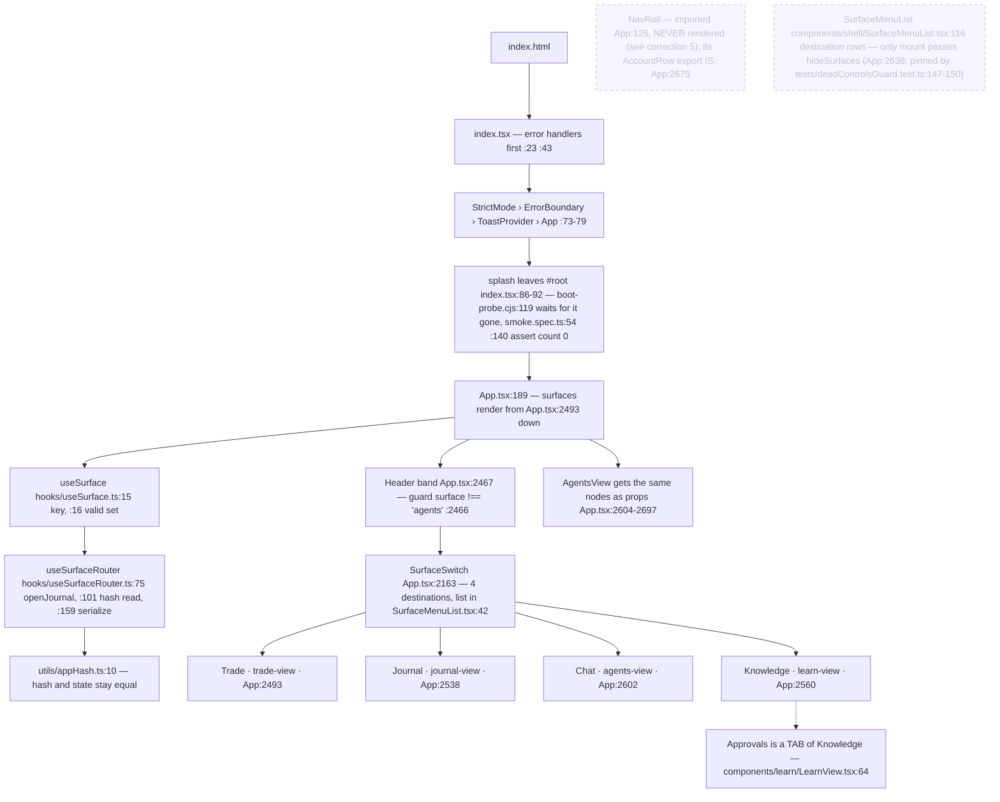
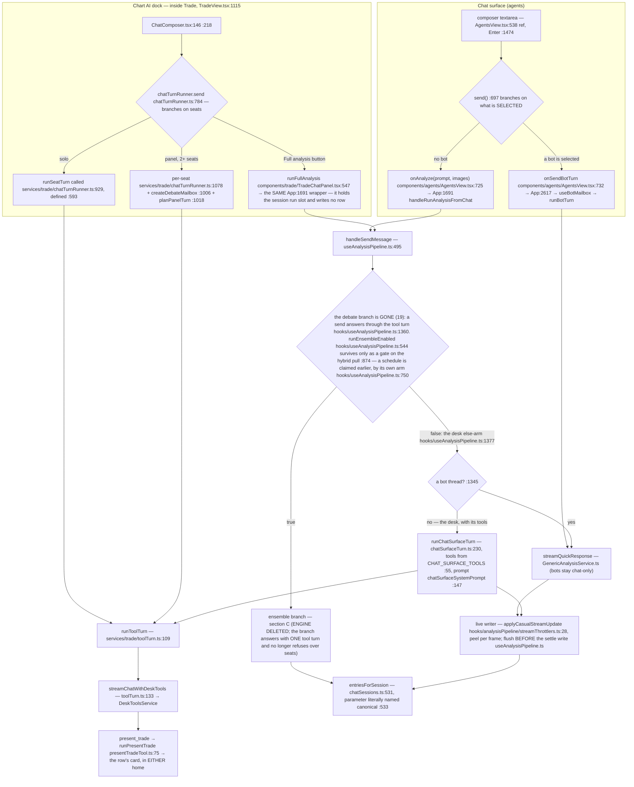
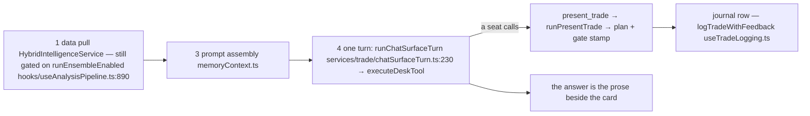
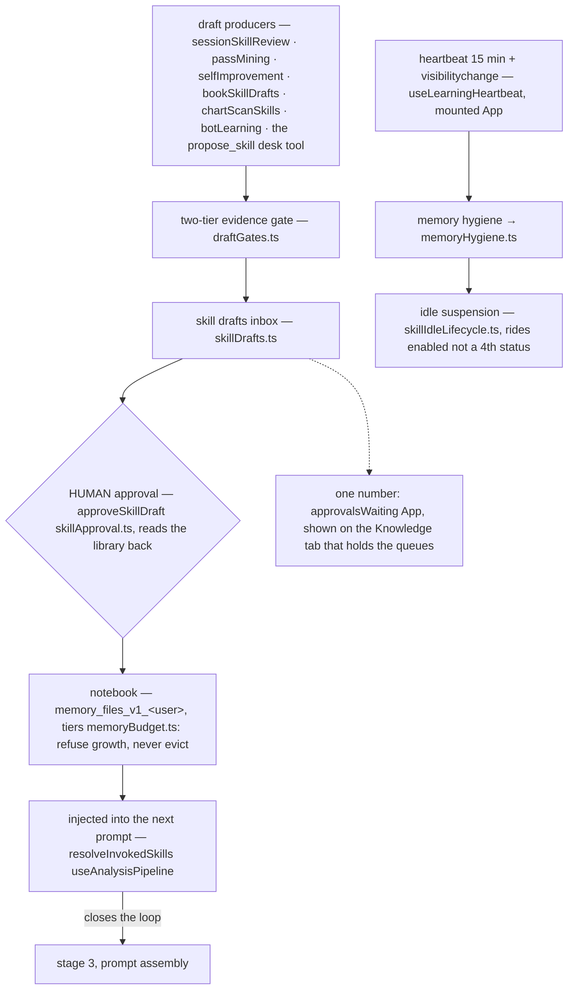
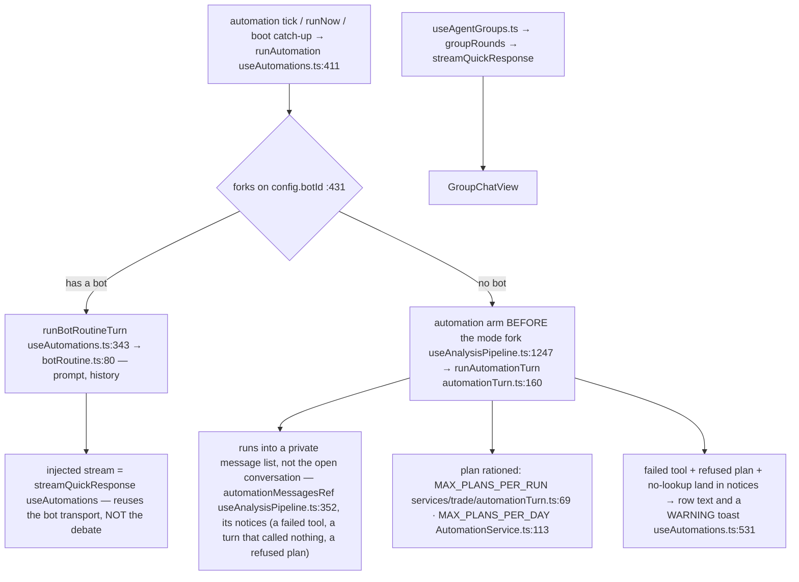
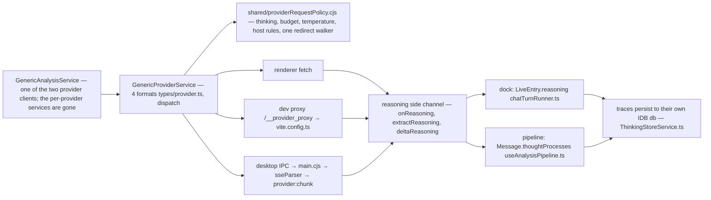

# August Trading — the complete flow

Every node names the file and line that implements it. Verified against the tree on
**2026-10-19** (the anchor gate re-measured every citation here and in the stage ledger:
**256 unique anchors verified, 0 unattributed** — plus two quality ceilings, 46 citations
that land on a comment line and 0 whose named symbol is not on the cited line (the check’s stated target, now the ceiling) (16 before the arrow list's symbols were paired with the citation on the next line), which
count only what the rule can *see* and therefore under-report: both rules exempt a line
carrying more than one citation, and a sentence that wraps puts its number out of reach of
its symbol, so four copies of one wrong number were fixed by hand after the gate called it
zero. A doubt about a wrapped citation gets re-measured, not waved at the ceiling);
this pass took out accuracy mode with the calibration
dashboards and the settings store that fed it (#17), the `savedAnalyses` store (#21), and
`isDebating` / `activeDebateSpeakers` with the run-failure branch that read them. It follows
the post-mortem, 2D desk floor, Saved-tab and Roles-tab deletions and
stages 20a/20a2/20g/20b/20b-B/20t/20c/20s/20d/20f/20r of the debate
removal, which moved
both chat homes and the scheduler onto one turn executor; if a line moves, fix the
line rather than deleting the claim.

Dotted nodes exist in the code but are **never mounted** by the running app.

Companion docs: [learning-loop-map.md](learning-loop-map.md) covers section D in more
depth, [ui-doctrine.md](ui-doctrine.md) governs the shell in sections A and B.
The stage ledger is [docs/plans/debate-deletion-status.md](plans/debate-deletion-status.md);
sections B and C moved again when stage 19 deleted the engine.

---

## A · Boot → shell → a surface

Stored surface values `'chat'`, `'boards'`, `'skills'` all migrate to `'trade'`
([useSurface.ts:24](../hooks/useSurface.ts)). There is no `main.tsx`.

---

## B · One message — two chat homes, ONE turn executor

The dock's system prompt is assembled by `systemPromptFor`
([TradeChatPanel.tsx:453](../components/trade/TradeChatPanel.tsx)) from
`TRADE_CHAT_SYSTEM_PROMPT` + skills index + strategies + profile memory + persona.
The Chat surface's prompt is its own now (stage 20s): `chatSurfaceSystemPrompt`
([services/trade/chatSurfaceTurn.ts:147](../services/trade/chatSurfaceTurn.ts))
leads with `CHAT_SURFACE_SYSTEM_PROMPT`
([chatPrompts.ts:40](../constants/prompts/chatPrompts.ts)) — which is
`CASUAL_CHAT_SYSTEM_PROMPT` with a calling mandate and an explicit "no chart
here" bolted on, so the output discipline that fixed the
"Here's a thinking process:" replies survives — then appends the skills index,
the active strategy plans and the profile memory index, each read FRESH per turn
the way the dock reads them. Its skills heading says *what the trader asks
about*, not *this chart*: `buildSkillsIndexForPrompt` took a `where` argument so
the dock's default stays byte-identical. The slugs that actually travelled are
recorded on the row (`Message.injectedSkills`, `types/message.ts:280`), bounded
to the 30 the index prints — a row naming skills the model never saw would be an
audit defect, not an audit trail.

**One entry, both homes.** `handleRunAnalysisFromChat` (App.tsx:1691) is the only
analysis wrapper: the dock passes it as `onRunAnalysis` (App:2485) and the Chat
surface as `onAnalyze` (App:2581). It was two, and `services/trade/analysisTurn.ts`
was deleted (2026-10-17) because a second writer keyed rows with ids no canonical
row could match — that is what made the two homes disagree.

**One executor, two row shapes.** `runToolTurn`
([services/trade/toolTurn.ts:109](../services/trade/toolTurn.ts)) owns the stream,
the tool rounds, the abort-before-repair order, the text-protocol strip and the
reasoning peel. The ROW stays with the caller, because the two shapes do not share
those fields: the dock writes a `chatStore` `LiveEntry` (`tools`/`toolIds`), the
Chat surface writes a canonical `Message` (`liveToolEvents`, `toolActions`,
`thoughtProcesses`). That is why the executor takes an event SINK and not a shared
state object — and why the Chat surface stopped answering live-data questions from
the model's training data (stage 20b, `chatSurfaceTurn.ts`).

A desk seat on the Chat surface may call the canvas-free half of the dock's tools
plus `present_trade`; the other seven `CHART_ACTION_TOOL_DEFS` are not offered at
all, because `streamChatWithDeskTools` lists a chart-action definition only when a
caller dispatches it **and** the seat's allow-list names it. Bots are the exception
by ruling: a bot thread keeps the plain transport, and `useBotMailbox`,
`botRoutine` and `groupRounds` are not on the tool turn.

The card a presented plan draws lives on whichever row presented it — the dock's
entry or `Message.proposal` — and the logged/dismissed disposition is one module
map for both ([proposalDisposition.ts:22](../services/trade/proposalDisposition.ts)),
keyed by the row id `entriesForSession` already shares.

**The wording gate is gone (stage 20c).** `isChartAnalysisRequested` used to test
the prompt for `LIVE MARKET` / `STRATEGY` / `ANALYZE` / `CHART` / `SETUP` — plus the
image and update facts — and `useAnalysisPipeline.ts` branched on it. It was already
a dead decision for a human send: the predicate was ANDed with `runEnsembleEnabled`
and `isEnsembleEnabled` appeared on both sides, so with the toggle on every send
ran the pipeline whatever it said and with it off no wording could make one. The
one route words controlled was a scheduled run's, contradicting the flag's own
comment that automations always run the pipeline: the same automation answered
casually when its prompt read "outlook" and fully when it read "setup". The guard
is now the mode alone — and stage 20r finished what that sentence implies: the
flag no longer has an automation clause either, so the mode decides for a human
send and a schedule has its own arm above the fork (section E). Consequences
worth knowing: a screenshot attached to a toggle-off send is still casual chat (it
always was), and the structured verdict,
the levels and the journal row reach a normal send only as TOOLS the seat calls —
which is why 20b and 20b-B had to land first.

**A plan the seat only *said* still gets the card (stage 20d).** A tool is only as
good as the model's choice to call it, and the ledger's whole problem is rows that
never arrive. So a Chat row whose prose carries a labelled entry, stop and target
offers the same decision the card offers: `planFromProse` extracts the numbers and
hands them to `parseTradeProposal` — there is no second validator, which is why a
long whose stop sits above its entry grows no chip — and the chip mints the plan id
through `mintPlanId`, the one shape `present_trade` uses, so the two paths dedupe
against each other. It requires a coin, one direction (a reply that hedges "long
above X, short below Y" is not one plan), and it stays out of the way of a row that
already has a proposal.

---

## C · The analysis pipeline, in call order

Stage 19 deleted the debate from this path. What one send actually does now:

**Stages 2, 5, 6, 7 and 8 of the old list are gone from the call path**: the gate
scan (`GateKeeperService`) — the gate now runs inside `present_trade` (20a2); the
analyst openings and the debate (`conductDebate` / `conductRealDebate`); the
moderator pass; the finalizer (its file and suite are now DELETED); the
pipeline-side Monte Carlo and backtest. The engine FILES are now deleted too: stage 19's second tranche removed
`ensembleService`, `ensembleConsensus`, `debateScience`, `debateResume`,
`provisionalVerdict`, `analysisResultProcessor`, `CompletionNotifications` and
22 more, with their suites — 26 production files gone. The three reachable modules
that still imported debate helpers were cut by INLINING the slice each one used
(`streamThrottlers` keeps only `throttledCasualStream`; the watch follow-up groups
round-1 turns itself; `monthlyReport` computes the log-odds mean itself), so no
displayed number changed. `runEnsembleEnabled` (hooks/useAnalysisPipeline.ts:544) survives as a switch with
far fewer things to switch between, and `Message.debateTurns` stays as a read-only
legacy field for rows written before the cut — the same rule `modelsUsed` follows.

Why the deletion is safe rather than a loss: the thing section C existed to produce
— a grounded verdict with a journal row — is what a tool-bearing turn produces now
(section B). A `TradeAnalysis` row is no longer written by a send, so the journal's
verdict-shaped rows come from `proposal` cards, and the surviving readers were
re-pointed in 20b-B and 20r rather than left reading a field nothing writes.

**One known residue, stated as measured.** With Hybrid Intelligence on, a human
send still fetches real-time data: the gate is `hooks/useAnalysisPipeline.ts:941`.
What no longer happens is the part that made it worth the round trip — the
injection string it builds (`hooks/useAnalysisPipeline.ts:954`, or `:988` for
preset data) is read afterwards only by `devLog` at
`hooks/useAnalysisPipeline.ts:979`, `:973` and `:1160`. It is
never handed to the turn, because the analyst and moderator prompts it used to ride
are the files stage 19 deleted. The packet object does still have one consumer:
`hooks/useAnalysisPipeline.ts:1047` passes it into
`assemblePipelineMemoryContext`, which is where the learning coin and the notebook
slice come from, so dropping the fetch is NOT a byte-preserving cleanup — that is
why it is an owner decision rather than something I removed silently. The loading
state at `hooks/useAnalysisPipeline.ts:890` still flips for a send whose result
only the coin picker reads. Separately, `beginPromptLane` now has zero callers
while the `finally` still calls `endPromptLane()`, so the prompt A/B lane is
starved rather than deleted; re-wiring it onto the tool turn or removing it is
likewise the owner's call.

**The node that used to hang off stage 8 is gone.** `usePostMortem.ts` and
`GenericAnalysisService.conductPostMortem` were deleted (2026-10-18, `03fc0d5`);
nothing re-runs an analysis after a trade closes. That is the arrow section D used
to close on — and deleting the writer is not the same as deleting the route, which
section D states exactly.

---

## D · The learning loop — now open at the trade end

**What changed here:** the entry node used to be `closed trade / post-mortem →
craftSkillFromPostMortem`. The post-mortem was the only writer of
`LoggedTrade.postMortem`, so deleting it **starved that route rather than deleting
it** — the distinction matters because the code still looks alive. Nothing writes
the field any more, but `craftSkillFromPostMortem`
([services/learning/SkillCraftService.ts:140](../services/learning/SkillCraftService.ts))
is still called from `botLearning.ts:234`, and its first guard is
`if (pm.length < 40) return null` on `trade.postMortem` (`services/learning/SkillCraftService.ts:145`). So for every
trade closed after 2026-10-18 the craft leg can only return null; it still answers
for a row that carries a post-mortem from before then. `selfImprovement.ts:73-74`,
`SkillMemoryService` and `DoctrineConsolidationService` read the same dead field.
**Sizing that by grep is a trap, so the recipe is part of the number — and the word
boundary is load-bearing.** Counting the TOKEN, `grep -rE "postMortem" --include="*.ts"
--include="*.tsx" .`, measures **122 lines in 50 files**; counting the field reads needs
`grep -rE "\.postMortem\b" …` and measures **34 lines in 23 files**. Drop the `\b` and the
second figure silently becomes **38**, because four of those lines are a DIFFERENT field:
`postMortemCreatedAt`, the timestamp twin, which is read at
`hooks/analysisPipeline/memoryContext.ts:183` and
`services/learning/DecisionReflectionService.ts:24` and gated on at
`services/ui/AlgorithmicSummaryService.ts:50`. A census without the boundary sweeps a live
name into the dead list, which is the mistake this page keeps re-recording. Earlier drafts of this page asserted
189/57 and 105/~35 — true the day they were taken, untrue from the stage that deleted readers
onward, and unreproducible without the filter, which is how a census becomes a claim nobody can
check. The rest
is a name collision with two live things: the outcome-validation engine
(`PostMortemTPHit` and the `[PostMortemValidation]` log prefixes in
`services/backtesting/BacktestingService.ts`, `PostMortemDataSummary` /
`logPostMortemDataVerification` in `services/ui/AutoCaptureService.ts`), which replays
candles to decide whether a TP or SL really got hit; and the enum member
`'autopilot' | 'postMortem'` on `LoggedTrade.rSource` / `excursionSource`
(`types/trade.ts:185-186`), which names that after-close pass and is still written. A bulk
deletion keyed on the word would remove the validator. Re-measured 2026-10-19; the reader
list and the two decisions that pass has to make up front are in
[the stage ledger](plans/debate-deletion-status.md). Deleting the writer was the owner's
explicit choice, with no replacement. Clearing the readers is NOT simply scheduled work:
the stored-history readers answer only for rows written before 2026-10-18, so whether
that museum stays readable is the owner's open call (#21), and deleting the fields deletes
the history with it.

The chain from `draftGates` to the injected skill is unchanged and still runs; it
now starts at the review passes and at the chat's `propose_skill` tool, not at a
settled position.

Corollary that is easy to miss: `GlobalMemory.aiPatternMemory` and
`insightKnowledgeBase` are **frozen stores** (see G), and
`MistakePatternService` / `JobQueueService`, which warned about a recurring setup
before the next entry, no longer exist.

---

## E · Autonomy — routines, rooms, alerts

A scheduled run no longer takes the debate path: `runEnsembleEnabled =
isEnsembleEnabled` (useAnalysisPipeline.ts:544) and every remaining flag-gated block also tests `!isAutomationRun`
(`hooks/useAnalysisPipeline.ts:719` gates ON the run, the ensemble-only tip `:783` gates OFF it), so one config has one behaviour whatever the
trader's toggle says. That is what lets stage 19 delete the engine without
taking the scheduler down with it.

What the schedule keeps, and what it gained, are written down rather than
assumed. `tests/automationRouteCharacterization.test.tsx` pins the private
`automation-<id>` thread, the config's own model pick, the continuity read (now
the last three DELIVERED runs — `MAX_HISTORY_RUNS` useAutomations.ts:191, because
the old row-count read spent half its budget on `appendRun`'s 'running' stubs),
and the verdict row. `tests/automationToolTurn.test.ts` pins the two rules a run
with nobody watching needs: a plan refused past the cap answers with an
`ok: false` receipt, and a tool that came back with nothing — or a turn that
called nothing — is stated in the row and changes the toast from success to
warning. Its tool list is the Chat surface's minus the notebook-writers
(`AUTOMATION_UNATTENDED_DENY` automationTurn.ts:54): a recurring job that edits
the trader's memory changes what every later turn sees, with nobody in the loop.

---

## F · How a request leaves the app

`electron/sseParser.cjs` mirrors only three dialects — `google` has no desktop SSE
parser. That is the one place "three formats" is true.

---

## G · Where everything is remembered

Both lesson stores are **frozen**: readers and the injected index stay, so a profile
keeps what it already carries, but nothing grows them (`03fc0d5`).

| What | Key |
|---|---|
| dock sessions · active id · tool payloads | `trade_chat_sessions_v1_` · `trade_chat_active_v1_` · `trade_tool_payloads_v1_` |
| notebook · queue · drafts · rules | `memory_files_v1_` · `learning_proposals_v1:` · `skill_drafts_v1:` · `approval_rules_v1:` |
| roster · automations · providers | `agents_bots_v1` · `automations_v1_` · `provider_configs_v1` (keys `enc:v1:` via safeStorage) |
| screenshots · reasoning traces | IDB store `images` (`services/infrastructure/messageImageStore.ts`) · own db (`services/infrastructure/ThinkingStoreService.ts`) |
| reduce-motion preference | `desk_idle_motion_v1_&lt;user&gt;` — the desk floor is deleted, the key is not, renaming it silently resets every profile |

`savedAnalyses` is deleted outright (stage 21): the `UserProfile` field, its state, the
SQLite column read and write section, the backup validation and the `savedAnalysesCount`
preview. The Journal's Saved tab and `SavedAnalyses.tsx` had already gone (`591f735`), and
nothing had written the field since. The `saved_analyses` **table** is still created and
still holds whatever rows history wrote — dropping a table is a migration on the owner's
live journal, which is a different act from deleting the code that read it.

A presented plan is remembered on its row, not in a store of its own: the dock keeps
`proposal` on the runtime `LiveEntry` only, the Chat surface on `Message.proposal`
(persisted with the conversation), and the logged/dismissed decision in
`proposalDisposition` — module scope, bounded, deliberately not persisted, because a
card that forgets it was clicked offers a second journal row.

---

## H · Every arrow

| # | from → to | what crosses |
|---|---|---|
| 1 | index.html → index.tsx | mount, error handlers first `:23 :43` |
| 2 | index.tsx → App | StrictMode › ErrorBoundary › ToastProvider `index.tsx:73-79` |
| 3 | App → useSurfaceRouter | surface + journalTab + journalOpenNonce |
| 4 | useSurfaceRouter → useSurface | persisted value, key `hooks/useSurface.ts:15 august_surface_v1`, valid set `:16` |
| 5 | useSurfaceRouter → appHash | `#/journal\|market\|settings\|watch` ⇄ state `hooks/useSurfaceRouter.ts:101`, serialize `:159` |
| 6 | App → Header | band `App.tsx:2467`, guard `surface !== 'agents'` `:2466` |
| 7 | App → 4 lazy surfaces | each behind `SurfaceSkeleton`, guards `App.tsx:2493 :2538 :2560 :2602` |
| 8 | Header → SurfaceSwitch | the destination set `App.tsx:2163`, list `SurfaceMenuList.tsx:42` |
| 9 | App → AgentsView props | same switch + StatusCluster + AccountRow + SurfaceMenuList(hideSurfaces) `App.tsx:2604-2697` |
| 10 | TradeView → TradeChatPanel | the dock, inside Trade `components/trade/TradeView.tsx:1115` |
| 11 | AgentsView.send → bot branch | the selected bot answered at `components/agents/AgentsView.tsx:732` |
| 12 | bot branch → useBotMailbox | `runUserBotTurn` → `runBotTurn` |
| 13 | AgentsView.send → analysis branch | `onAnalyze` `components/agents/AgentsView.tsx:725` → `App.tsx:1691` — the dock's `onRunAnalysis` reaches the SAME wrapper |
| 14 | dock Full analysis → the run slot | `runFullAnalysis` `components/trade/TradeChatPanel.tsx:547` → `beginRun`/`endRunOwned`; it writes **no row**, the pipeline's own messages are projected into the session |
| 15 | ChatComposer → chatTurnRunner.send | Enter `ChatComposer.tsx:146` / button `:201` → `services/trade/chatTurnRunner.ts:784` |
| 16 | solo → runSeatTurn | `services/trade/chatTurnRunner.ts:929` (definition `:593`) |
| 17 | runSeatTurn → the ONE turn executor | `runToolTurn toolTurn.ts:109` → `streamChatWithDeskTools :133` → `DeskToolsService` → `streamChatRequest` |
| 18 | panel → per-seat + mailbox | `services/trade/chatTurnRunner.ts:1078` · `:1006` · `:1018` |
| 19 | systemPromptFor → prompt | `TRADE_CHAT_SYSTEM_PROMPT` + skills + strategies + profile + persona `TradeChatPanel.tsx:453`, assembled `:475` |
| 20 | every dock turn → chatStore | `mutate` · `beginRun` |
| 21 | handleSendMessage → what answers | the fork is gone (19): a bot thread streams `useAnalysisPipeline.ts:1357`, anything else runs the tool turn `:1376`; the mode flag `:556` now only gates the hybrid pull `:874` |
| 22 | the casual arms | a bot thread → `streamQuickResponse useAnalysisPipeline.ts:1334` (plain transport); the desk → `runChatSurfaceTurn chatSurfaceTurn.ts:230` → arrow 17. Tier on both via `resolveComposerEffort`; a Full-analysis send also sets `requireTools` |
| 23 | casual frames → Message.text | `hooks/analysisPipeline/streamThrottlers.ts:28`; flush precedes the settle write useAnalysisPipeline.ts |
| 24 | ensemble → 8 stages | see C — anchors deliberately omitted |
| 25 | desk tools → what a caller can reach | `executeDeskTool DeskToolsService.ts` (its allow-list is enforced at execution, not only at offer time) |
| 26 | panel tools → chart echo | `executePanelTool chatTurnRunner.ts` → `onToolAction` |
| 27 | automation tick → runAutomation | `useAutomations.ts:411`, forks on `config.botId` `:431`; the no-bot path takes the pipeline's OWN schedule arm `useAnalysisPipeline.ts:1247` → `runAutomationTurn automationTurn.ts:160`, writing the private list automationMessagesRef useAnalysisPipeline.ts:352, its `notices` (a tool that came back failed, a turn that called nothing, a refused plan) and settling through `onMessage` `useAutomations.ts:531`. Characterized in `tests/automationRouteCharacterization.test.tsx` |
| 28 | bot routine → injected stream | `botRoutine.ts` ← `useAutomations` (reuses 22's bot arm) |
| 29 | rooms → groupRounds | `useAgentGroups` → `streamQuickResponse` |
| 30 | review passes / propose_skill → draft → approval → skill | `draftGates.ts` → `skillApproval` — the post-mortem leg is starved, not deleted (see D) |
| 31 | approved skill → next prompt | `resolveInvokedSkills` — closes into 24's stage 3 |
| 32 | logged trade → memory + autopilot | `useTradeLogging` → `MemoryService`; `proposedTrade` leaves outcome PENDING so the autopilot watches it |
| 33 | App messages + dock entries → one thread | `chatSessions.ts:531` |
| 34 | chatStore → localStorage | `saveSessions` → debounced key |
| 35 | App → profile persistence → engine | `useProfilePersistence` → `dbService` or `SqliteService` |
| 36 | providers → Preferences, keys encrypted | `ProviderConfigService` |
| 37 | every provider call → the policy | `GenericProviderService` → `providerRequestPolicy.cjs` |
| 38 | dev calls → the proxy | `/__provider_proxy` → `vite.config.ts` |
| 39 | desktop calls → IPC → sseParser → chunks | `main.cjs` → `sseParser.cjs` |
| 40 | reasoning deltas → their own field | `chatTurnRunner` / `useAnalysisPipeline` → `ThinkingStoreService` |
| 41 | notebook writes → byte tiers | `MemoryFilesService` → `memoryBudget.ts` → `memoryHealth.ts` |
| 42 | heartbeat → hygiene + idle sweep | `useLearningHeartbeat` → `memoryHygiene.ts` → `skillIdleLifecycle.ts` |
| 43 | approval tray → badge | `collectApprovalItems` → `approvalsWaiting` → Knowledge tab only |
| 44 | the pane filters what it shows | `agentThreads.ts` read at `AgentsView.tsx` |
| 45 | `present_trade` → a card in either home | `runPresentTrade presentTradeTool.ts:75` ← dock sink `chatTurnRunner.ts` / desk sink `chatSurfaceTurn.ts`; gate scan starts there, the cap binds at log time (`ensureStamp`) |
| 46 | `chatSurfaceSystemPrompt` → the desk arm's prompt | `chatSurfaceTurn.ts:147` — mandate (`chatPrompts.ts:40`) + skills index + active strategies + memory index, read FRESH per turn; the 30 slugs printed are the 30 recorded on the row (`types/message.ts:280`) |
| 47 | prose that never called the tool → the same decision | `planFromProse` (`services/trade/tradeShapedProse.ts`) reads the labelled entry/stop/target out of the row, `parseTradeProposal` decides whether that is a plan, and the chip mints the ONE plan-id shape (`mintPlanId`) before calling `onLogProposedTrade` — so a spoken plan reaches the journal the same way a presented one does |
| 48 | a scheduled run → a rationed plan | `MAX_PLANS_PER_RUN` (`automationTurn.ts:69`) counts inside the turn; `MAX_PLANS_PER_DAY` (`AutomationService.ts:113`) is a local-calendar-day ledger keyed per automation (`:130` read, `:143` spend). Past either, `present_trade` gets an `ok: false` receipt naming the limit — a refusal the MODEL reads, not a card that quietly never appears |
| 49 | a schedule's failure → the row and the toast | the turn's `notices` (`automationTurn.ts:160`) — a tool that came back `ok: false` (from `onToolPayload`, which already carries it), a turn that called nothing, a refused plan — are written into the stored text at `useAnalysisPipeline.ts:1247` and handed to `useAutomations.ts:531`, which downgrades the toast from success to warning. Nobody is watching a schedule live; a success toast over a failed lookup is how an unattended run manufactures confidence |
| 50 | a journal row gets its scalp/swing class | `withDetectedTradeType` (`services/analysis/ScalpDetectionService.ts`) is called at the two row-minting sites in `hooks/useTradeLogging.ts` — label-only, so no `validityDurationMinutes` appears and the autopilot expiry window never widens. The filter reads it at `components/journal/TradeLog.tsx:532` |
| 51 | a run records its measured cost | `recordToolTurnUsage` (`utils/sessionUsage.ts`) is called by all three turn owners — desk arm `chatSurfaceTurn.ts`, schedule arm `automationTurn.ts`, dock seats `chatTurnRunner.ts` — from the `usage` the wire reported per request. `Knowledge → Session Usage` reads that ledger; stage 19 left it with a reader and no writer. `usageCalls` distinguishes a zero-cost run from a provider that sent no usage frame |
| 52 | a finished analysis says so | `notify()` (`services/infrastructure/notify.ts`) fires when a Full-analysis send settles un-stopped (`hooks/useAnalysisPipeline.ts:1466`). Before stage 19 this came from the verdict finalizer; `CompletionNotifications` was a native-only copy of the same thing and now has no caller, so the app speaks through one notifier |
| 53 | the chart gets its Entry/Stop/Target lines | `latestChartVerdict(messages)` (`services/trade/chartData.ts`) is what App hands `TradeView` as `verdict` — the newest row carrying `Message.proposal` (what `present_trade` stamps; `useAnalysisPipeline.ts:1293`), with `Message.analysis` as the fallback for pre-debate history. Red-proved: the old selector keyed on `ensembleProgress` / >1 `modelsUsed` / `debateTurns` and returned null for every tool-turn row. render-probe PASSED on 2026-10-18 after this change (zero pageerrors, every row rendered), but the probe asserts no canvas overlay levels, so the drawn Entry/Stop/Target line is still un-asserted by any gate

---

## Corrections this doc is guarding

1. There is **no `main.tsx`** — the entry is `index.tsx`.
2. There is **no `utils/deskThread.ts`** — `deskThread` is `utils/agentThreads.ts`.
3. The provider layer speaks **four** wire formats (`types/provider.ts`); "three"
   describes only `electron/sseParser.cjs`, which has no `google` dialect.
4. Approvals is a **tab** of the Knowledge surface, not a fifth destination. The live
   destination set is exactly `trade | journal | agents (labelled Chat) | learn
   (labelled Knowledge)`.
5. **`NavRail` is imported and NOT rendered — it is a dead node.** Verified four
   ways on 2026-10-18: `grep -c NavRail App.tsx` = 18 occurrences and **none is a
   JSX element**; `grep '<NavRail'` repo-wide matches only `components/shell/NavRail.tsx:140`
   (its own definition) and `tests/agentsSurface.test.tsx:390` (a test mounting it
   directly); ESLint reports `App.tsx:125:8 'NavRail' is defined but never used`; and
   the code says so out loud — `App.tsx:2445` is the comment reading "The
   NavRail is GONE: its five destination rows were the tab strip this redesign was
   asked to remove". Only the `AccountRow` export is rendered, at `App.tsx:2637`.
   **An earlier pass of this doc asserted the opposite** ("rendered at App.tsx line 2766") and
   the mechanism is worth keeping: `App.tsx:2483` passes `onExpandNavRail={…}` and
   the rail's expand state is very much alive at `App.tsx:657` and `:680-692`, so a grep for `NavRail`
   looks like a mounted component. An `on…` prop is not a render. Withdrawn.
6. **A doc line number is a claim, not a citation — and `npm run
   check-flow-doc-anchors` now refuses it.** Every number in both flow docs names
   its file on the same line, so the gate can check it: 256 anchors verified, 0
   unattributed, ceiling 0, wired into CI as "Flow docs cite real lines". A bare
   `:NNN` no longer survives a push, and neither does a stale figure quoted from its own output: the
   docs state 256 anchors verified and the gate refuses the merge if that sentence stops
   matching the scan. Qualifying the citations that had no symbol
   of their own is what found
   six numbers that were right-shaped and wrong: `runSeatTurn` is called at
   `services/trade/chatTurnRunner.ts:929`, `createDebateMailbox` at
   `services/trade/chatTurnRunner.ts:1006`, `planPanelTurn` at
   `services/trade/chatTurnRunner.ts:1018`, the dock's `send` at
   `services/trade/chatTurnRunner.ts:784`, `runFullAnalysis` at
   `components/trade/TradeChatPanel.tsx:547`, and `MAX_PLANS_PER_RUN` at
   `services/trade/automationTurn.ts:69`. The pass also moved four surface anchors
   that pointed inside a prop list onto the guard that mounts the surface:
   `App.tsx:2493` trade, `App.tsx:2538` journal, `App.tsx:2560` learn,
   `App.tsx:2602` agents, with the header band at `App.tsx:2467`. Counts were
   taken with `grep -c` rather than a truncated listing — the first version of
   correction 5 died by exactly that truncation. Numbers in section C are
   deliberately omitted: they are the lines stage 19 deletes.
7. **"The Chat surface has no tools wired" was true, and stopped being true on
   2026-10-18.** Both homes now run `runToolTurn`; what still differs is the row
   each writes and which tools that row can honour (a Chat seat gets no canvas
   tools, and its `present_trade` receipt says so rather than promising a level-watch
   that cannot exist there). If a future pass restores the old sentence, it is
   describing a bug it just reintroduced.

8. **"Automations always run the ensemble pipeline" was a code comment, and it is
   now false.** It was true up to stage 20r (2026-10-18), and stage 20c had even
   made it MORE true by deleting the wording that let one schedule answer casually.
   A scheduled run now takes its own arm — one tool turn, its own model pick, no
   canvas, a rationed plan and visible failures — so the ensemble flag answers only
   the question the trader's switch asks. If the sentence comes back, whoever
   restores it has also made stage 19 undeletable and given every schedule a debate
   nobody is watching.

## Measured after stage 19: what the deletion did NOT remove

The engine files are gone, and most of the branch with them. What was removed this pass: the seat-completeness refusals ("Your analyst team is incomplete", "Analysts must use different models", "Two debate seats share a model") and the `TEAM_MAX_SEATS` ceiling — only ONE model answers a send (`provider`, `hooks/useAnalysisPipeline.ts:1296` falls back to `enabledProviders[0]`), so those blocked a run over a roster the run never uses, and the ceiling guarded a fan-out that no longer exists. The moderator readiness check survives but now applies only to a scheduled run (`:737`), because a schedule really does take its seat from that config; the human-send version of it refused a click over an unused pick. `runEnsembleEnabled` (`:567`) is now down to `buildEnsembleAnalysts` and the "include a coin" tip; `isDebating` and `activeDebateSpeakers` are deleted outright — every writer set a literal `false`, so the one branch that read the flag could not run.

The user-visible consequence, now FIXED: the chart used to pick its verdict row by the DEBATE shapes (`ensembleProgress`, >1 `modelsUsed`, `debateTurns`) and passed `verdict={verdictMessage?.analysis}` — while nothing writes `Message.analysis` for a new run any more. `verdictFinalizer` was the writer; a tool turn answers with a `TradeProposal` in the tool payload (`services/trade/presentTradeTool.ts`, `proposedTrade.ts`, `tradeShapedProse.ts`). Reader without a writer, the third time in this stage (session usage, the completion notice). Fixed by `latestChartVerdict` in `services/trade/chartData.ts` (`App.tsx:1251`, passed to the chart at `:2517`): it keys on the settled proposal through the existing `buildProposedTradeAnalysis` and keeps `analysis` as the fallback for old rows; `tests/chartVerdictSource.test.ts` pins the proposal path, the fallback, the preference when a row carries both, the symbol match through `verdictLevels`, and the App wiring. render-probe PASSED on 2026-10-18 after this change (zero pageerrors, every row rendered), but the probe asserts no canvas overlay levels, so the drawn Entry/Stop/Target line is still un-asserted by any gate

