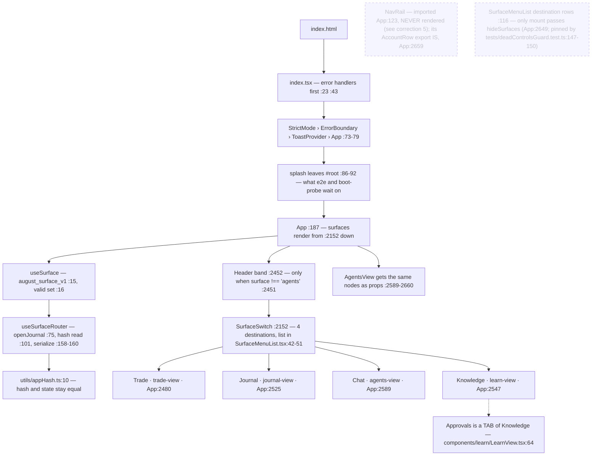
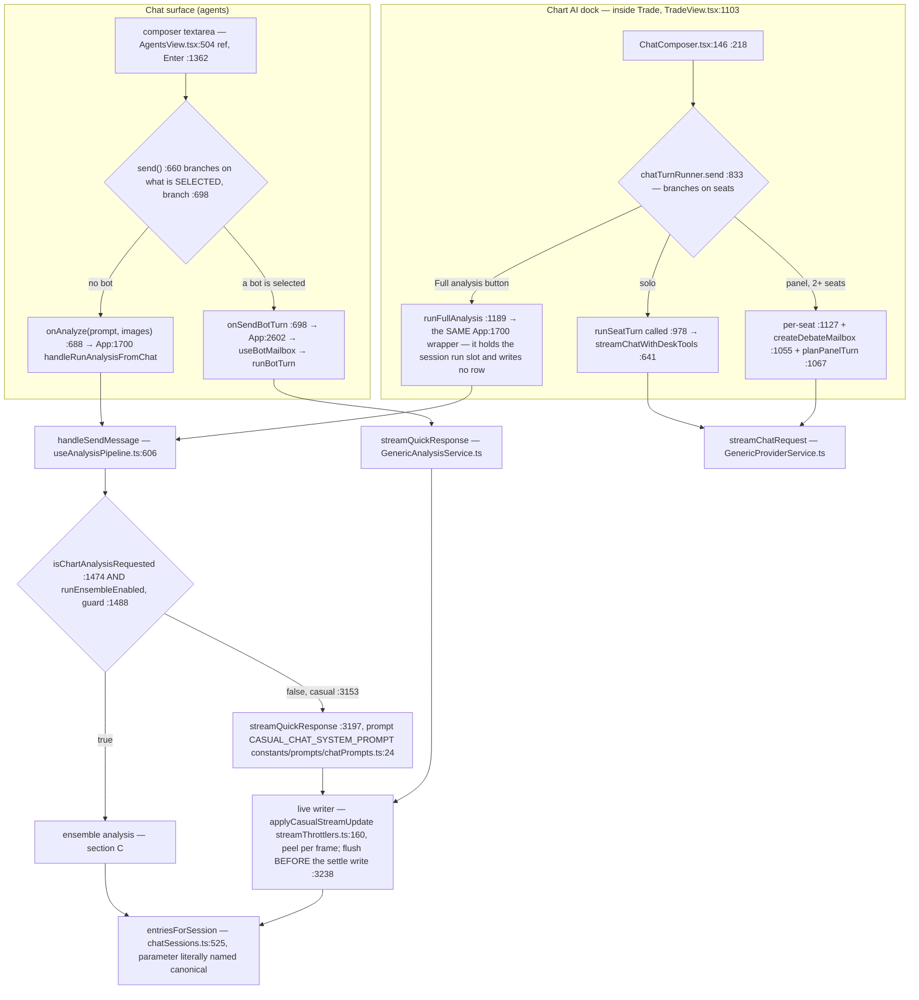
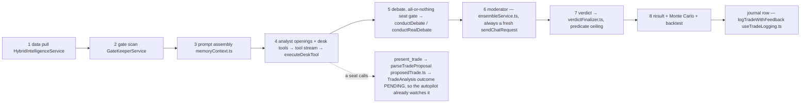
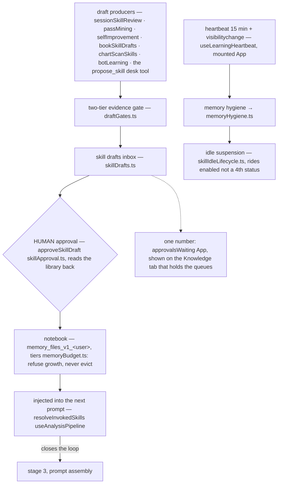
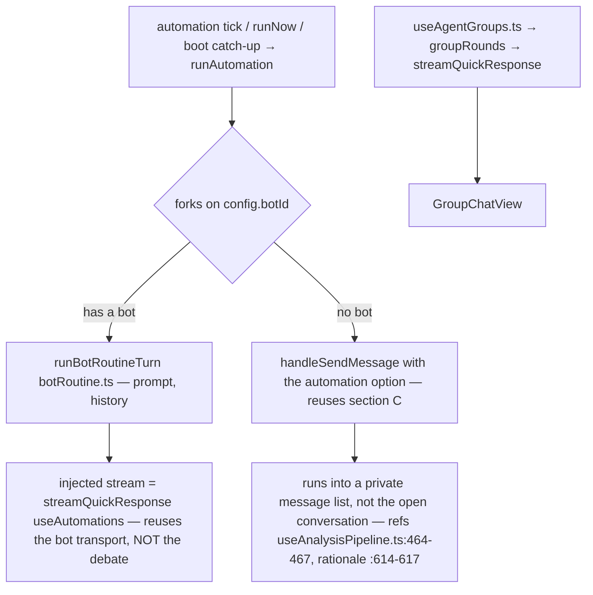
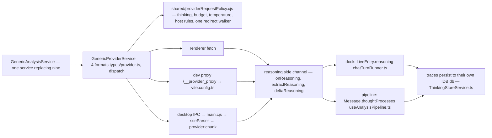

# August Trading — the complete flow

Every node names the file and line that implements it. Verified against the tree on
**2026-10-18** (after the post-mortem, 2D desk floor, saved-analyses and Roles-tab
deletions); if a line moves, fix the line rather than deleting the claim.

Dotted nodes exist in the code but are **never mounted** by the running app.

Companion docs: [learning-loop-map.md](learning-loop-map.md) covers section D in more
depth, [ui-doctrine.md](ui-doctrine.md) governs the shell in sections A and B.
Sections B, C and D move again in stages 19–20 of the debate deletion — see
[docs/plans/debate-deletion-status.md](plans/debate-deletion-status.md).

---

## A · Boot → shell → a surface

Stored surface values `'chat'`, `'boards'`, `'skills'` all migrate to `'trade'`
([useSurface.ts:24](../hooks/useSurface.ts)). There is no `main.tsx`.

---

## B · One message — two chat homes, two decisions

The dock's system prompt is assembled by `systemPromptFor`
([TradeChatPanel.tsx:453](../components/trade/TradeChatPanel.tsx)) from
`TRADE_CHAT_SYSTEM_PROMPT` + skills index + strategies + profile memory + persona.

**One entry, both homes.** `handleRunAnalysisFromChat` (App.tsx:1700) is the only
analysis wrapper: the dock passes it as `onRunAnalysis` (App:2508) and the Chat
surface as `onAnalyze` (App:2604). It was two, and `services/trade/analysisTurn.ts`
was deleted (2026-10-17) because a second writer keyed rows with ids no canonical
row could match — that is what made the two homes disagree.

The Chat surface's non-bot branch has **no desk tools wired** — that is the gap
stage 20 closes, by routing both homes through `chatTurnRunner`.

---

## C · The analysis pipeline, in call order

Stage line numbers are omitted deliberately: this section is deleted in stage 19 of
the debate removal, and re-measuring 8 anchors to document a week's life is not
worth it. The structure above is what to replace it with.

**The node that used to hang off stage 8 is gone.** `usePostMortem.ts` and
`GenericAnalysisService.conductPostMortem` were deleted (2026-10-18, `03fc0d5`);
nothing re-runs an analysis after a trade closes. That is the arrow section D used
to close on — and deleting the writer is not the same as deleting the route, which
section D states exactly.

---

## D · The learning loop — now open at the trade end

**What changed here:** the entry node used to be `closed trade / post-mortem →
craftSkillFromPostMortem`. The post-mortem was the only writer of
`LoggedTrade.postMortem`, so deleting it **starved that route rather than deleting
it** — the distinction matters because the code still looks alive. Nothing writes
the field any more, but `craftSkillFromPostMortem`
([services/learning/SkillCraftService.ts:140](../services/learning/SkillCraftService.ts))
is still called from `botLearning.ts:234`, and its first guard is
`if (pm.length < 40) return null` on `trade.postMortem` (`:144`). So for every trade
closed after 2026-10-18 the craft leg can only return null; it still answers for a
row that carries a post-mortem from before then. `selfImprovement.ts:73-74`,
`SkillMemoryService` and `DoctrineConsolidationService` read the same dead field —
25 read accesses across 17 files outside the tests and the SQLite row mapping
(measured 2026-10-18). Deleting the writer was the owner's
explicit choice, with no replacement; clearing the readers is stage 21.

The chain from `draftGates` to the injected skill is unchanged and still runs; it
now starts at the review passes and at the chat's `propose_skill` tool, not at a
settled position.

Corollary that is easy to miss: `GlobalMemory.aiPatternMemory` and
`insightKnowledgeBase` are **frozen stores** (see G), and
`MistakePatternService` / `JobQueueService`, which warned about a recurring setup
before the next entry, no longer exist.

---

## E · Autonomy — routines, rooms, alerts

An automation run always takes the ensemble path: `runEnsembleEnabled =
isAutomationRun || isEnsembleEnabled` (useAnalysisPipeline.ts:669). That is why
stage 19 has to give scheduled runs a new route, not just delete the branch.

---

## F · How a request leaves the app

`electron/sseParser.cjs` mirrors only three dialects — `google` has no desktop SSE
parser. That is the one place "three formats" is true.

---

## G · Where everything is remembered

Both lesson stores are **frozen**: readers and the injected index stay, so a profile
keeps what it already carries, but nothing grows them (`03fc0d5`).

| What | Key |
|---|---|
| dock sessions · active id · tool payloads | `trade_chat_sessions_v1_` · `trade_chat_active_v1_` · `trade_tool_payloads_v1_` |
| notebook · queue · drafts · rules | `memory_files_v1_` · `learning_proposals_v1:` · `skill_drafts_v1:` · `approval_rules_v1:` |
| roster · automations · providers | `agents_bots_v1` · `automations_v1_` · `provider_configs_v1` (keys `enc:v1:` via safeStorage) |
| screenshots · reasoning traces | IDB store `images` (`services/infrastructure/messageImageStore.ts`) · own db (`services/infrastructure/ThinkingStoreService.ts`) |
| reduce-motion preference | `desk_idle_motion_v1_&lt;user&gt;` — the desk floor is deleted, the key is not, renaming it silently resets every profile |

`savedAnalyses` still travels through profile persistence, SQLite and backups, but
**has no writer** — the Journal's Saved tab and `SavedAnalyses.tsx` were deleted
(`591f735`), and clearing the store itself is stage 21.

---

## H · Every arrow

| # | from → to | what crosses |
|---|---|---|
| 1 | index.html → index.tsx | mount, error handlers first `:23 :43` |
| 2 | index.tsx → App | StrictMode › ErrorBoundary › ToastProvider `:73-79` |
| 3 | App → useSurfaceRouter | surface + journalTab + journalOpenNonce |
| 4 | useSurfaceRouter → useSurface | persisted value, key `august_surface_v1` `:15` |
| 5 | useSurfaceRouter → appHash | `#/journal\|market\|settings\|watch` ⇄ state `:101 :158` |
| 6 | App → Header | band, only when `surface !== 'agents'` `:2451` |
| 7 | App → 4 lazy surfaces | each behind `SurfaceSkeleton` `:2480 :2525 :2547 :2589` |
| 8 | Header → SurfaceSwitch | the destination set `:2152`, list `SurfaceMenuList.tsx:42-51` |
| 9 | App → AgentsView props | same switch + StatusCluster + AccountRow + SurfaceMenuList(hideSurfaces) `:2589-2660` |
| 10 | TradeView → TradeChatPanel | the dock, inside Trade `:1103` |
| 11 | AgentsView.send → bot branch | `activeBot` truthy `:698` |
| 12 | bot branch → useBotMailbox | `runUserBotTurn` → `runBotTurn` |
| 13 | AgentsView.send → analysis branch | `onAnalyze` `:688` → App `:1700` — the dock's `onRunAnalysis` reaches the SAME wrapper |
| 14 | dock Full analysis → the run slot | `runFullAnalysis :1189` → `beginRun`/`endRunOwned`; it writes **no row**, the pipeline's own messages are projected into the session |
| 15 | ChatComposer → chatTurnRunner.send | Enter `:146` / button `:218` → `:833` |
| 16 | solo → runSeatTurn | `:978` (definition `:604`) |
| 17 | runSeatTurn → streamChatWithDeskTools | `:641` → `DeskToolsService` → `streamChatRequest` |
| 18 | panel → per-seat + mailbox | `:1127` · `:1055` · `:1067` |
| 19 | systemPromptFor → prompt | `TRADE_CHAT_SYSTEM_PROMPT` + skills + strategies + profile + persona `TradeChatPanel.tsx:453` |
| 20 | every dock turn → chatStore | `mutate` · `beginRun` |
| 21 | handleSendMessage → the fork | `:1474`, guard `:1488`, else `:3153` |
| 22 | casual → streamQuickResponse | `:3197` → `GenericAnalysisService`, tier via `resolveComposerEffort` |
| 23 | casual frames → Message.text | `streamThrottlers.ts:160`; flush precedes the settle write `:3238` |
| 24 | ensemble → 8 stages | see C — anchors deliberately omitted |
| 25 | desk tools → what a caller can reach | `executeDeskTool DeskToolsService.ts` |
| 26 | panel tools → chart echo | `executePanelTool chatTurnRunner.ts` → `onToolAction` |
| 27 | automation tick → runAutomation | fork on `config.botId`; no-bot path reuses 21 with `automation` → private list `:464-467 :614-617` |
| 28 | bot routine → injected stream | `botRoutine.ts` ← `useAutomations` (reuses 22) |
| 29 | rooms → groupRounds | `useAgentGroups` → `streamQuickResponse` |
| 30 | review passes / propose_skill → draft → approval → skill | `draftGates.ts` → `skillApproval` — the post-mortem leg is starved, not deleted (see D) |
| 31 | approved skill → next prompt | `resolveInvokedSkills` — closes into 24's stage 3 |
| 32 | logged trade → memory + autopilot | `useTradeLogging` → `MemoryService`; `proposedTrade` leaves outcome PENDING so the autopilot watches it |
| 33 | App messages + dock entries → one thread | `chatSessions.ts:525` |
| 34 | chatStore → localStorage | `saveSessions` → debounced key |
| 35 | App → profile persistence → engine | `useProfilePersistence` → `dbService` or `SqliteService` |
| 36 | providers → Preferences, keys encrypted | `ProviderConfigService` |
| 37 | every provider call → the policy | `GenericProviderService` → `providerRequestPolicy.cjs` |
| 38 | dev calls → the proxy | `/__provider_proxy` → `vite.config.ts` |
| 39 | desktop calls → IPC → sseParser → chunks | `main.cjs` → `sseParser.cjs` |
| 40 | reasoning deltas → their own field | `chatTurnRunner` / `useAnalysisPipeline` → `ThinkingStoreService` |
| 41 | notebook writes → byte tiers | `MemoryFilesService` → `memoryBudget.ts` → `memoryHealth.ts` |
| 42 | heartbeat → hygiene + idle sweep | `useLearningHeartbeat` → `memoryHygiene.ts` → `skillIdleLifecycle.ts` |
| 43 | approval tray → badge | `collectApprovalItems` → `approvalsWaiting` → Knowledge tab only |
| 44 | the pane filters what it shows | `agentThreads.ts` read at `AgentsView.tsx` |

---

## Corrections this doc is guarding

1. There is **no `main.tsx`** — the entry is `index.tsx`.
2. There is **no `utils/deskThread.ts`** — `deskThread` is `utils/agentThreads.ts`.
3. The provider layer speaks **four** wire formats (`types/provider.ts`); "three"
   describes only `electron/sseParser.cjs`, which has no `google` dialect.
4. Approvals is a **tab** of the Knowledge surface, not a fifth destination. The live
   destination set is exactly `trade | journal | agents (labelled Chat) | learn
   (labelled Knowledge)`.
5. **`NavRail` is imported and NOT rendered — it is a dead node.** Verified four
   ways on 2026-10-18: `grep -c NavRail App.tsx` = 18 occurrences and **none is a
   JSX element**; `grep '<NavRail'` repo-wide matches only `components/shell/NavRail.tsx:140`
   (its own definition) and `tests/agentsSurface.test.tsx:390` (a test mounting it
   directly); ESLint reports `App.tsx:123:8 'NavRail' is defined but never used`; and
   the code says so out loud — `App.tsx:2430` and `:2435` are comments reading "The
   NavRail is GONE: its five destination rows were the tab strip this redesign was
   asked to remove". Only the `AccountRow` export is rendered, at `App.tsx:2659`.
   **An earlier pass of this doc asserted the opposite** ("rendered at App:2766") and
   the mechanism is worth keeping: `App.tsx:2468` passes `onExpandNavRail={…}` and the
   rail's expand state is very much alive at `:655-691`, so a grep for `NavRail` looks
   like a mounted component. An `on…` prop is not a render. Withdrawn.
6. **A doc line number is a claim, not a citation.** Every anchor above was
   re-measured with grep on 2026-10-18, and counts were taken with `grep -c` rather
   than a truncated `head` — the first version of correction 5 died by exactly that
   truncation. Numbers in section C are deliberately omitted: they are the lines stage
   19 deletes.
