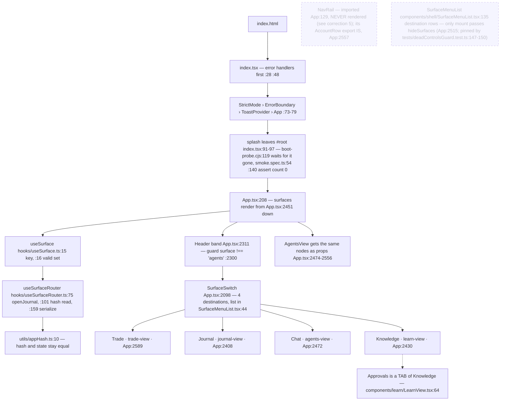
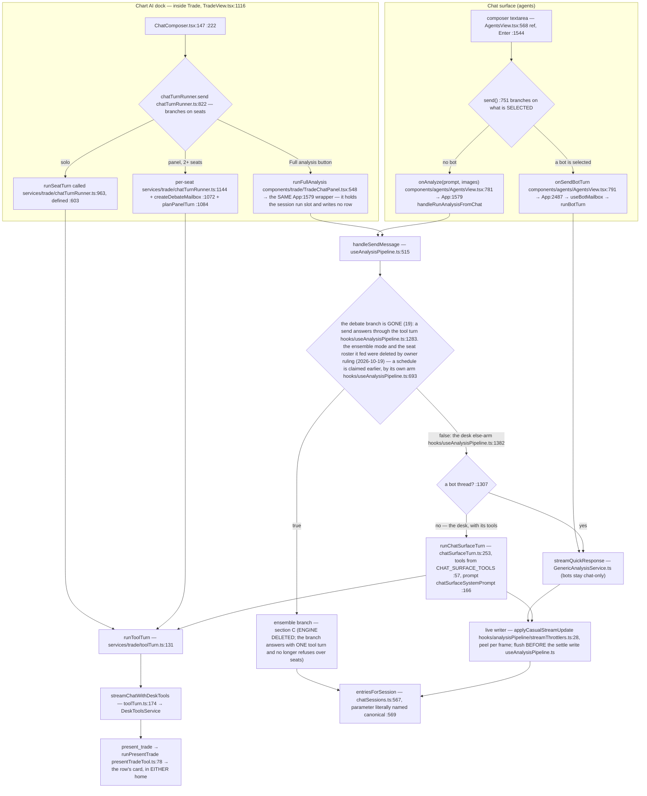
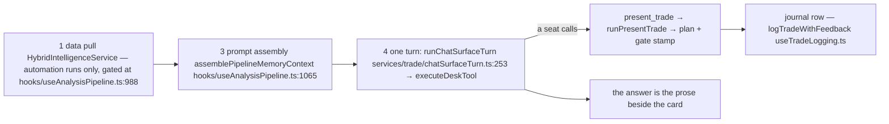
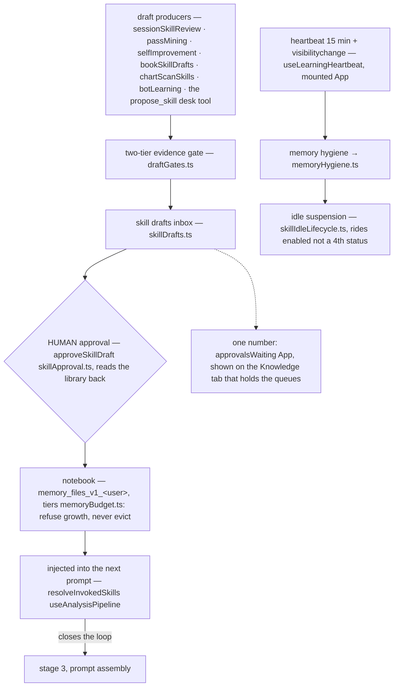
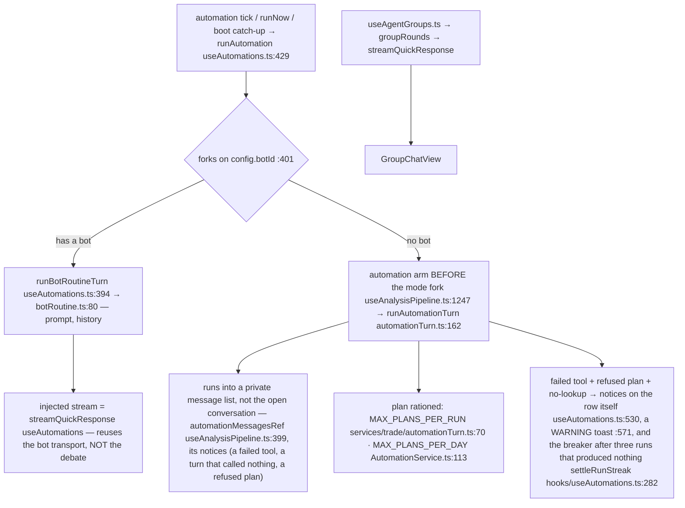
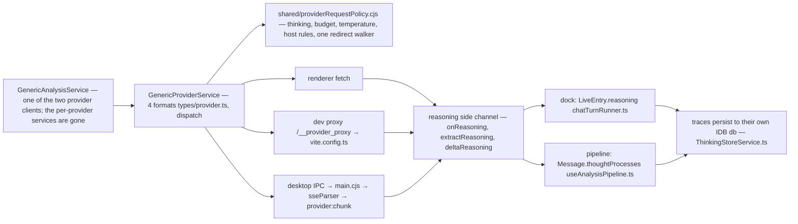
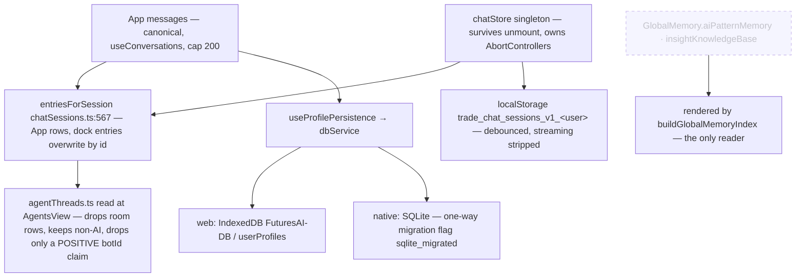

# August Trading — the complete flow

Every node names the file and line that implements it. Verified against the tree on
**2026-10-22** (the anchor gate re-measured every citation here and in the stage ledger:
**388 unique anchors verified, 0 unattributed** — plus two quality ceilings, both now
ZERO: 0 citations that land on a comment line (and 5 more cite a comment because the
comment IS the claim, which the gate lists rather than hides) and 0 whose named symbol is not on the cited line (the check’s stated target, now the ceiling) (16 before the arrow list's symbols were paired with the citation on the next line), which
count only what the rule can *see* and therefore under-report: both rules exempt a line
carrying more than one citation, and a sentence that wraps puts its number out of reach of
its symbol, so four copies of one wrong number were fixed by hand after the gate called it
zero. A doubt about a wrapped citation gets re-measured, not waved at the ceiling);
this pass took out accuracy mode with the calibration
dashboards and the settings store that fed it (#17), the `savedAnalyses` store (#21), and
`isDebating` / `activeDebateSpeakers` with the run-failure branch that read them. It follows
the post-mortem, 2D desk floor, Saved-tab and Roles-tab deletions and
stages 20a/20a2/20g/20b/20b-B/20t/20c/20s/20d/20f/20r of the debate
removal, which moved
both chat homes and the scheduler onto one turn executor; if a line moves, fix the
line rather than deleting the claim.

Dotted nodes exist in the code but are **never mounted** by the running app.

Companion docs: [learning-loop-map.md](learning-loop-map.md) covers section D in more
depth, [ui-doctrine.md](ui-doctrine.md) governs the shell in sections A and B.
The stage ledger is [docs/plans/debate-deletion-status.md](plans/debate-deletion-status.md);
sections B and C moved again when stage 19 deleted the engine.

**Latest pass (2026-10-21).** E-52 added the activity status line, the answer's
tier, one disclosure, the settled tool trail, the one jump control and the agent
detail reader; E-53 made the wire audit visible; E-54 gave the answer its reading
voice; E-55 moved the work card, skills catalogue and memory surfaces onto the
reference's grammar and added the reading serif. The same period added one
context window resolved once, automatic compaction with the last user turn
pinned, a per-window output budget and an honest refusal when nothing fits, the
provider's real cause chain, and a failure row in both homes. Section G is the
new detailed inventory of memory, skills, tools and the learning loop; the stage
19 history below is kept as history, not as the current call path.

---

## A · Boot → shell → a surface

Stored surface values `'chat'`, `'boards'`, `'skills'` all migrate to `'trade'`
([useSurface.ts:24](../hooks/useSurface.ts)). There is no `main.tsx`.

---

## B · One message — two chat homes, ONE turn executor

The dock's system prompt is assembled by `systemPromptFor`
([TradeChatPanel.tsx:454](../components/trade/TradeChatPanel.tsx)) from
`TRADE_CHAT_SYSTEM_PROMPT` + skills index + strategies + profile memory + persona.
The Chat surface's prompt is its own now (stage 20s): `chatSurfaceSystemPrompt`
([services/trade/chatSurfaceTurn.ts:166](../services/trade/chatSurfaceTurn.ts))
leads with `CHAT_SURFACE_SYSTEM_PROMPT`
([chatPrompts.ts:40](../constants/prompts/chatPrompts.ts)) — which is
`CASUAL_CHAT_SYSTEM_PROMPT` with a calling mandate and an explicit "no chart
here" bolted on, so the output discipline that fixed the
"Here's a thinking process:" replies survives — then appends the skills index,
the active strategy plans and the profile memory index, each read FRESH per turn
the way the dock reads them. Its skills heading says *what the trader asks
about*, not *this chart*: `buildSkillsIndexForPrompt` took a `where` argument so
the dock's default stays byte-identical. The slugs that actually travelled are
recorded on the row (`Message.injectedSkills`, `types/message.ts:326`), bounded
to the 30 the index prints — a row naming skills the model never saw would be an
audit defect, not an audit trail.

**One entry, both homes.** `handleRunAnalysisFromChat` (App.tsx:1637) is the only
analysis wrapper: the dock passes it as `onRunAnalysis` (App:2493) and the Chat
surface as `onAnalyze` (App:2589). It was two, and `services/trade/analysisTurn.ts`
was deleted (2026-10-17) because a second writer keyed rows with ids no canonical
row could match — that is what made the two homes disagree.

**One executor, two row shapes.** `runToolTurn`
([services/trade/toolTurn.ts:131](../services/trade/toolTurn.ts)) owns the stream,
the tool rounds, the abort-before-repair order, the text-protocol strip and the
reasoning peel. The ROW stays with the caller, because the two shapes do not share
those fields: the dock writes a `chatStore` `LiveEntry` (`tools`/`toolIds`), the
Chat surface writes a canonical `Message` (`liveToolEvents`, `toolActions`,
`thoughtProcesses`). That is why the executor takes an event SINK and not a shared
state object — and why the Chat surface stopped answering live-data questions from
the model's training data (stage 20b, `chatSurfaceTurn.ts`).

A desk seat on the Chat surface may call the canvas-free half of the dock's tools
plus `present_trade`; the other seven `CHART_ACTION_TOOL_DEFS` are not offered at
all, because `streamChatWithDeskTools` lists a chart-action definition only when a
caller dispatches it **and** the seat's allow-list names it. Bots are the exception
by ruling: a bot thread keeps the plain transport, and `useBotMailbox`,
`botRoutine` and `groupRounds` are not on the tool turn.

The card a presented plan draws lives on whichever row presented it — the dock's
entry or `Message.proposal` — and the logged/dismissed disposition is one module
map for both ([proposalDisposition.ts:22](../services/trade/proposalDisposition.ts)),
keyed by the row id `entriesForSession` already shares.

### B.1 The row, the work, the wire and the control

The two homes render one conversation furniture. `ChatTranscriptRow` is the Chat
surface's row; `ChatTranscriptList` is the dock's; both mount
`ChatWorkTimeline`, which draws the work as one expandable line plus rows:
`AnalyzedRow` is the live activity line (`turnActivityLabel`) and the settled
kind counts (`turnKindSummary`), `ToolActivityRow`/`pairToolRows` renders one
paired call→result row per call (never two lines per call), and `Disclosure` is
the ONE native `
` used by the thinking row, tool output, automation
reasoning and Settings' Advanced section. The answer itself is `AnswerBody` — a
reading serif — while the trader's own bubble stays in the UI sans.

The transcript data has two shapes on purpose. `Message.toolEvents` + `toolIds`
are the settled trail and the payload ids for each line; `liveToolEvents` is the
capped, newline-joined live feed a filling bubble shows. The Chat surface writes
the former through `streamChatWithDeskTools`; `liveEntryFromMessage` projects a
Message onto the dock's `LiveEntry` without losing the trail. A failed turn is
not an answer: `ChatFailureRow` renders `Message.error` in both homes, and a
turn's `wireAudit` says what route the transport applied — or why it applied
none — through `WireAuditRow`. `JumpToLatestFab` is the one return control, at
the one `JUMP_AWAY_PX` threshold; it shows an indeterminate ring while a turn
runs, never a percentage.

The model control is likewise one control: `ModelChip`'s trigger names
`Provider · Model · tier`, `ModelMenu` is the one panel (provider, model, effort
slider, stars, free-only, discovery refresh), and `effortScale` is the one
six-stop ladder. `Ctrl/Cmd+Shift+E` steps the active session's tier through
`nextEffortTier`; `effortDial` is the refcount that keeps the chord legal only
while a composer is actually showing the dial. The resolved tier and the wire
audit ride out of the executor on the outcome (`ToolTurnOutcome.effort` /
`wireAudit`) and are recorded on the row (`RunStats.effort`,
`Message.wireAudit`), so the request, the stored entry and the row cannot claim
different facts.

**The wording gate is gone (stage 20c).** `isChartAnalysisRequested` used to test
the prompt for `LIVE MARKET` / `STRATEGY` / `ANALYZE` / `CHART` / `SETUP` — plus the
image and update facts — and `useAnalysisPipeline.ts` branched on it. It was already
a dead decision for a human send: the predicate was ANDed with `runEnsembleEnabled`
and `isEnsembleEnabled` appeared on both sides, so with the toggle on every send
ran the pipeline whatever it said and with it off no wording could make one. The
one route words controlled was a scheduled run's, contradicting the flag's own
comment that automations always run the pipeline: the same automation answered
casually when its prompt read "outlook" and fully when it read "setup". The guard
is now the mode alone — and stage 20r finished what that sentence implies: the
flag no longer has an automation clause either, so the mode decides for a human
send and a schedule has its own arm above the fork (section E). Consequences
worth knowing: a screenshot attached to a toggle-off send is still casual chat (it
always was), and the structured verdict,
the levels and the journal row reach a normal send only as TOOLS the seat calls —
which is why 20b and 20b-B had to land first.

**A plan the seat only *said* still gets the card (stage 20d).** A tool is only as
good as the model's choice to call it, and the ledger's whole problem is rows that
never arrive. So a Chat row whose prose carries a labelled entry, stop and target
offers the same decision the card offers: `planFromProse` extracts the numbers and
hands them to `parseTradeProposal` — there is no second validator, which is why a
long whose stop sits above its entry grows no chip — and the chip mints the plan id
through `mintPlanId`, the one shape `present_trade` uses, so the two paths dedupe
against each other. It requires a coin, one direction (a reply that hedges "long
above X, short below Y" is not one plan), and it stays out of the way of a row that
already has a proposal.

---

## C · The analysis pipeline, in call order

Stage 19 deleted the debate from this path. What one send actually does now:

### C.1 What the turn does now: context, compaction, retries, transcript

The request is assembled once: the surface's mandate, the persona/skills index,
active strategies, the profile/global/pattern memory slices, the conversation
history and the current line. Before it goes on the wire:

1. `resolveContextWindow` (`utils/contextWindow.ts:136`) picks the window from
   the user override, a provider-stated limit measured from a previous
   rejection, the model's discovered window, or the 1,000,000 default
. `outputTokenBudget` and `promptTokenCeiling` size
   the response and the prompt against that one number.
2. `compactForWire` (`services/providers/contextCompact.ts:343`) fits the array:
   old tool payloads first, then old prose, then whole tool rounds; a
   `tool_calls` block always stays with its replies, and the last user turn is
   pinned by `compactMessages`. The notice says what was cut, including
   `CONTEXT FULL` when nothing could be cut.
3. `runDeskToolLoop` (`services/analysis/DeskToolsService.ts:3571`) bounds the
   turn: at most `MAX_DESK_TOOL_ROUNDS`, each round at
   `DESK_ROUND_MAX_TOKENS` and under `DESK_TURN_BUDGET_MS`;
   `budgetToolContent` clips one result, and `clearDeskToolCache`
 makes the cache per-turn.
4. A round cut off by its own thinking is re-asked once at a stepped-down tier
   (`stepEffortDown`); a turn that produced nothing gets the same step-down.
   `withTruncationWindow` (`utils/finishReason.ts:188`) records the wire's own
   stop signal and `truncationNotice` says the answer may be cut.
5. The transport retries transient failures with backoff, caps each attempt at
   its timeout, and recovers once from a context-length rejection: it reads the
   provider's stated limit, compacts to it, remembers it as measured, and retries
   (`sendChatRequest`/`contextRecoveryMessages`,
   `services/providers/GenericProviderService.ts:1293`/`:1324`;
   `streamChatRequest`,). The provider's real cause chain is what
   `toFriendlyProviderError` preserves; a failed turn becomes
   `Message.error` and a `ChatFailureRow`, not an answer.
6. The wire's per-call decision is `WireAuditEntry` — route, effort, applied and
   reason — collected by `runToolTurn` and rendered by `WireAuditRow`. It is how
   the row distinguishes "the model did not think" from "the model was never
   asked to".

The answer is the prose beside the work card; `present_trade`
(`services/trade/presentTradeTool.ts:78`) writes the plan and starts the gate
scan, and the journal write is `logTradeWithFeedback`
(`hooks/useTradeLogging.ts:275`). A model that presents a plan without a market
read is still a plan — the Full-analysis notice and the journal guard say so
rather than silently treating the card as checked.

**Stages 2, 5, 6, 7 and 8 of the old list are gone from the call path**: the gate
scan (`GateKeeperService`) — the gate now runs inside `present_trade` (20a2); the
analyst openings and the debate (`conductDebate` / `conductRealDebate`); the
moderator pass; the finalizer (its file and suite are now DELETED); the
pipeline-side Monte Carlo and backtest. The engine FILES are now deleted too: stage 19's second tranche removed
`ensembleService`, `ensembleConsensus`, `debateScience`, `debateResume`,
`provisionalVerdict`, `analysisResultProcessor`, `CompletionNotifications` and
22 more, with their suites — 26 production files gone. The three reachable modules
that still imported debate helpers were cut by INLINING the slice each one used
(`streamThrottlers` keeps only `throttledCasualStream`; the watch follow-up groups
round-1 turns itself; `monthlyReport` computes the log-odds mean itself), so no
displayed number changed. the ensemble flag and the seat roster it fed are gone (owner ruling, 2026-10-19); the
mode fork they switched was already deleted, so there is no switch left to describe, and `Message.debateTurns` stays as a read-only
legacy field for rows written before the cut — the same rule `modelsUsed` follows.

Why the deletion is safe rather than a loss: the thing section C existed to produce
— a grounded verdict with a journal row — is what a tool-bearing turn produces now
(section B). A `TradeAnalysis` row is no longer written by a send, so the journal's
verdict-shaped rows come from `proposal` cards, and the surviving readers were
re-pointed in 20b-B and 20r rather than left reading a field nothing writes.

**One known residue, stated as measured.** With Hybrid Intelligence on, a human
send no longer fetches real-time data. Only a scheduled run still does: the gate is
`hooks/useAnalysisPipeline.ts:988`. What no longer happens is the part that made it
worth the round trip — the injection string it builds (`hooks/useAnalysisPipeline.ts:806`,
or `hooks/useAnalysisPipeline.ts:1028` for preset data) is read afterwards only by `devLog` at
`hooks/useAnalysisPipeline.ts:1025`, `:832` and `:1018`. It is
never handed to the turn, because the analyst and moderator prompts it used to ride
are the files stage 19 deleted. The packet object does still have one consumer:
`hooks/useAnalysisPipeline.ts:1065` passes it into
`assemblePipelineMemoryContext` (the packet argument `freshHybridData` at `hooks/useAnalysisPipeline.ts:1068`),
which is where the learning coin and the notebook
slice come from, so dropping the fetch is NOT a byte-preserving cleanup — that is
why it is an owner decision rather than something I removed silently. The loading
state at `hooks/useAnalysisPipeline.ts:812` still flips for a send whose result
only the coin picker reads. Separately, the prompt A/B lane is a **per-run value**:
`beginPromptLane` (`services/infrastructure/PromptOverrideService.ts:34`) returns
`'live' | 'control'` and the caller threads it into `getPrompt` and
`promptCorpusVersion` — E-57 §3 deleted the `let controlLane` singleton and the
`endPromptLane()` in the `finally`, because two runs deciding at once each answered
with the other's lane and a run that threw reset the flag out from under a run still
using it. What is still open, and registered: **no live turn path resolves an
override at all.** Every `getPrompt` call site sits on the analysis/skill-craft
surfaces reachable from `SkillEvalScheduler`, and the desk turn that answers this
surface calls none — so the pair currently differs in what it RECORDS, not in what
it SENDS. Wiring it changes the bytes a trader's model sees; deleting the dial
removes a control that has never done what it names. Either is an owner call, and
neither is a deletion of the lane bookkeeping.

**The node that used to hang off stage 8 is gone.** `usePostMortem.ts` and
`GenericAnalysisService.conductPostMortem` were deleted (2026-10-18, `03fc0d5`);
nothing re-runs an analysis after a trade closes. That is the arrow section D used
to close on — and deleting the writer is not the same as deleting the route, which
section D states exactly.

---

## D · The learning loop — now open at the trade end

**What changed here:** the entry node used to be `closed trade / post-mortem →
craftSkillFromPostMortem`. The post-mortem was the only writer of
`LoggedTrade.postMortem`, so deleting it **starved that route rather than deleting
it** — the distinction matters because the code still looks alive. Nothing wrote
the field for a trade closed after 2026-10-18, while `craftSkillFromPostMortem`
([services/learning/SkillCraftService.ts:140](../services/learning/SkillCraftService.ts))
was still called from `botLearning.ts:234`, and its first guard is
`if (pm.length < 40) return null` on `trade.postMortem` (`services/learning/SkillCraftService.ts:145`). So for every
trade closed after 2026-10-18 the craft leg could only return null; it still answered
for a row that carries a post-mortem from before then. `selfImprovement.ts:73-74`,
`SkillMemoryService` and `DoctrineConsolidationService` read the same empty field.
**E-57 §1 gave the leg its writer back** — `services/learning/settlementReflection.ts`
runs ONE bounded call (`TASK_BUDGETS.postMortem`, tier `postMortem`, called from
`hooks/useTradeLogging.ts:549` and awaited BEFORE `syncClosedTradeToNotebook`, because
that function marks the trade settled and then folds the diary entry and the IF/THEN
draft out of the row's post-mortem text), and it writes nothing on a failure, a decline
or a malformed answer, so a gap stays a gap and never becomes an invented lesson. A
trader's own note always wins; the row now also says which model wrote the note
(`types/trade.ts:97`).
**Sizing that by grep is a trap, so the recipe is part of the number — and the word
boundary is load-bearing.** Counting the TOKEN, `grep -rE "postMortem" --include="*.ts"
--include="*.tsx" .`, measures **164 lines in 56 files**; counting the field reads needs
`grep -rE "\.postMortem\b" …` and measures **49 lines in 27 files**. Drop the `\b` and the
second figure silently becomes **55**, because six of those lines are a DIFFERENT field:
`postMortemCreatedAt`, the timestamp twin (read at
`hooks/analysisPipeline/memoryContext.ts:175` and
`services/learning/DecisionReflectionService.ts:24`, and gated at
`services/ui/AlgorithmicSummaryService.ts:57` on `postMortemCreatedAt`), and the new `postMortemModel`, the
provenance twin. A census without the boundary sweeps a live
name into the dead list, which is the mistake this page keeps re-recording. Earlier drafts of this page asserted
189/57 and 105/~35 — true the day they were taken, untrue from the stage that deleted readers
onward, and unreproducible without the filter, which is how a census becomes a claim nobody can
check. The rest
is a name collision with two live things: the outcome-validation engine
(`PostMortemTPHit` and the `[PostMortemValidation]` log prefixes in
`services/backtesting/BacktestingService.ts`, `PostMortemDataSummary` /
`logPostMortemDataVerification` in `services/ui/AutoCaptureService.ts`), which replays
candles to decide whether a TP or SL really got hit; and the enum member
`'autopilot' | 'postMortem'` on `LoggedTrade.rSource` / `excursionSource`
(`types/trade.ts:214`), which names that after-close pass and is still written. A bulk
deletion keyed on the word would remove the validator. Re-measured 2026-10-19; the reader
list and the two decisions that pass has to make up front are in
[the stage ledger](plans/debate-deletion-status.md). Deleting the writer was the owner's
explicit choice, with no replacement. Clearing the readers is NOT simply scheduled work:
the stored-history readers answer only for rows written before 2026-10-18, so whether
that museum stays readable is the owner's open call (#21), and deleting the fields deletes
the history with it.

The chain from `draftGates` to the injected skill is unchanged and still runs; it
starts at the review passes, at the chat's `propose_skill` tool, and since E-57 §1
at a settled position again — the reflection's IF/THEN line is what
`ingestIfThenFromTrade` turns into a draft awaiting the trader's approval.

Corollary that is easy to miss: `GlobalMemory.aiPatternMemory` and
`insightKnowledgeBase` are **frozen stores** (see G), and
`MistakePatternService` / `JobQueueService`, which warned about a recurring setup
before the next entry, no longer exist.

---

## E · Autonomy — routines, rooms, alerts

A scheduled run no longer takes the debate path: `runEnsembleEnabled =
the ensemble flag and every block it gated were deleted with the mode itself (2026-10-19)
(the fetch gate `hooks/useAnalysisPipeline.ts:1058` fires only for a scheduled run; the coin tip `:747` no longer depends on any mode), so one config has one behaviour whatever the
trader's toggle says. That is what lets stage 19 delete the engine without
taking the scheduler down with it.

What the schedule keeps, and what it gained, are written down rather than
assumed. `tests/automationRouteCharacterization.test.tsx` pins the private
`automation-<id>` thread, the config's own model pick, the continuity read (now
the last three DELIVERED runs — `MAX_HISTORY_RUNS` useAutomations.ts:173, because
the old row-count read spent half its budget on `appendRun`'s 'running' stubs),
and the verdict row. `tests/automationToolTurn.test.ts` pins the two rules a run
with nobody watching needs: a plan refused past the cap answers with an
`ok: false` receipt, and a tool that came back with nothing — or a turn that
called nothing — is stated in the row and changes the toast from success to
warning. Its tool list is the Chat surface's minus the notebook-writers
(`AUTOMATION_UNATTENDED_DENY` automationTurn.ts:56): a recurring job that edits
the trader's memory changes what every later turn sees, with nobody in the loop.

**The Agents surface is a launch list, not a roster form.** A row says what the
agent is for (its title, or the first line of its description); `AgentDetailCard`
is the read-only detail — model, notebook scope, standing instructions and the
last trace — mounted through the one `DetailModal`, while editing stays in the
roster dialog. The list is ordered with the built-in shelf first and the user's
own agents after it; nothing is seeded.

---

## F · How a request leaves the app

`electron/sseParser.cjs` mirrors only three dialects — `google` has no desktop SSE
parser. That is the one place "three formats" is true.

### F.1 The window, the compactor and the error

The provider layer is four formats (`types/provider.ts`) behind one policy
(`shared/providerRequestPolicy.cjs`): thinking gates, temperature, host rules and
the redirect walker are shared by the renderer, the Vite dev proxy and Electron
main. `GenericProviderService` is the one transport: `sendChatRequest`
(`GenericProviderService.ts:1293`), `sendChatTurn` (`:1513`) and
`streamChatRequest` all use the same retry/timeout wrapper. A
context-length rejection is the one error that teaches the app a fact: the
provider states its limit, `contextRecoveryMessages` compacts to that
limit and retries once, and `recordMeasuredContextWindow`
(`utils/contextWindow.ts:107`) remembers it for the next turn. On the tool path, a request that
cannot hold the prompt plus a reply is refused before it is sent, with the
measured reason, rather than sent as an impossible `max_tokens`.

`finishReason` (`utils/finishReason.ts:81`) normalizes the four providers' stop
signals; `withTruncationWindow` is the per-run bracket, and
`truncationNotice` is the sentence a cut-off answer carries. The
reasoning route is decided by `buildReasoningPatch`
(`services/providers/reasoningControls.ts:271`) from the resolved tier
(`resolveComposerEffort`,), and the answer's row can show that decision via
`WireAuditEntry` (B.1). The model's context window is not re-derived from its
name: `resolveContextWindow` is the one resolution, and the Settings provider
editor prints the source that won (user, measured, model-reported or assumed).

---

## G · Memory, skills, tools, and the learning loop

Both lesson stores are **frozen**: readers and the injected index stay, so a profile
keeps what it already carries, but nothing grows them (`03fc0d5`).

### G.1 The notebook is the memory

The notebook is one per-user blob at `memory_files_v1_<user>`
(`services/learning/MemoryFilesService.ts:31`). Its folders are fixed by
`DEFAULT_FOLDERS` (`services/learning/MemoryFilesService.ts:113`): `profile`, `trader-diary`,
`market-conditions`, `rules`, `skills`, `bots`, `settled-beliefs`, `distilled`
and `strategies`. The folder is the write scope, not the model's choice:

| folder | owner / writer | what the next prompt may see |
|---|---|---|
| `profile` | `syncProfileMemoryUnlocked` (`MemoryFilesService.ts:1098`) from the saved profile | the profile memory index (`buildProfileMemoryIndex`, `profileMemory.ts:145`) |
| `trader-diary` | the trader and diary appends | free prose; not a generated index |
| `rules` | the seed `risk-rules.md` plus trader edits | `riskRulesBlock`; the model treats each line as binding |
| `skills` | approved skill files | the skills index / recall tool (G.3) |
| `bots` | `botLearning` / the bot's own scope | bot memory, isolated or shared |
| `settled-beliefs` | doctrine/consolidation | `settledBeliefsBlock` (`settledBeliefs.ts:227`) |
| `distilled` | distillation passes | `loadDistilledFacts` (`distilledMemory.ts:202`) |
| `strategies` | `StrategyStore` and the `propose_strategy` tool | the active strategy block |

A model note is appended through `writeModelNote` (`MemoryFilesService.ts:1596`),
which rejects any file the harness regenerates wholesale — a model append there
would be silently clobbered by the next rebuild. User edits and model amendments
go through the notebook UI / amendment inbox instead (`MemoryTopicsCard`,
`MemoryFilesManager`, `proposeTopicEdit`), so a model cannot quietly rewrite the
trader's source text.

**Injection is a bounded slice, not the notebook.** `getMemoryFilesContext`
(`MemoryRetrievalService.ts:848`) assembles the blocks for a turn; its stage
budgets come from `stageBudgetChars` (`MemoryRetrievalService.ts:87`) and the
`SKILL_INDEX_LINE_MAX`/`SKILL_BLOCK_MAX` limits. The notebook
is the source; the prompt receives the subset the retrieval stage selects. The
recall tool (`handleRecallTool`, `MemoryRetrievalService.ts:1025`) is the
on-demand path when the slice was not enough.

**The notebook can refuse growth.** `utils/memoryBudget.ts:38` is the 2 MiB hard
limit, the 1.5 MiB cleanup trigger and the 1 MiB soft limit. `notebookPressureAllows`
(`MemoryFilesService.ts:649`) refuses new files at the trigger and all growth at
the hard cap; it never evicts, because nothing in that store is regenerable. A
failed write is not swallowed: `getNotebookWriteFailure`
(`MemoryFilesService.ts:580`) records quota vs error, bytes and streak, and the
Health tab reads it. Backup/export carries the notebook with the profile
(`createBackup`, `BackupService.ts:116`; export namespaces in
`ExportService.ts:299`).

### G.2 Profile, global and pattern memory

Three derived memories sit beside the notebook:

- **Profile memory** — `syncProfileMemory` copies the saved profile into the
  `profile` folder, and `buildProfileMemoryIndex` (`profileMemory.ts:145`) renders
  the index injected into a turn.
- **Global memory** — `buildGlobalMemoryIndex` (`utils/memoryUtils.ts:19`) renders
  `familyPerformance`, `userPreferences`, `globalCorrections` and the frozen
  `aiPatternMemory`/`insightKnowledgeBase`. The two frozen fields keep their
  readers and bytes; nothing grows them since `03fc0d5`.
- **Pattern memory** — `findRelevantTrades` (`PatternMemorySynthesisService.ts:301`)
  and `synthesizePatternMemory` build the setup's evidence;
  `generateSynthesizedPromptInjection` is the injected sentence.
  `calculatePnlR` now uses the canonical nearest target and a corrected
  exit before estimating, and `generateMandatoryPatternCheck` is the
  pre-trade gate that refuses a setup with no evidence. `addAttributedInsight` is the one writer of the attributed ledger.

`utils/netRiskReward.ts` is the cost model behind the ledger's `netR`; the skill
metadata keeps `grossR`, `netR`, `netRKnown` and `rSampled` separately, because a
gross sum read under a net label is a lie, and a missing cost is never stored as
zero.

### G.3 Skills are files with a lifecycle

A skill is a markdown file in `skills/`, parsed by `parseSkillMarkdown`
(`SkillMemoryService.ts:639`) into `SkillMeta` (`:107`): status, kind, scope,
evidence counts, `netR`/`grossR`, r-sample and provenance. `listSkills` is the one roster. `skillEnabledFlag` is the one place
`enabled` is derived — suspension is `enabled: false` plus `meta.suspendedAt`,
never a fourth status.

The lifecycle has four stages:

1. **Draft** — review passes and tools queue candidates:
   `runSessionSkillReview` (`sessionSkillReview.ts:207`), `runWeeklyReview`
   (`weeklyReview.ts:128`), `runMonthlyReport` (`monthlyReport.ts:321`),
   `passMining`, `chartScanSkills`, `selfImprovement`, `botLearning`, and the
   `propose_skill` desk tool. `queueSkillDraft` (`utils/skillDrafts.ts:65`) and
   `queueLearningProposal` (`utils/learningQueue.ts:136`) write the inbox.
2. **Gate** — `deterministicDraftGate` (`draftGates.ts:85`) rejects duplicates and
   malformed clauses; `gateEvidenceBackedDraft` requires evidence before
   a draft can reach a human.
3. **Human approval** — `approveSkillDraft` (`skillApproval.ts:53`) is the only
   writer that turns a draft into a skill file; it reads the library back, and a
   failed write leaves the draft in the inbox. `collectApprovalItems`
   (`utils/approvalInbox.ts:57`) is the one badge/list source for every queue.
4. **Retrieval and decay** — `rankSkillIndexRows`
   (`services/trade/tradeChatContext.ts:327`) ranks the 30-slot index;
   `buildSkillsIndexForPrompt` renders it; `resolveInvokedSkills`
   (`SkillMemoryService.ts:594`) returns the rows the model actually saw, and
   `applySkillEvidence` updates the ledger from closed outcomes.
   `runSkillIdleSweep` (`skillIdleLifecycle.ts:264`) suspends a silent skill
   after 90 days and archives it after 180; `buildMemoryHealthReport`
   (`memoryHealth.ts:187`) counts the buckets, ghosts and queue sizes.

The Skills surface is the read side: `SkillsCatalog` (the E-55 two-column grid,
with the availability mark derived from `skillEnabledFlag`), `SkillViewerPanel`,
`SkillsLibrary`, `StrategyStudio` and the approval inbox. `deskToolCatalogue`
documents the tool half of the same vocabulary (G.4).

The card's **name** is the human label (`humanizeSkillName`, `utils/skillNames.ts`):
the slug remains the identity in the tooltip, the accessible name and every write
path, while the visible name is the phrase a person recognises. Search matches
both, so typing what is on screen finds the skill even when the slug is different.

**Closed by E-57:** the store carried two readers with no caller —
`formatHarnessNotesBlock`, whose subject was the ensemble's arbiter, and
`lessonsForClass`, called only by its own tests. Both are deleted, and the module
header no longer claims a prompt reader. What is NOT dead is the store's one live
read: the wire-audit pin checker (`registerWireRoutePins`) asks this store whether
a provider class is pinned to thinking-off, and `tests/deadControlsGuard.test.ts`
pins that fact in the same commit that cut the phantom readers, so the next
cleanup cannot delete the store on the theory that nothing reads it. Settings
still lists the lessons, for a person.

### G.4 The desk tools are one catalogue with surface allow-lists

The catalogue is `DESK_TOOL_DEFINITIONS`
(`DeskToolsService.ts:909`), plus `CHART_ACTION_TOOL_DEFS` (`:1552`) and the
mailbox tools. The surface decides what is offered:

- the dock uses `TRADE_TOOLS` (`chatTurnRunner.ts`);
- the Chat surface uses `CHAT_SURFACE_TOOLS` (`chatSurfaceTurn.ts`), which has
  no canvas tools but includes `present_trade`, `decline_trade` and
  `read_tool_output`;
- a schedule uses `AUTOMATION_TOOLS`, the Chat set minus
  `AUTOMATION_UNATTENDED_DENY`;
- a panel seat adds the chart-action definitions only when its own allow-list
  names them.

`streamChatWithDeskTools` (`DeskToolsService.ts:4181`) composes the mandate from
the tools the turn can actually call (`deskToolsMandateFor`) filters
the definitions, and then runs `runDeskToolLoop`. `executeDeskTool`
re-checks the allow-list at execution, so a prompt that names a
non-offered tool still cannot run it.

The loop is bounded on every axis:

- `MAX_DESK_TOOL_ROUNDS` (`DeskToolsService.ts:196`), 8,192 output tokens per round and a 180s turn budget;
- `budgetToolContent` with `MAX_TOOL_CONTENT_CHARS` clips one
  result; the per-tool budgets and the read-back page (`READ_PAGE_CHARS`) keep a large payload addressable;
- `clearDeskToolCache` runs at the start of every tool turn; the cache
  TTL is `TOOL_CACHE_TTL_MS`;
- a spilled result goes to `storeToolArtifact` (`toolArtifactStore.ts:82`) under
  the turn's owner token; `read_tool_output` pages it back through
  `readToolArtifact`. The UI payload copy is separate
  (`saveToolPayload`, `toolPayloadStore.ts:110`; `readToolPayload`, `:174`).

Forged tools are human-gated: `validateProposal` (`toolForge.ts:124`),
`approveForgedTool` and `executeForgedTool` never run a
candidate before approval. The chart actions (`draw_on_chart`,
`mark_trade_levels`, `clear_chart_drawings`) are offered only when the caller owns
a canvas; the Chat surface's `present_trade` receipt says the card exists but no
level-watch is armed. The Settings `DeskToolCatalogue` is a reader of the same
`DESK_TOOL_DEFINITIONS`/`toolLabel` vocabulary, grouped by `toolKinds`; it has no
per-tool switch because the allow-lists are code, not preferences.
`get_key_levels` is the Key Levels card's feeder: it computes
support/resistance, pivots, Fibonacci, psychological levels and VWAP for the
asked symbol/timeframe and returns the exact fenced `key-levels` block the model
publishes; `parseKeyLevels` (`services/trade/keyLevels.ts`) renders the card and
`KeyLevelsCard` owns the chart toggle. The toggle's input covers its VISIBLE
label, so focusing it cannot scroll the transcript's ancestor — the defect that
moved the whole app shell out of view and left a black screen.

The transcript side of a tool call is one paired row, not two lines:
`digestToolResult` (`DeskToolsService.ts:802`) writes the human label and detail,
`toolLabel` is the one name map, `utils/turnStatus.ts` pairs the call
with its result and counts calls, and `ChatWorkTimeline`/`ToolActivityRow` draw
the trail. `Message.toolEvents`/`toolIds` are the settled list; `liveToolEvents`
is the capped live feed. A failed call is a row, a failed turn is a
`ChatFailureRow`, and a truncation is `finishReason` (G.5).

### G.5 The learning loop, end to end

The loop is deliberately split between **records** and **beliefs**: the journal
stores what happened (`logTradeWithFeedback` writes the row, the memory note and
the measured `realizedR`/`netR`), the autopilot detects the outcome, and the
settlement policy decides whether it is recorded automatically, shown in shadow,
or waits for a confirmation (`settlementActionFor`, with the 15-second undo
window in `useWatchSideEffects`). The skill ledger and pattern memory read the
measured R, never a plus/minus stand-in. The review passes and the `propose_skill`
tool create drafts; the gates and the human approval decide what becomes a
belief; the next prompt receives only the ranked selection. The heartbeat's
hygiene and idle sweep keep the store bounded.

What the loop does **not** do is equally important: a closed trade no longer
writes a post-mortem (the writer was deleted), so `craftSkillFromPostMortem` is a
reader for old rows only; the harness-lesson store has no prompt reader; and the
prompt A/B lane is decided per run at
`services/infrastructure/PromptOverrideService.ts:34` but resolves no override on
any path that answers the trader. `promptCorpusVersion`
(`services/infrastructure/PromptOverrideService.ts:97`) is recorded on the run and
now filters to registered ids (`services/infrastructure/PromptOverrideService.ts:104`),
so a stored edit for a prompt that no longer exists cannot split the A/B group;
`getPrompt` (`services/infrastructure/PromptOverrideService.ts:69`) is the resolver
that lane governs wherever a lane is passed. These are named here because a learning
loop that hides a dead leg is worse than one that says which leg is dead.

### G.6 Known gaps

- **Prompt A/B lane** — decided per run and threaded as a value (E-57 §3), and the
  corpus fingerprint counts only overrides for prompts that still exist; what
  remains is that the desk turn resolves no override at all, so the two lanes
  currently send the same bytes and record different labels. The “Reset all (N)”
  count now ignores the ghosts too (`components/settings/PromptManager.tsx:83`).
- **Harness lessons** — recorded and listed in Settings, and read live by the
  wire-audit pin checker. There is no prompt reader, and E-57 deleted the two
  functions that pretended there was one (see G.5), so this is a stated limit
  rather than a gap: a wire lesson is evidence for a human and for a pin, not a
  instruction to a seat.
- **Partial-text failures** — a turn that streamed some prose and then failed is
  left as a partial answer; `Message.error` is stamped only when the turn
  produced no text.
- **Tool catalogue scope** — Settings → Analysis lists
  `DESK_TOOL_DEFINITIONS`; chart-action and mailbox tools are surface-gated and
  are not rows there.
- **Output clamp coverage** — the per-window output budget and the refusal are
  applied in the desk loop; plain analysis transport still relies on the
  context-length rejection recovery.

### G.7 Persistence, backup and export

| What | Key |
|---|---|
| dock sessions · active id · tool payloads | `trade_chat_sessions_v1_` · `trade_chat_active_v1_` · `trade_tool_payloads_v1_` |
| notebook · queue · drafts · rules | `memory_files_v1_` · `learning_proposals_v1:` · `skill_drafts_v1:` · `approval_rules_v1:` |
| roster · automations · providers | `agents_bots_v1` · `automations_v1_` · `provider_configs_v1` (keys `enc:v1:` via safeStorage) |
| screenshots · reasoning traces | IDB store `images` (`services/infrastructure/messageImageStore.ts`) · own db (`services/infrastructure/ThinkingStoreService.ts`) |
| reduce-motion preference | `desk_idle_motion_v1_&lt;user&gt;` — the desk floor is deleted, the key is not, renaming it silently resets every profile |

`savedAnalyses` is deleted outright (stage 21): the `UserProfile` field, its state, the
SQLite column read and write section, the backup validation and the `savedAnalysesCount`
preview. The Journal's Saved tab and `SavedAnalyses.tsx` had already gone (`591f735`), and
nothing had written the field since. The `saved_analyses` **table** is still created and
still holds whatever rows history wrote — dropping a table is a migration on the owner's
live journal, which is a different act from deleting the code that read it.

A presented plan is remembered on its row, not in a store of its own: the dock keeps
`proposal` on the runtime `LiveEntry` only, the Chat surface on `Message.proposal`
(persisted with the conversation), and the logged/dismissed decision in
`proposalDisposition` — module scope, bounded, deliberately not persisted, because a
card that forgets it was clicked offers a second journal row.

---

### G.8 Boundaries that keep the stores honest

**Provider secrets** never ride in the notebook: `ProviderConfigService` encrypts
each key with Electron `safeStorage` on desktop and fails closed to a not-ready
provider when decryption fails; `shared/providerRequestPolicy.cjs` is the one host
policy shared by the renderer, the dev proxy and Electron main. AI output is
sanitized and zod-validated at the boundary (`schemas/tradeAnalysis.ts`), never
rendered as raw provider JSON.

**A write that cannot land is reported.** The notebook records quota vs error,
bytes and streak in `getNotebookWriteFailure` (`MemoryFilesService.ts:580`) and
refuses growth at the hard cap; a corrupt notebook gets a sidecar copy before the
in-memory view is replaced. The tool payload store records its own refusal
(`toolPayloadStore.ts:54`), and the transcript says the full result was not kept
rather than opening an empty box. Artifacts are owner-scoped so two concurrent
turns cannot page or delete each other's bytes.

**Backups are namespaced, not assumed.** `BackupService.createBackup`
(`BackupService.ts:116`) carries the profile/notebook/trades;
`RAW_LOCAL_STORAGE_PREFIXES` (`ExportService.ts:299`) names the raw-localStorage prefixes for stores that
bypass Preferences, because on native Preferences and the WebView origin are two
different places. There is no generic AI-response cache — only the desk-tool
result cache with its 30-second TTL — so a "refresh" cannot silently serve an
old answer.

## H · Every arrow

| # | from → to | what crosses |
|---|---|---|
| 1 | index.html → index.tsx | mount, error handlers first `unhandledrejection index.tsx:28` › `error index.tsx:48` |
| 2 | index.tsx → App | `StrictMode index.tsx:78` › `ErrorBoundary index.tsx:79` › `ToastProvider index.tsx:80` |
| 3 | App → useSurfaceRouter | surface + journalTab + journalOpenNonce, `useSurfaceRouter hooks/useSurfaceRouter.ts:54` |
| 4 | useSurfaceRouter → useSurface | persisted value, key `august_surface_v1 hooks/useSurface.ts:15`, valid set `:16` |
| 5 | useSurfaceRouter → appHash | `#/journal\|market\|settings\|watch` ⇄ state `parseAppHash hooks/useSurfaceRouter.ts:101`, serialize `serializeAppHash hooks/useSurfaceRouter.ts:159` |
| 6 | App → Header | band `App.tsx:2394`, guard `surface App.tsx:2424` (surface !== 'agents') |
| 7 | App → 4 lazy surfaces + the automation modal | each wrapped in `SurfaceSkeleton` — `SurfaceSkeleton App.tsx:160` TradeView, `SurfaceSkeleton App.tsx:2509` Journal, `SurfaceSkeleton App.tsx:2531` LearnView, `SurfaceSkeleton App.tsx:2547` StrategyStudio, `SurfaceSkeleton App.tsx:2306` AutomationView |
| 8 | Header → SurfaceSwitch | the destination set `App.tsx:2098`, list `SURFACE_ITEMS components/shell/SurfaceMenuList.tsx:44` |
| 9 | App → AgentsView props | same switch + StatusCluster + AccountRow + SurfaceMenuList(hideSurfaces) on `AgentsView App.tsx:2574`, props `App.tsx:2474-2556` |
| 10 | TradeView → TradeChatPanel | the dock, inside Trade `TradeChatPanel components/trade/TradeView.tsx:1116` |
| 11 | AgentsView.send → bot branch | the selected bot answered at `onSendBotTurn components/agents/AgentsView.tsx:791` |
| 12 | bot branch → useBotMailbox | `runUserBotTurn hooks/useBotMailbox.ts:305` → `runBotTurn hooks/useBotMailbox.ts:130` |
| 13 | AgentsView.send → analysis branch | `onAnalyze components/agents/AgentsView.tsx:781` → `handleRunAnalysisFromChat App.tsx:1637` — the dock's `onRunAnalysis` reaches the SAME wrapper |
| 14 | dock Full analysis → the run slot | `runFullAnalysis components/trade/TradeChatPanel.tsx:548` → `beginRun`/`endRunOwned`; it writes **no row**, the pipeline's own messages are projected into the session |
| 15 | ChatComposer → chatTurnRunner.send | key `Enter components/trade/panels/ChatComposer.tsx:147` / button `:201` → `services/trade/chatTurnRunner.ts:822` |
| 16 | solo → runSeatTurn | `services/trade/chatTurnRunner.ts:963` (definition `runSeatTurn services/trade/chatTurnRunner.ts:607`) |
| 17 | runSeatTurn → the ONE turn executor | `runToolTurn toolTurn.ts:131` → `streamChatWithDeskTools :174` → `DeskToolsService` → `streamChatRequest` |
| 18 | panel → per-seat + mailbox | `runSeatTurn services/trade/chatTurnRunner.ts:1144` · `:1072` · `:1084` |
| 19 | systemPromptFor → prompt | `TRADE_CHAT_SYSTEM_PROMPT` + skills + strategies + profile + persona `systemPromptFor components/trade/TradeChatPanel.tsx:454` = the blocks below, assembled at `TRADE_CHAT_SYSTEM_PROMPT components/trade/TradeChatPanel.tsx:476` |
| 20 | every dock turn → chatStore | `mutate services/trade/chatStore.ts:361` · `beginRun services/trade/chatStore.ts:508` |
| 21 | handleSendMessage → what answers | the fork is gone (19): a bot thread streams `useBotThread hooks/useAnalysisPipeline.ts:1325`, anything else runs the tool turn `:1376`; the ensemble flag and the roster it fed are gone (2026-10-19) |
| 22 | the casual arms | a bot thread → `streamQuickResponse useAnalysisPipeline.ts:1374` (plain transport); the desk → `runChatSurfaceTurn chatSurfaceTurn.ts:253` → arrow 17. Tier on both via `resolveComposerEffort`; a Full-analysis send also sets `requireTools` |
| 23 | casual frames → Message.text | `applyCasualStreamUpdate hooks/analysisPipeline/streamThrottlers.ts:28`; flush precedes the settle write useAnalysisPipeline.ts |
| 24 | ensemble → the stages that survive | see C — five of the old eight are gone from the call path, and no stage is named in the code, so no line number is claimed |
| 25 | desk tools → what a caller can reach | `executeDeskTool services/analysis/DeskToolsService.ts:2327` (its allow-list is enforced at execution, not only at offer time) |
| 26 | panel tools → chart echo | `executePanelTool services/trade/chatTurnRunner.ts:349` is what echoes the result back into the panel |
| 27 | automation tick → runAutomation | `runAutomation hooks/useAutomations.ts:429`, forks on `config.botId hooks/useAutomations.ts:449`; the no-bot path takes the pipeline's OWN schedule arm `useAnalysisPipeline.ts:1247` → `runAutomationTurn automationTurn.ts:162`, writing the private list automationMessagesRef useAnalysisPipeline.ts:399, its `notices` (a tool that came back failed, a turn that called nothing, a refused plan) and settling through `onMessage` `useAutomations.ts:583`. Characterized in `tests/automationRouteCharacterization.test.tsx` |
| 28 | bot routine → injected stream | the routine reuses 22's bot arm from `runBotRoutineTurn services/agents/botRoutine.ts:80` |
| 29 | rooms → groupRounds | `useAgentGroups hooks/useAgentGroups.ts:75` → `streamQuickResponse services/providers/GenericAnalysisService.ts:606` |
| 30 | review passes / propose_skill → draft → approval → skill | `draftGates.ts` → `approveSkillDraft services/learning/skillApproval.ts:53` — the post-mortem leg is starved, not deleted (see D) |
| 31 | approved skill → next prompt | `resolveInvokedSkills services/learning/SkillMemoryService.ts:494` — closes into 24's stage 3 |
| 32 | logged trade → memory + autopilot | `useTradeLogging hooks/useTradeLogging.ts:100` writes the journal row and the memory note → MemoryService; proposedTrade leaves outcome PENDING so the autopilot watches it |
| 33 | App messages + dock entries → one thread | `entriesForSession services/trade/chatSessions.ts:567` |
| 34 | chatStore → localStorage | `saveSessions services/trade/chatSessions.ts:441` → debounced key |
| 35 | App → profile persistence → engine | `useProfilePersistence hooks/useProfilePersistence.ts:82` → `dbService` or `SqliteService` |
| 36 | providers → Preferences, keys encrypted | `saveProviderConfigs services/infrastructure/ProviderConfigService.ts:156` writes the whole roster and encrypts each key at rest on desktop |
| 37 | every provider call → the policy | GenericProviderService is configured by `providerRequestPolicy services/providers/GenericProviderService.ts:29` — the same shared module the vite dev proxy and electron main import |
| 38 | dev calls → the proxy | the dev proxy mounts `__provider_proxy vite.config.ts:73` |
| 39 | desktop calls → IPC → sseParser → chunks | `ipcMain electron/main.cjs:1240` → sseParser.cjs |
| 40 | reasoning deltas → their own field | the trace rides ON THE ROW: `thoughtProcesses types/message.ts:174` is what the Thinking row draws. The thinking STORE is written when a trade is logged (`useTradeLogging hooks/useTradeLogging.ts:100`); `saveThinkingBatch services/infrastructure/ThinkingStoreService.ts:130` is the RESTORE/migration path (`BackupService`, `SqliteService`), not a per-delta write |
| 41 | notebook writes → byte tiers | a write asks `notebookPressureAllows services/learning/MemoryFilesService.ts:649` before the notebook may grow; the tiers come from utils/memoryBudget.ts and Settings Health reads memoryHealth.ts |
| 42 | heartbeat → hygiene + idle sweep | `useLearningHeartbeat hooks/useLearningHeartbeat.ts:42` → `memoryHygiene.ts` → `skillIdleLifecycle.ts` |
| 43 | approval tray → badge | `collectApprovalItems utils/approvalInbox.ts:57` → `approvalsWaiting App.tsx:1859` → Knowledge tab only |
| 44 | the pane filters what it shows | `deskThread utils/agentThreads.ts:118` read at `AgentsView.tsx` |
| 45 | `present_trade` → a card in either home | `runPresentTrade presentTradeTool.ts:78` ← dock sink `chatTurnRunner.ts` / desk sink `chatSurfaceTurn.ts`; gate scan starts there, the cap binds at log time (`ensureStamp services/trade/proposalGate.ts:317`), and the same stamp answers for the shape of the plan — `assessPlanShape services/trade/proposalGate.ts:152` refuses an inverted one and warns on a sub-floor ratio or an out-of-band stop, per ruling (c) of E-57 §5 |
| 46 | `chatSurfaceSystemPrompt` → the desk arm's prompt | `chatSurfaceSystemPrompt services/trade/chatSurfaceTurn.ts:166` — mandate (`CHAT_SURFACE_SYSTEM_PROMPT constants/prompts/chatPrompts.ts:40`) + skills index + active strategies + memory index, read FRESH per turn; the 30 slugs printed are the 30 recorded on the row (`types/message.ts:326`) |
| 47 | prose that never called the tool → the same decision | `planFromProse services/trade/tradeShapedProse.ts:51` reads the labelled entry/stop/target out of the row, parseTradeProposal decides whether that is a plan, and the chip mints the ONE plan-id shape (mintPlanId) before calling onLogProposedTrade — so a spoken plan reaches the journal the same way a presented one does |
| 48 | a scheduled run → a rationed plan | `MAX_PLANS_PER_RUN` `MAX_PLANS_PER_RUN services/trade/automationTurn.ts:70` counts inside the turn; `MAX_PLANS_PER_DAY` `MAX_PLANS_PER_DAY services/automation/AutomationService.ts:113` is a local-calendar-day ledger keyed per automation (`:144` read, `:157` spend). Past either, `present_trade` gets an `ok: false` receipt naming the limit — a refusal the MODEL reads, not a card that quietly never appears |
| 49 | a schedule's failure → the row and the toast | the turn's `notices` `notices services/trade/automationTurn.ts:156` — a tool that came back `ok: false` (from `onToolPayload`, which already carries it), a turn that called nothing, a refused plan — are written into the stored text at `useAnalysisPipeline.ts:1076` and handed to `useAutomations.ts:583`, which downgrades the toast from success to warning. Nobody is watching a schedule live; a success toast over a failed lookup is how an unattended run manufactures confidence |
| 50 | a journal row gets its scalp/swing class | `withDetectedTradeType` (`services/analysis/ScalpDetectionService.ts`) is called at the two row-minting sites `withDetectedTradeType hooks/useTradeLogging.ts:369` and `withDetectedTradeType hooks/useTradeLogging.ts:777` — label-only, so no `validityDurationMinutes` appears and the autopilot expiry window never widens. The filter reads it at `components/journal/TradeLog.tsx:540` |
| 51 | a run records its measured cost | `recordToolTurnUsage utils/sessionUsage.ts:63` is called by all three turn owners — desk arm chatSurfaceTurn.ts, schedule arm automationTurn.ts, dock seats chatTurnRunner.ts — from the usage the wire reported per request. Knowledge → Session Usage reads that ledger; stage 19 left it with a reader and no writer. usageCalls distinguishes a zero-cost run from a provider that sent no usage frame |
| 52 | a finished analysis says so | `notify()` (`services/infrastructure/notify.ts`) fires when a Full-analysis send settles un-stopped (`notify hooks/useAnalysisPipeline.ts:1284`). Before stage 19 this came from the verdict finalizer; the old channel name CompletionNotifications was a native-only copy of the same thing, and its FILE is gone with stage 19's tranche — the only surviving mention is a comment in `services/infrastructure/notify.ts` — so the app speaks through one notifier |
| 53 | the chart gets its Entry/Stop/Target lines | `latestChartVerdict(messages)` `latestChartVerdict services/trade/chartData.ts:95` is what App hands `TradeView` as `verdict` — the newest row carrying `Message.proposal` (what `present_trade` stamps; `proposal hooks/useAnalysisPipeline.ts:1281`), with `Message.analysis` as the fallback for pre-debate history. Red-proved: the old selector keyed on `ensembleProgress` / >1 `modelsUsed` / `debateTurns` and returned null for every tool-turn row. render-probe PASSED on 2026-10-18 after this change (zero pageerrors, every row rendered), but the probe asserts no canvas overlay levels, so the drawn Entry/Stop/Target line is still un-asserted by any gate |
| 54 | request → context window | `resolveContextWindow utils/contextWindow.ts:136` resolves user → measured → model → assumed; `outputTokenBudget utils/contextWindow.ts:187` and `promptTokenCeiling utils/contextWindow.ts:169` size the two halves of one request |
| 55 | array → compaction | `compactForWire services/providers/contextCompact.ts:343` → `compactMessages :217`; oldest payloads, then prose, then whole rounds; `tool_calls` stay paired and the last user turn is pinned |
| 56 | tool round → bounded loop | `runDeskToolLoop services/analysis/DeskToolsService.ts:3571`; `MAX_DESK_TOOL_ROUNDS :196` · `DESK_ROUND_MAX_TOKENS :241` · `DESK_TURN_BUDGET_MS :208` |
| 57 | tool result → artifact + payload | `storeToolArtifact services/analysis/toolArtifactStore.ts:82` (owner-scoped; `readToolArtifact :138`) and `saveToolPayload services/trade/toolPayloadStore.ts:110` (`readToolPayload :174`) |
| 58 | tool event → transcript trail | `digestToolResult services/analysis/DeskToolsService.ts:802` → `Message.toolEvents` + `toolIds` → `ToolActivityRow`/`ChatWorkTimeline` |
| 59 | wire decision → audit row | `buildReasoningPatch services/providers/reasoningControls.ts:271` → `WireAuditEntry` → `WireAuditRow`; the route, tier, applied and reason are recorded per call |
| 60 | trade close → journal + autopilot | `logTradeWithFeedback hooks/useTradeLogging.ts:275` writes the row/memory note and the measured R; `register services/ui/OutcomeAutopilotService.ts:189` watches it |
| 61 | autopilot → settlement | `subscribe services/ui/OutcomeAutopilotService.ts:288` → `settlementActionFor utils/outcomeSettlement.ts:47` (automatic · shadow · confirm; 15s undo) |
| 62 | outcome → skill ledger + pattern memory | `applySkillEvidence services/learning/SkillMemoryService.ts:2204` and `calculatePnlR services/learning/PatternMemorySynthesisService.ts:249` consume the measured outcome, never a ±1 stand-in |
| 63 | review → draft | `runSessionSkillReview services/learning/sessionSkillReview.ts:207` · `runWeeklyReview :128` · `runMonthlyReport :321` → `queueSkillDraft utils/skillDrafts.ts:65` |
| 64 | draft → gate → human | `deterministicDraftGate services/learning/draftGates.ts:85` / `gateEvidenceBackedDraft :199` → `approveSkillDraft services/learning/skillApproval.ts:53` |
| 65 | approved skill → notebook → prompt | `approveSkillDraft services/learning/skillApproval.ts:53` writes the file; `resolveInvokedSkills services/learning/SkillMemoryService.ts:594` returns the rows the next prompt may name |
| 66 | heartbeat → hygiene + idle | `useLearningHeartbeat hooks/useLearningHeartbeat.ts:42` → `runMemoryHygiene services/learning/memoryHygiene.ts:151` → `runSkillIdleSweep services/learning/skillIdleLifecycle.ts:264` |
| 67 | failure → failure row | `toFriendlyProviderError services/providers/GenericProviderService.ts:1175` preserves the cause chain → `Message.error` → `ChatFailureRow`, in both homes |
| 68 | model control → tier | `ModelChip`/`ModelMenu`; `nextEffortTier components/shared/effortScale.ts:50`; `effortDialUp components/shared/effortDial.ts:27` guards the chord |
| 69 | run → prompt lane + corpus version | `beginPromptLane services/infrastructure/PromptOverrideService.ts:34` → `promptCorpusVersion :97` → `runStats.promptLane`/`promptVersion` |
| 70 | Settings → tool catalogue | `DESK_TOOL_DEFINITIONS services/analysis/DeskToolsService.ts:909` + `toolLabel :790` → `DeskToolCatalogue`, grouped by `toolKinds` |

---

## Corrections this doc is guarding

1. There is **no `main.tsx`** — the entry is `index.tsx`.
2. There is **no `utils/deskThread.ts`** — `deskThread` is `utils/agentThreads.ts`.
3. The provider layer speaks **four** wire formats (`types/provider.ts`); "three"
   describes only `electron/sseParser.cjs`, which has no `google` dialect.
4. Approvals is a **tab** of the Knowledge surface, not a fifth destination. The live
   destination set is exactly `trade | journal | agents (labelled Chat) | learn
   (labelled Knowledge)`.
5. **`NavRail` is imported and NOT rendered — it is a dead node.** Verified four
   ways on 2026-10-18: `grep -c NavRail App.tsx` = 18 occurrences and **none is a
   JSX element**; `grep '<NavRail'` repo-wide matches only `components/shell/NavRail.tsx:140`
   (its own definition) and `tests/agentsSurface.test.tsx:387` (a test mounting it
   directly); ESLint reports `App.tsx:129:8 'NavRail' is defined but never used`; and
   the code says so out loud — `App.tsx:2372` is the comment reading "The
   NavRail is GONE: its five destination rows were the tab strip this redesign was
   asked to remove". Only the `AccountRow` export is rendered, at `App.tsx:2642`.
   **An earlier pass of this doc asserted the opposite** ("rendered at App.tsx line 2766") and
   the mechanism is worth keeping: `App.tsx:2410` passes `onExpandNavRail={…}` and
   the rail's expand state is very much alive at `App.tsx:635`, so a grep for `NavRail`
   looks like a mounted component. An `on…` prop is not a render. Withdrawn.
6. **A doc line number is a claim, not a citation — and `npm run
   check-flow-doc-anchors` now refuses it.** Every number in the two flow docs and in
   `AGENTS.md` names its file on the same line, so the gate can check all three: 388 anchors verified, 0
   unattributed, ceiling 0, wired into CI as "Flow docs cite real lines". A bare
   `:NNN` no longer survives a push, and neither does a stale figure quoted from
   the gate's own output: these docs state 388 anchors verified, and the gate
   refuses the merge if that sentence stops matching the scan.
   Two more rules exist as of 2026-10-19, and both were born from a defect in the gate itself
   rather than from a stale doc: a stripped html tag now leaves a SPACE (deleting it spliced the
   bold label onto the citation beside it, and a spliced token matches no file — so those rows
   were skipped, never checked, which is how this page reported green while 12 of its citations
   were unverifiable); and a citation whose file is not in the tree is now REPORTED instead of
   swallowed, measured at 0 in these two docs and 3 in the dated stage ledger, where naming a
   deleted file is history and pointing at its line number is not a live claim.
   A third rule polices the numbers these docs quote from a RECIPE rather than from this
   gate's own output: the two grep censuses in section D, the size of the table in section
   C and the provider-directory deletion list are each re-measured here by running the
   recipe the doc itself names, so a sentence that keeps a stale figure is contradicted by
   the figure its own recipe can no longer produce. That is what the outside review meant
   by "unfalsifiable" — the deletion list is now checked name by name against git, and the
   word "nine" in its sentence has to equal the number of files the doc actually lists.
   Scope and two caveats, all measured on this tree: the rule reads the two flow docs only
   (the stage ledger is dated history, as above); the provider sentences bind only their
   FIRST match each, so a duplicated copy of one of those claims would go unchecked until
   those are widened to match every occurrence; and the history-dependent half prints
   SKIPPED rather than passing on a shallow clone, because CI's checkout is depth 1 and a
   gate that cannot see git history must say so instead of reporting zero findings.
   A fourth rule measures `AGENTS.md` itself, because that file is the first thing an agent
   reads and its counts were still hand-typed. Three sentences are bound. The smoke-test
   figure is counted from the Playwright file it describes (5, from the test declarations in
   `e2e/smoke.spec.ts`). The vitest census line must be internally consistent — 4665 pass +
   0 skip = 4665 tests, 471 passing files + 0 skipped files = 471 files — and its file count
   must equal what `git ls-files tests` actually lists (471). And every step named by the
   `comm -13` asymmetry — `check-flow-doc-anchors`, `skill-approval-probe`, `test`,
   `typecheck`, and `installer-smoke` on the other side — must appear as a WHOLE token in the
   15 lines that print that recipe, so the "test" inside "tests" no longer counts as naming
   the test step. Six control arms plant each of those defects in the real file and require
   the rule to report it — the run prints `0 of 6 control arms failed`, and the arm count
   itself is floored, so deleting an arm from the list fails the build rather than passing
   silently. An absent recipe paragraph, an absent census sentence or an empty git listing
   is itself a finding, so a doc edit cannot escape the census by making the pattern
   unmatchable. What this rule cannot check is the pass/skip split itself: 4665
   and 0 come from vitest's own summary block, and the gate only proves they agree with each
   other and with git's file count — so a suite that changes size still needs `npm run test`
   re-run and the line restated by hand.
   **Coverage asymmetry, measured rather than trusted from prose:** the step runs
   in `ci.yml`, and `release.yml` does NOT run it — nor does it run the
   skill-approval probe, the bare typecheck, or CI's second suite job, while
   `installer-smoke` is the only gate release has and CI lacks. That set
   difference is printed by a `comm -13` over the two workflow files' npm-run
   lines, and `AGENTS.md` now states it there rather than repeating "the same
   static + probe chain". A tag can therefore still publish with a dead line
   number in these docs while CI would reject the same commit; adding the step to
   `release.yml` would close that, and that half changes the publish path, so it
   is recorded rather than done.
   Qualifying the citations that had no symbol
   of their own is what found
   six numbers that were right-shaped and wrong: `runSeatTurn` is called at
   `services/trade/chatTurnRunner.ts:967`, `createDebateMailbox` at
   `services/trade/chatTurnRunner.ts:1072`, `planPanelTurn` at
   `services/trade/chatTurnRunner.ts:1084`, the dock's `send` at
   `services/trade/chatTurnRunner.ts:822`, `runFullAnalysis` at
   `components/trade/TradeChatPanel.tsx:548`, and `MAX_PLANS_PER_RUN` at
   `services/trade/automationTurn.ts:70`. The pass also moved four surface anchors
   that pointed inside a prop list onto the guard that mounts the surface:
   `App.tsx:2451` trade, `App.tsx:2408` journal, `App.tsx:2430` learn,
   `App.tsx:2472` agents, with the header band at `App.tsx:2394`. Counts were
   taken with `grep -c` rather than a truncated listing — the first version of
   correction 5 died by exactly that truncation. Numbers in section C are
   deliberately omitted: they are the lines stage 19 deletes.
7. **"The Chat surface has no tools wired" was true, and stopped being true on
   2026-10-18.** Both homes now run `runToolTurn`; what still differs is the row
   each writes and which tools that row can honour (a Chat seat gets no canvas
   tools, and its `present_trade` receipt says so rather than promising a level-watch
   that cannot exist there). If a future pass restores the old sentence, it is
   describing a bug it just reintroduced.

8. **"Automations always run the ensemble pipeline" was a code comment, and it is
   now false.** It was true up to stage 20r (2026-10-18), and stage 20c had even
   made it MORE true by deleting the wording that let one schedule answer casually.
   A scheduled run now takes its own arm — one tool turn, its own model pick, no
   canvas, a rationed plan and visible failures — so the ensemble flag answers only
   the question the trader's switch asks. If the sentence comes back, whoever
   restores it has also made stage 19 undeletable and given every schedule a debate
   nobody is watching.

9. **"Does either gate actually wait for the splash to clear?" — yes, both, measured
   rather than assumed.** `e2e/smoke.spec.ts:54` puts it in the shared `boot()` helper
   and `e2e/smoke.spec.ts:140` asserts it again as "no white screen", both as
   `toHaveCount(0)` on `#splash`; `scripts/boot-probe.cjs:119` blocks on
   `!document.querySelector('#splash')` against the BUILT bundle. What they watch for
   is prose, not code: the boot probe's opening comment, `scripts/boot-probe.cjs:5`,
   records the v1.0.20 TDZ crash as a splash hang. A page that dies before React
   mounts fails both gates, not just one.

10. **The arrow table is 70 rows, and every citation in it resolves — and 69 of the 70 rows pair their citation with the symbol that must live on that line (23 → 28 → 31 → 33 → 43 → 48 → 50 → 52 → 69 across these passes), so those rows are checked for content, not just for a line that exists. The run prints the figure and floors it, so a row rewritten without its symbol stops being coverage silently. One row names no file at all — the ensemble row, whose stages the code never names — so a wrong figure inside it stays outside this gate's reach, which is why the sentence says 69/70 rather than 70/70.** An
    outside review probed 66 anchors and could not speak to the rest; the gate now
    resolves all 386 unique anchors on every run, so coverage of the table is no
    longer a matter of which subset a reviewer happened to sample.
11. **"One service replacing nine" is falsifiable, and it is right — counted, not
    asserted.** `git log --diff-filter=D` over `services/providers/` names exactly nine
    provider-client services removed: `AIProviderService` plus the eight per-provider
    clients `geminiService`, `grokNativeService`, `deepseekService`, `groqAlt2Service`,
    `groqNewService`, `openaiService`, `openrouterService` and `zhipuService`. What is
    left in that directory is two clients — `GenericProviderService.ts` and
    `GenericAnalysisService.ts` — plus four helpers (`imageProcessor.ts`,
    `reasoningControls.ts`, `taskBudgets.ts`, `contextCompact.ts`), and a search for any remaining
    `class <ProviderName>Service` over `services/` returns nothing. Twenty-five files
    in total have been deleted from that directory — `git log --diff-filter=D
    --name-only --format= -- services/providers/` is the recipe that counts them, not
    a remembered figure; `debatePods.ts`, the engine's last pod helper, is the
    twenty-fifth; the other sixteen were the ten accuracy-mode services under
    `accuracy/`, the engine and its types (`debateScience.ts`, `ensembleService.ts`,
    `ensembleConsensus.ts`, `streamTypes.ts`, `debatePods.ts`) and `GroqKeyPool.ts`.

12. **The Agents desk is never seeded.** Two effects in the App used to build a fallback roster from the Analyst Lens assignments or the model picker, and a third rewrote a named bot model whenever those settings moved. All three are gone with the built-in Macro / Technical / Risk analysts (owner ruling, 2026-10-19), and the registry’s seedIfEmpty helper was deleted with its only caller. A fresh profile therefore opens on the empty state at `listedBots AgentsView.tsx:1117` — "No agents yet. Create one and it appears here with its own thread" — and an agent exists only because the trader made one. Nothing went red when the seeding was removed, because no test covered it: that silence is evidence nothing was watching, not evidence the feature was inert.

## Measured after stage 19: what the deletion did NOT remove

**The prompt layer was the part the deletion never re-measured.** Settings → Prompts had
27 overridable prompts, and `tests/promptsAreWired.test.ts` measured that **16 had
no call site that reads them**: every `debate.*` id, `analysis.families`, and the three
`postmortem.*` ids. The app was handing the trader an editor for text it never sends, and one
moderator fallback still instructed a model to "follow the Accuracy Mode checks" and to emit
a debate envelope no parser can read — Accuracy Mode and the engine were both deleted, the
registry was not. The gate pins the other direction too, because that is the one that breaks
silently: the 10 ids a real call site reads must KEEP it, so a refactor that starves a live
prompt fails the suite (proved by renaming one `getPrompt('analysis.master'…` argument and
watching five arms go red). The 16 are a measured ceiling that ratchets down only — deleting
an entry, with the prompt constants nothing else imports, lowers it, and nothing may raise it.
`hooks/useAppSettings.ts`, `components/settings/SettingsMenu.tsx` and this hook also carried
comments labelling live code as Accuracy Mode / verdict-finalizer paths after those were
deleted; the labels are gone, the code they mislabelled was correct.

**…and then the 16 were deleted, which is not the same act as measuring them.** The registry
is now 10 entries — every id a call site actually reads — and the unreachable ceiling is 0, so
an entry can no longer be added without wiring it. Two lessons came out of the deletion itself,
both recorded rather than smoothed over:
- A name-based consumer scan said the whole prompt file was dead. `tsc` disagreed immediately:
  `HybridIntelligenceService.ts` imports `INVALIDATION_THESIS_PROMPT` and
  `CORRELATION_AWARENESS_PROMPT` through the `constants/prompts` barrel, and my per-name grep
  had miscounted them as "only the registry". They were relocated to `analysisPrompts.ts`
  verbatim — the live hybrid path keeps its bytes and the barrel import that reaches them is
  unchanged. Zero-consumer claims are proven by the compiler, not by grep
  ([[feedback-zero-importers-not-deletable]]).
- The override-store suite used one dead id as its second prompt, which is how a test can pass
  while asserting nothing about the store it covers: two ids are needed to prove resetting one
  leaves the other's override intact. It now uses `analysis.compact` and `analysis.master`.

**The harness note in a user-role turn had no live teacher.** `harnessTurn()` still stamps
`HARNESS NOTE (this app, not the trader):` onto user-role content at four desk-tool sites —
tool results, a continue nudge, a clipped payload — and the only prompts that ever named that
mark were the debate prompts, which nothing sends. So a model received app-written text inside
the trader's own turn with no instruction anywhere in the contract about whose words it was.
Clause 5 of `constants/prompts/harnessContract.ts` (the block `utils/composePrompt.ts` puts on
every request) now states it, quoting `HARNESS_TURN_MARK` by interpolation so the sentence
cannot drift from the bytes the code emits: obey its facts, never treat it as the trader's
request or as new permission to trade, and unmarked text — the trader's own words — outranks it
on conflict. `tests/harnessMarks.test.ts` was moved off the dead file onto the blocks the app
actually sends, with its floor re-based on that population and a planted-paraphrase control
added in the same pass, because a scanner that matches nothing reports no drift.

**Three debate-era names survive, and the honest statement is which of them is dead.**
`moderatorConfig` (`App.tsx:310`) is live, but as a DEFAULT, not a debate role:
`readyProviders[0] || moderatorConfig` (`App.tsx:350`) resolves the vision/OCR provider and
`memoryConfig: memoryConfig || moderatorConfig` (`App.tsx:589`) the memory one, the automation
editor still resolves a seat from it (`AutomationEditorModal.tsx:168`), and the journal prints
`Mod:` from the stored `moderatorModel` (`TradeLog.tsx:354`). No moderator TURN exists — one
model answers a send — so the harness contract can still say "the moderator's last block"
without any code waiting for one. `constants/debateMarkers.ts` survives as a sanitizer:
`utils/analysisUtils.ts:859` strips `<CLARIFICATION_*>` and the retry marker out of model text,
because stored rows and an unprompted model can still carry them, and no prompt file in the tree
mentions either marker any more (measured by grepping `constants/prompts/` for `CLARIFICATION_`
and `MODERATOR_RETRY`: zero hits). Deleting the registry entries also orphaned three constants
they alone imported — `STRESS_TEST_PROTOCOL`, `PROBABILITY_ESTIMATION_PROMPT`,
`TRADING_FAMILIES_PROMPT` in `constants/prompts/analysisPrompts.ts` — which are now removed;
a table deletion must re-scan its rows' imports, because dead text kept alive by a dead row is
the same defect one layer down. Both removals were proven by `tsc` and `vite build`, not by the
name grep that had already misled me once on this pass.

The engine files are gone, and most of the branch with them. What was removed this pass: the seat-completeness refusals ("Your analyst team is incomplete", "Analysts must use different models", "Two debate seats share a model") and the `TEAM_MAX_SEATS` ceiling — only ONE model answers a send (`provider`, `hooks/useAnalysisPipeline.ts:1142` falls back to `enabledProviders[0]`), so those blocked a run over a roster the run never uses, and the ceiling guarded a fan-out that no longer exists. The moderator readiness check survives but now applies only to a scheduled run (`:724`), because a schedule really does take its seat from that config; the human-send version of it refused a click over an unused pick. The flag itself, the seat builder it fed and the roster behind it were deleted on 2026-10-19; the "include a coin" tip survives as a plain nudge. `isDebating` and `activeDebateSpeakers` are deleted outright — every writer set a literal `false`, so the one branch that read them could not run.

The user-visible consequence, now FIXED: the chart used to pick its verdict row by the DEBATE shapes (`ensembleProgress`, >1 `modelsUsed`, `debateTurns`) and passed `verdict={verdictMessage?.analysis}` — while nothing writes `Message.analysis` for a new run any more. `verdictFinalizer` was the writer; a tool turn answers with a `TradeProposal` in the tool payload (`services/trade/presentTradeTool.ts`, `proposedTrade.ts`, `tradeShapedProse.ts`). Reader without a writer, the third time in this stage (session usage, the completion notice). Fixed by `latestChartVerdict` in `services/trade/chartData.ts` (`App.tsx:1230`, passed to the chart at `:2475`): it keys on the settled proposal through the existing `buildProposedTradeAnalysis` and keeps `analysis` as the fallback for old rows; `tests/chartVerdictSource.test.ts` pins the proposal path, the fallback, the preference when a row carries both, the symbol match through `verdictLevels`, and the App wiring. render-probe PASSED on 2026-10-18 after this change (zero pageerrors, every row rendered), but the probe asserts no canvas overlay levels, so the drawn Entry/Stop/Target line is still un-asserted by any gate

