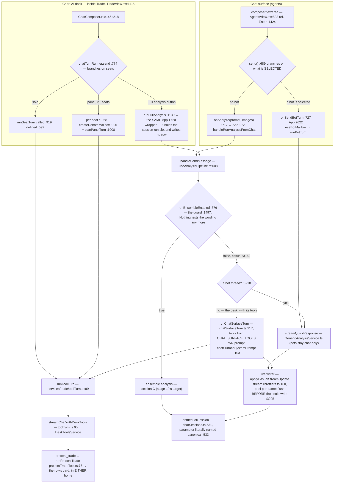
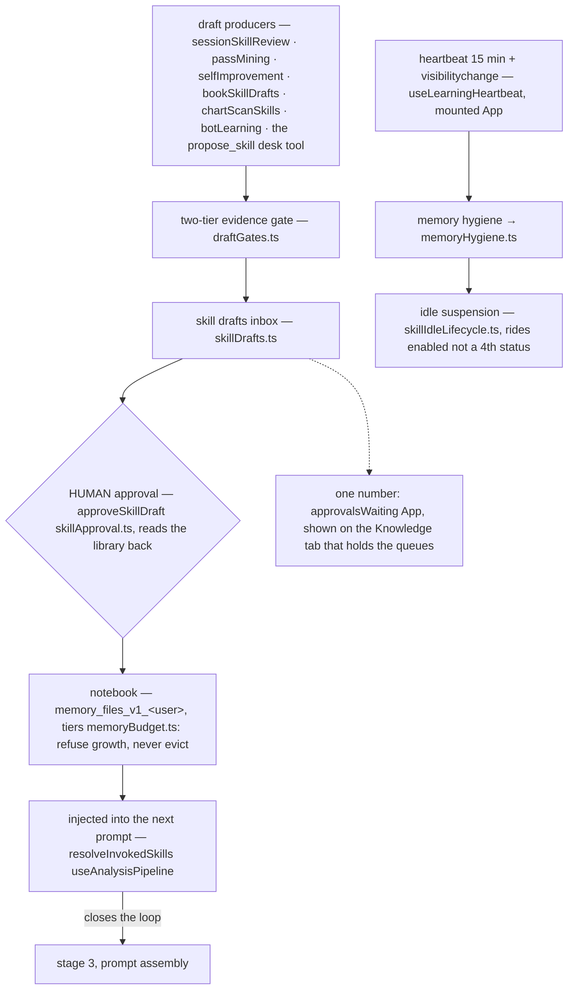
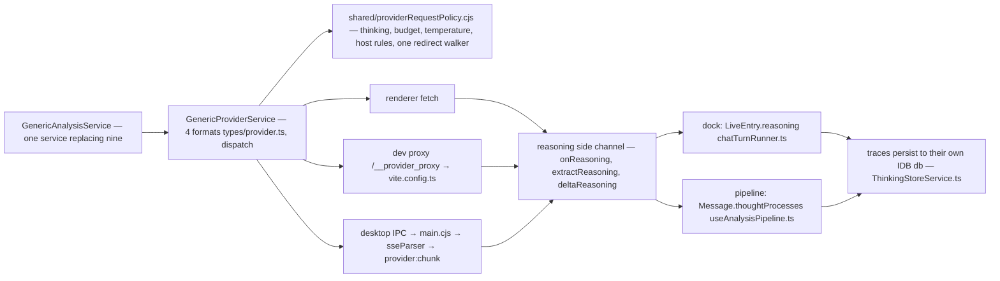

# August Trading — the complete flow

Every node names the file and line that implements it. Verified against the tree on
**2026-10-18** (after the post-mortem, 2D desk floor, saved-analyses and Roles-tab
deletions **and stages 20a/20a2/20g/20b/20b-B/20t/20c/20s/20d/20f of the debate
removal**, which moved
both chat homes onto one turn executor); if a line moves, fix the line rather than
deleting the claim.

Dotted nodes exist in the code but are **never mounted** by the running app.

Companion docs: [learning-loop-map.md](learning-loop-map.md) covers section D in more
depth, [ui-doctrine.md](ui-doctrine.md) governs the shell in sections A and B.
The stage ledger is [docs/plans/debate-deletion-status.md](plans/debate-deletion-status.md);
sections B and C still move again in stage 19.

---

## A · Boot → shell → a surface

Stored surface values `'chat'`, `'boards'`, `'skills'` all migrate to `'trade'`
([useSurface.ts:24](../hooks/useSurface.ts)). There is no `main.tsx`.

---

## B · One message — two chat homes, ONE turn executor

The dock's system prompt is assembled by `systemPromptFor`
([TradeChatPanel.tsx:453](../components/trade/TradeChatPanel.tsx)) from
`TRADE_CHAT_SYSTEM_PROMPT` + skills index + strategies + profile memory + persona.
The Chat surface's prompt is its own now (stage 20s): `chatSurfaceSystemPrompt`
([services/trade/chatSurfaceTurn.ts:103](../services/trade/chatSurfaceTurn.ts))
leads with `CHAT_SURFACE_SYSTEM_PROMPT`
([chatPrompts.ts:40](../constants/prompts/chatPrompts.ts)) — which is
`CASUAL_CHAT_SYSTEM_PROMPT` with a calling mandate and an explicit "no chart
here" bolted on, so the output discipline that fixed the
"Here's a thinking process:" replies survives — then appends the skills index,
the active strategy plans and the profile memory index, each read FRESH per turn
the way the dock reads them. Its skills heading says *what the trader asks
about*, not *this chart*: `buildSkillsIndexForPrompt` took a `where` argument so
the dock's default stays byte-identical. The slugs that actually travelled are
recorded on the row (`Message.injectedSkills`, `types/message.ts:368`), bounded
to the 30 the index prints — a row naming skills the model never saw would be an
audit defect, not an audit trail.

**One entry, both homes.** `handleRunAnalysisFromChat` (App.tsx:1720) is the only
analysis wrapper: the dock passes it as `onRunAnalysis` (App:2528) and the Chat
surface as `onAnalyze` (App:2624). It was two, and `services/trade/analysisTurn.ts`
was deleted (2026-10-17) because a second writer keyed rows with ids no canonical
row could match — that is what made the two homes disagree.

**One executor, two row shapes.** `runToolTurn`
([services/trade/toolTurn.ts:89](../services/trade/toolTurn.ts)) owns the stream,
the tool rounds, the abort-before-repair order, the text-protocol strip and the
reasoning peel. The ROW stays with the caller, because the two shapes do not share
those fields: the dock writes a `chatStore` `LiveEntry` (`tools`/`toolIds`), the
Chat surface writes a canonical `Message` (`liveToolEvents`, `toolActions`,
`thoughtProcesses`). That is why the executor takes an event SINK and not a shared
state object — and why the Chat surface stopped answering live-data questions from
the model's training data (stage 20b, `chatSurfaceTurn.ts`).

A desk seat on the Chat surface may call the canvas-free half of the dock's tools
plus `present_trade`; the other seven `CHART_ACTION_TOOL_DEFS` are not offered at
all, because `streamChatWithDeskTools` lists a chart-action definition only when a
caller dispatches it **and** the seat's allow-list names it. Bots are the exception
by ruling: a bot thread keeps the plain transport, and `useBotMailbox`,
`botRoutine` and `groupRounds` are not on the tool turn.

The card a presented plan draws lives on whichever row presented it — the dock's
entry or `Message.proposal` — and the logged/dismissed disposition is one module
map for both ([proposalDisposition.ts:22](../services/trade/proposalDisposition.ts)),
keyed by the row id `entriesForSession` already shares.

**The wording gate is gone (stage 20c).** `isChartAnalysisRequested` used to test
the prompt for `LIVE MARKET` / `STRATEGY` / `ANALYZE` / `CHART` / `SETUP` — plus the
image and update facts — and `useAnalysisPipeline.ts` branched on it. It was already
a dead decision for a human send: the predicate was ANDed with `runEnsembleEnabled`
and `isEnsembleEnabled` appeared on both sides, so with the toggle on every send
ran the pipeline whatever it said and with it off no wording could make one. The
one route words controlled was a scheduled run's, contradicting the flag's own
comment that automations always run the pipeline: the same automation answered
casually when its prompt read "outlook" and fully when it read "setup". The guard
is now the mode alone. Consequences worth knowing: a screenshot attached to a
toggle-off send is still casual chat (it always was), and the structured verdict,
the levels and the journal row reach a normal send only as TOOLS the seat calls —
which is why 20b and 20b-B had to land first.

**A plan the seat only *said* still gets the card (stage 20d).** A tool is only as
good as the model's choice to call it, and the ledger's whole problem is rows that
never arrive. So a Chat row whose prose carries a labelled entry, stop and target
offers the same decision the card offers: `planFromProse` extracts the numbers and
hands them to `parseTradeProposal` — there is no second validator, which is why a
long whose stop sits above its entry grows no chip — and the chip mints the plan id
through `mintPlanId`, the one shape `present_trade` uses, so the two paths dedupe
against each other. It requires a coin, one direction (a reply that hedges "long
above X, short below Y" is not one plan), and it stays out of the way of a row that
already has a proposal.

---

## C · The analysis pipeline, in call order

Stage line numbers are omitted deliberately: this section is deleted in stage 19 of
the debate removal, and re-measuring 8 anchors to document a week's life is not
worth it. The structure above is what to replace it with — the replacement shape is
already in the app: a chat turn that grounds itself with tools and answers with
`present_trade` (section B) is what section C exists to produce by debate.

**The node that used to hang off stage 8 is gone.** `usePostMortem.ts` and
`GenericAnalysisService.conductPostMortem` were deleted (2026-10-18, `03fc0d5`);
nothing re-runs an analysis after a trade closes. That is the arrow section D used
to close on — and deleting the writer is not the same as deleting the route, which
section D states exactly.

---

## D · The learning loop — now open at the trade end

**What changed here:** the entry node used to be `closed trade / post-mortem →
craftSkillFromPostMortem`. The post-mortem was the only writer of
`LoggedTrade.postMortem`, so deleting it **starved that route rather than deleting
it** — the distinction matters because the code still looks alive. Nothing writes
the field any more, but `craftSkillFromPostMortem`
([services/learning/SkillCraftService.ts:140](../services/learning/SkillCraftService.ts))
is still called from `botLearning.ts:234`, and its first guard is
`if (pm.length < 40) return null` on `trade.postMortem` (`:145`). So for every
trade closed after 2026-10-18 the craft leg can only return null; it still answers
for a row that carries a post-mortem from before then. `selfImprovement.ts:73-74`,
`SkillMemoryService` and `DoctrineConsolidationService` read the same dead field —
25 read accesses across 17 files outside the tests and the SQLite row mapping
(measured 2026-10-18). Deleting the writer was the owner's
explicit choice, with no replacement; clearing the readers is stage 21.

The chain from `draftGates` to the injected skill is unchanged and still runs; it
now starts at the review passes and at the chat's `propose_skill` tool, not at a
settled position.

Corollary that is easy to miss: `GlobalMemory.aiPatternMemory` and
`insightKnowledgeBase` are **frozen stores** (see G), and
`MistakePatternService` / `JobQueueService`, which warned about a recurring setup
before the next entry, no longer exist.

---

## E · Autonomy — routines, rooms, alerts

An automation run always takes the ensemble path: `runEnsembleEnabled =
isAutomationRun || isEnsembleEnabled` (useAnalysisPipeline.ts:676). That is why
stage 19 has to give scheduled runs a new route, not just delete the branch.

What that route must keep is written down, not assumed:
`tests/automationRouteCharacterization.test.tsx` pins the private
`automation-<id>` thread, the per-config overrides, the continuity read, and the
fact that the run's product is a verdict row. It also pins one wart the new route
inherits: `appendRun` never dedupes, so each run is stored twice and the
last-4-**rows** continuity read only ever reaches the last two completed runs.

---

## F · How a request leaves the app

`electron/sseParser.cjs` mirrors only three dialects — `google` has no desktop SSE
parser. That is the one place "three formats" is true.

---

## G · Where everything is remembered

Both lesson stores are **frozen**: readers and the injected index stay, so a profile
keeps what it already carries, but nothing grows them (`03fc0d5`).

| What | Key |
|---|---|
| dock sessions · active id · tool payloads | `trade_chat_sessions_v1_` · `trade_chat_active_v1_` · `trade_tool_payloads_v1_` |
| notebook · queue · drafts · rules | `memory_files_v1_` · `learning_proposals_v1:` · `skill_drafts_v1:` · `approval_rules_v1:` |
| roster · automations · providers | `agents_bots_v1` · `automations_v1_` · `provider_configs_v1` (keys `enc:v1:` via safeStorage) |
| screenshots · reasoning traces | IDB store `images` (`services/infrastructure/messageImageStore.ts`) · own db (`services/infrastructure/ThinkingStoreService.ts`) |
| reduce-motion preference | `desk_idle_motion_v1_&lt;user&gt;` — the desk floor is deleted, the key is not, renaming it silently resets every profile |

`savedAnalyses` still travels through profile persistence, SQLite and backups, but
**has no writer** — the Journal's Saved tab and `SavedAnalyses.tsx` were deleted
(`591f735`), and clearing the store itself is stage 21.

A presented plan is remembered on its row, not in a store of its own: the dock keeps
`proposal` on the runtime `LiveEntry` only, the Chat surface on `Message.proposal`
(persisted with the conversation), and the logged/dismissed decision in
`proposalDisposition` — module scope, bounded, deliberately not persisted, because a
card that forgets it was clicked offers a second journal row.

---

## H · Every arrow

| # | from → to | what crosses |
|---|---|---|
| 1 | index.html → index.tsx | mount, error handlers first `:23 :43` |
| 2 | index.tsx → App | StrictMode › ErrorBoundary › ToastProvider `:73-79` |
| 3 | App → useSurfaceRouter | surface + journalTab + journalOpenNonce |
| 4 | useSurfaceRouter → useSurface | persisted value, key `august_surface_v1` `:15` |
| 5 | useSurfaceRouter → appHash | `#/journal\|market\|settings\|watch` ⇄ state `:101 :158` |
| 6 | App → Header | band, only when `surface !== 'agents'` `:2471` |
| 7 | App → 4 lazy surfaces | each behind `SurfaceSkeleton` `:2498 :2543 :2565 :2607` |
| 8 | Header → SurfaceSwitch | the destination set `:2172`, list `SurfaceMenuList.tsx:42-51` |
| 9 | App → AgentsView props | same switch + StatusCluster + AccountRow + SurfaceMenuList(hideSurfaces) `:2607-2680` |
| 10 | TradeView → TradeChatPanel | the dock, inside Trade `:1115` |
| 11 | AgentsView.send → bot branch | `activeBot` truthy `:727` |
| 12 | bot branch → useBotMailbox | `runUserBotTurn` → `runBotTurn` |
| 13 | AgentsView.send → analysis branch | `onAnalyze` `:717` → App `:1720` — the dock's `onRunAnalysis` reaches the SAME wrapper |
| 14 | dock Full analysis → the run slot | `runFullAnalysis :1130` → `beginRun`/`endRunOwned`; it writes **no row**, the pipeline's own messages are projected into the session |
| 15 | ChatComposer → chatTurnRunner.send | Enter `:146` / button `:218` → `:774` |
| 16 | solo → runSeatTurn | `:919` (definition `:592`) |
| 17 | runSeatTurn → the ONE turn executor | `runToolTurn toolTurn.ts:89` → `streamChatWithDeskTools :95` → `DeskToolsService` → `streamChatRequest` |
| 18 | panel → per-seat + mailbox | `:1068` · `:996` · `:1008` |
| 19 | systemPromptFor → prompt | `TRADE_CHAT_SYSTEM_PROMPT` + skills + strategies + profile + persona `TradeChatPanel.tsx:453` |
| 20 | every dock turn → chatStore | `mutate` · `beginRun` |
| 21 | handleSendMessage → the fork | the mode flag `:676` is the whole decision — guard `:1497`, else `:3162`. Stage 20c deleted the wording predicate |
| 22 | the casual arms | a bot thread → `streamQuickResponse :3223` (plain transport); the desk → `runChatSurfaceTurn chatSurfaceTurn.ts:217` → arrow 17. Tier on both via `resolveComposerEffort`; a Full-analysis send also sets `requireTools` |
| 23 | casual frames → Message.text | `streamThrottlers.ts:160`; flush precedes the settle write `:3295` |
| 24 | ensemble → 8 stages | see C — anchors deliberately omitted |
| 25 | desk tools → what a caller can reach | `executeDeskTool DeskToolsService.ts` (its allow-list is enforced at execution, not only at offer time) |
| 26 | panel tools → chart echo | `executePanelTool chatTurnRunner.ts` → `onToolAction` |
| 27 | automation tick → runAutomation | fork on `config.botId`; no-bot path reuses 21 with `automation` → private list `:466-469 :615-619`, characterized in `tests/automationRouteCharacterization.test.tsx` |
| 28 | bot routine → injected stream | `botRoutine.ts` ← `useAutomations` (reuses 22's bot arm) |
| 29 | rooms → groupRounds | `useAgentGroups` → `streamQuickResponse` |
| 30 | review passes / propose_skill → draft → approval → skill | `draftGates.ts` → `skillApproval` — the post-mortem leg is starved, not deleted (see D) |
| 31 | approved skill → next prompt | `resolveInvokedSkills` — closes into 24's stage 3 |
| 32 | logged trade → memory + autopilot | `useTradeLogging` → `MemoryService`; `proposedTrade` leaves outcome PENDING so the autopilot watches it |
| 33 | App messages + dock entries → one thread | `chatSessions.ts:531` |
| 34 | chatStore → localStorage | `saveSessions` → debounced key |
| 35 | App → profile persistence → engine | `useProfilePersistence` → `dbService` or `SqliteService` |
| 36 | providers → Preferences, keys encrypted | `ProviderConfigService` |
| 37 | every provider call → the policy | `GenericProviderService` → `providerRequestPolicy.cjs` |
| 38 | dev calls → the proxy | `/__provider_proxy` → `vite.config.ts` |
| 39 | desktop calls → IPC → sseParser → chunks | `main.cjs` → `sseParser.cjs` |
| 40 | reasoning deltas → their own field | `chatTurnRunner` / `useAnalysisPipeline` → `ThinkingStoreService` |
| 41 | notebook writes → byte tiers | `MemoryFilesService` → `memoryBudget.ts` → `memoryHealth.ts` |
| 42 | heartbeat → hygiene + idle sweep | `useLearningHeartbeat` → `memoryHygiene.ts` → `skillIdleLifecycle.ts` |
| 43 | approval tray → badge | `collectApprovalItems` → `approvalsWaiting` → Knowledge tab only |
| 44 | the pane filters what it shows | `agentThreads.ts` read at `AgentsView.tsx` |
| 45 | `present_trade` → a card in either home | `runPresentTrade presentTradeTool.ts:76` ← dock sink `chatTurnRunner.ts` / desk sink `chatSurfaceTurn.ts`; gate scan starts there, the cap binds at log time (`ensureStamp`) |
| 46 | `chatSurfaceSystemPrompt` → the desk arm's prompt | `chatSurfaceTurn.ts:103` — mandate (`chatPrompts.ts:40`) + skills index + active strategies + memory index, read FRESH per turn; the 30 slugs printed are the 30 recorded on the row (`types/message.ts:368`) |
| 47 | prose that never called the tool → the same decision | `planFromProse` (`services/trade/tradeShapedProse.ts`) reads the labelled entry/stop/target out of the row, `parseTradeProposal` decides whether that is a plan, and the chip mints the ONE plan-id shape (`mintPlanId`) before calling `onLogProposedTrade` — so a spoken plan reaches the journal the same way a presented one does |

---

## Corrections this doc is guarding

1. There is **no `main.tsx`** — the entry is `index.tsx`.
2. There is **no `utils/deskThread.ts`** — `deskThread` is `utils/agentThreads.ts`.
3. The provider layer speaks **four** wire formats (`types/provider.ts`); "three"
   describes only `electron/sseParser.cjs`, which has no `google` dialect.
4. Approvals is a **tab** of the Knowledge surface, not a fifth destination. The live
   destination set is exactly `trade | journal | agents (labelled Chat) | learn
   (labelled Knowledge)`.
5. **`NavRail` is imported and NOT rendered — it is a dead node.** Verified four
   ways on 2026-10-18: `grep -c NavRail App.tsx` = 18 occurrences and **none is a
   JSX element**; `grep '<NavRail'` repo-wide matches only `components/shell/NavRail.tsx:140`
   (its own definition) and `tests/agentsSurface.test.tsx:390` (a test mounting it
   directly); ESLint reports `App.tsx:123:8 'NavRail' is defined but never used`; and
   the code says so out loud — `App.tsx:2450` and `:2455` are comments reading "The
   NavRail is GONE: its five destination rows were the tab strip this redesign was
   asked to remove". Only the `AccountRow` export is rendered, at `App.tsx:2680`.
   **An earlier pass of this doc asserted the opposite** ("rendered at App:2766") and
   the mechanism is worth keeping: `App.tsx:2488` passes `onExpandNavRail={…}` and
   the rail's expand state is very much alive at `:679-692`, so a grep for `NavRail`
   looks like a mounted component. An `on…` prop is not a render. Withdrawn.
6. **A doc line number is a claim, not a citation.** Every anchor above was
   re-measured on 2026-10-18 by locating the SYMBOL each one names (a scripted
   grep per symbol, not a `head`), and counts were taken with `grep -c` rather than
   a truncated listing — the first version of correction 5 died by exactly that
   truncation. Numbers in section C are deliberately omitted: they are the lines stage
   19 deletes.
7. **"The Chat surface has no tools wired" was true, and stopped being true on
   2026-10-18.** Both homes now run `runToolTurn`; what still differs is the row
   each writes and which tools that row can honour (a Chat seat gets no canvas
   tools, and its `present_trade` receipt says so rather than promising a level-watch
   that cannot exist there). If a future pass restores the old sentence, it is
   describing a bug it just reintroduced.
