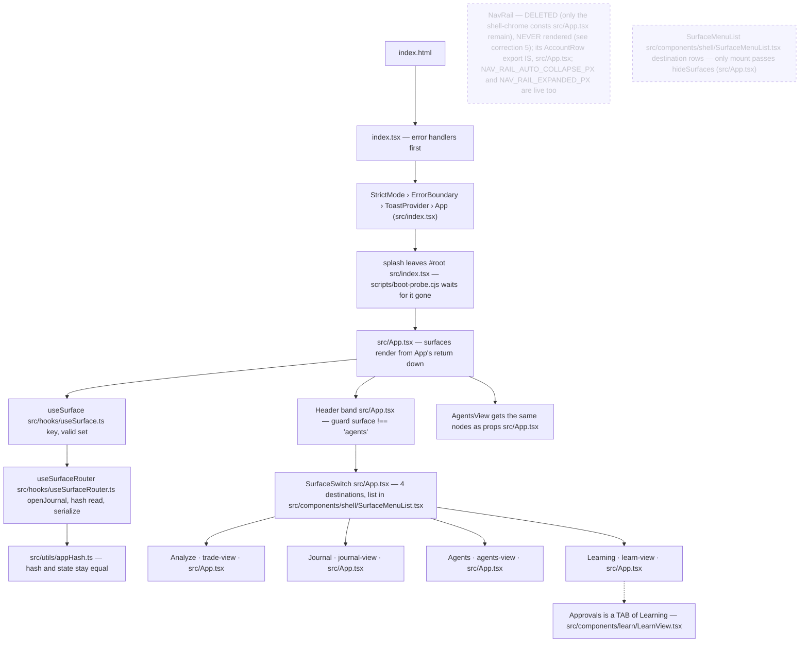
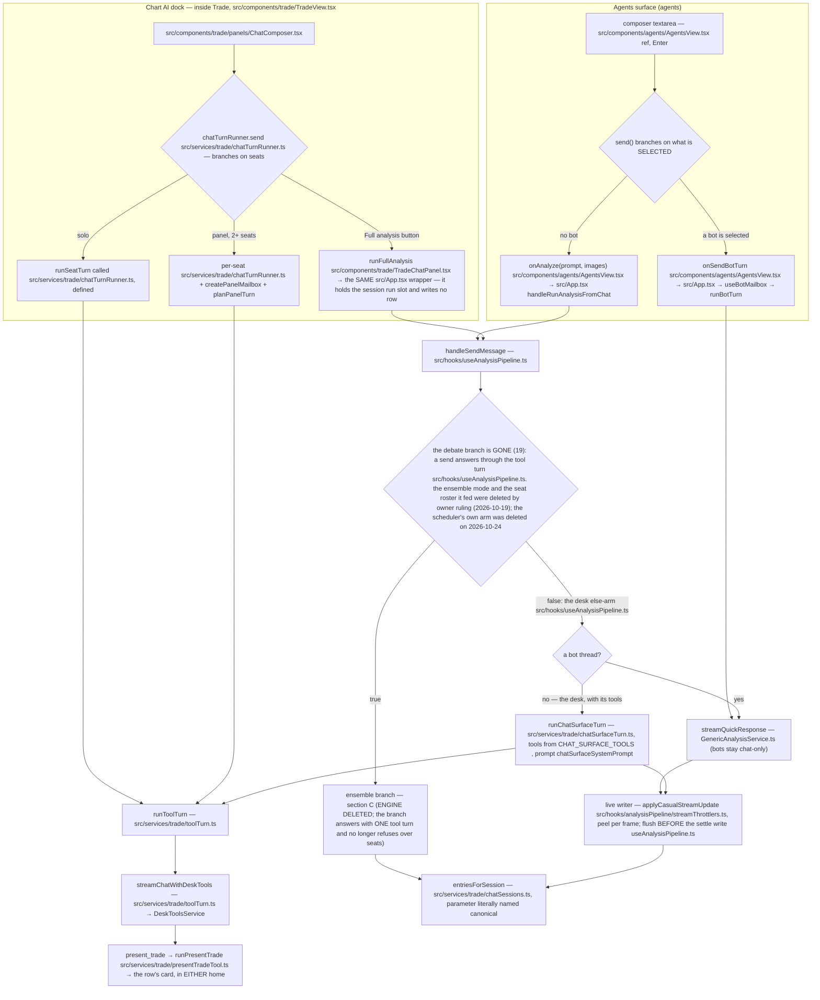
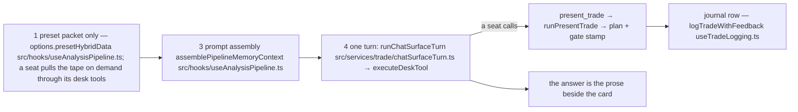
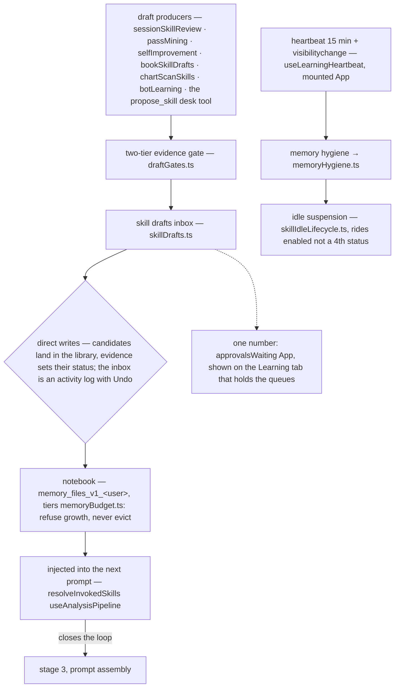
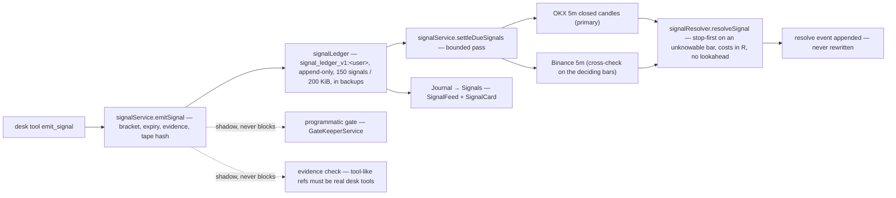
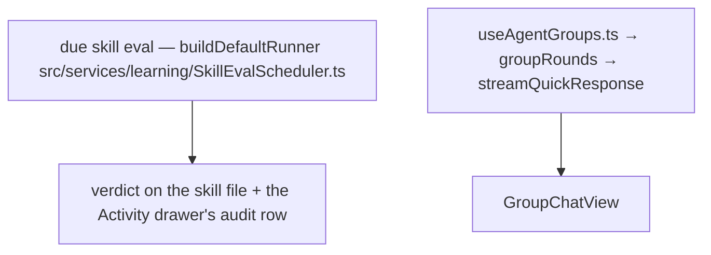
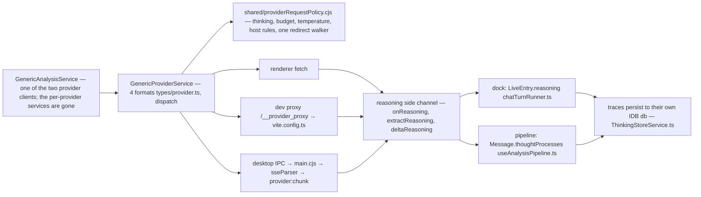
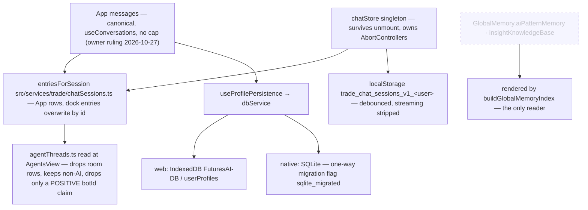

# The system map

**The complete flow of the running app: boot → shell → a message → the analysis turn → the
learning loop → persistence.** Every node is cited by symbol (`path` › `symbol`), and
`npm run check:docs` verifies each one still exists. Line numbers are deliberately absent — they
rot on the next edit.

Companion docs: [learning-loop.md](learning-loop.md) (the memory loop in depth),
[../product/ux/surfaces.md](../product/ux/surfaces.md) (what each surface is), and
[../engineering/conventions.md](../engineering/conventions.md) (the modules these nodes name).

**How to read it:** sections A–H are the map. The mermaid diagrams show the shape; the prose
carries the invariants. A dotted node exists in the code but is never mounted by the running app.

---

## A · Boot → shell → a surface

Stored surface values `'chat'`, `'boards'`, `'skills'` all migrate to `'trade'`
([`src/hooks/useSurface.ts` › `useSurface`](../../src/hooks/useSurface.ts)). There is no `main.tsx`.

---

## B · One message — two chat homes, ONE turn executor

The dock's system prompt is assembled by `systemPromptFor`
([`src/components/trade/TradeChatPanel.tsx` › `TradeChatPanel`](../../src/components/trade/TradeChatPanel.tsx)) from
`TRADE_CHAT_SYSTEM_PROMPT` + skills index + strategies + profile memory + persona.
The Agents surface's prompt is its own now (stage 20s): `chatSurfaceSystemPrompt`
([`src/services/trade/chatSurfaceTurn.ts` › `surfacePromptWith`](../../src/services/trade/chatSurfaceTurn.ts))
leads with `CHAT_SURFACE_SYSTEM_PROMPT`
([`src/constants/prompts/chatPrompts.ts` › `CHAT_SURFACE_SYSTEM_PROMPT`](../../src/constants/prompts/chatPrompts.ts)) — which is
`CASUAL_CHAT_SYSTEM_PROMPT` with a calling mandate and an explicit "no chart
here" bolted on, so the output discipline that fixed the
"Here's a thinking process:" replies survives — then appends the skills index,
the active strategy plans and the profile memory index, each read FRESH per turn
the way the dock reads them. Its skills heading says *what the trader asks
about*, not *this chart*: `buildSkillsIndexForPrompt` took a `where` argument so
the dock's default stays byte-identical. The slugs that actually travelled are
recorded on the row (`Message.injectedSkills`, `src/types/message.ts › Message`), bounded
to the 30 the index prints — a row naming skills the model never saw would be an
audit defect, not an audit trail.

**One entry, both homes.** `handleRunAnalysisFromChat` (`src/App.tsx` › `App`) is the only
analysis wrapper: the dock passes it as `onRunAnalysis` (`src/App.tsx` › `App`) and the Agents
surface as `onAnalyze` (`src/App.tsx` › `App`). It was two, and `services/trade/analysisTurn.ts`
was deleted (2026-10-17) because a second writer keyed rows with ids no canonical
row could match — that is what made the two homes disagree.

**One executor, two row shapes.** `runToolTurn`
([`src/services/trade/toolTurn.ts` › `runToolTurn`](../../src/services/trade/toolTurn.ts)) owns the stream,
the tool rounds, the abort-before-repair order, the text-protocol strip and the
reasoning peel. The ROW stays with the caller, because the two shapes do not share
those fields: the dock writes a `chatStore` `LiveEntry` (`tools`/`toolIds`), the
Agents surface writes a canonical `Message` (`liveToolEvents`, `toolActions`,
`thoughtProcesses`). That is why the executor takes an event SINK and not a shared
state object — and why the Agents surface stopped answering live-data questions from
the model's training data (stage 20b, `chatSurfaceTurn.ts`).

A desk seat on the Agents surface may call the canvas-free half of the dock's tools
plus `present_trade`; the other seven `CHART_ACTION_TOOL_DEFS` are not offered at
all, because `streamChatWithDeskTools` lists a chart-action definition only when a
caller dispatches it **and** the seat's allow-list names it. Bots are the exception
by ruling: a bot thread keeps the plain transport, and `useBotMailbox` and
`groupRounds` are not on the tool turn (the third name here, `botRoutine`, was the routine
executor and went with the automations on 2026-10-24).

The card a presented plan draws lives on whichever row presented it — the dock's
entry or `Message.proposal` — and the logged/dismissed disposition is one module
map for both ([`src/services/trade/proposalDisposition.ts` › `disposition`](../../src/services/trade/proposalDisposition.ts)),
keyed by the row id `entriesForSession` already shares.
**One thread, GENERATING in both homes.** A turn started on either surface is
visibly running on the other, and switching mid-answer does not restart,
duplicate or hide it.

- Chat → dock: `liveEntryFromMessage` (`src/services/trade/chatSessions.ts › liveEntryFromMessage`)
  carries `Message.isStreaming` onto the projected row, so an Agents-surface run
  keeps its activity line, its open work card and its live text after the trader
  hops to the chart. Without that one field the dock showed a FINISHED answer
  that the next token then rewrote under the trader's eyes.
- dock → Chat: `startEntryMirror`
  ([`src/services/trade/chatTurnMirror.ts` › `startEntryMirror`](../../src/services/trade/chatTurnMirror.ts)) copies the
  dock's live entry into the conversation under the SAME id the pane is already
  painting, throttled on a TIMER and flushed on stop. Never
  `requestAnimationFrame`: the generating surface is the one that is HIDDEN
  while the trader reads the other, and a rAF writer fires zero times there —
  the same defect `FadingText` records.
- The thread exists before the first write. A solo dock turn resolves its
  conversation at send (`turnConversationId`, `src/services/trade/chatTurnRunner.ts › createChatTurnRunner`)
  through `ensureDockTurnConversation` (`src/App.tsx › App`), handed to the runner as
  `onSyncConversation`, which adopts the unused blank conversation or mints one
  and makes it active — a session that never had a thread used to keep its
  transcript entirely to itself.
- Either home can stop it. The dock registers its controller under the
  CONVERSATION id as well as its session id, `cancelRunAt`
  (`src/hooks/useAnalysisPipeline.ts › useAnalysisPipeline`) falls back to that registry when it owns
  no pipeline run, and `AgentsView` folds `snap.conversationRunning` into its
  busy flag (`src/components/agents/AgentsView.tsx › AgentsView`) so the composer never
  offers Send over an answer that is arriving. The dock does the same with
  `conversationBusy` (`src/components/trade/TradeChatPanel.tsx › TradeChatPanel`).

### B.1 The row, the work, the wire and the control

The two homes render one conversation furniture. `ChatTranscriptRow` is the Agents
surface's row; `ChatTranscriptList` is the dock's; both mount
`ChatWorkTimeline`, which draws the work as one expandable line plus rows:
`AnalyzedRow` is the live activity line (`turnActivityLabel`) and the settled
command count — `Ran N commands`, counted by `pairToolRows` so the headline and
the rows beneath it cannot disagree about how many calls the turn ran —
`ToolActivityRow`/`pairToolRows` renders one paired call→result row per call
(never two lines per call), and `Disclosure` is
the ONE native `
` used by the thinking row, tool output and Settings'
Advanced section. The answer itself is `AnswerBody` — its own
reading role, `font-reading` — while the trader's own bubble stays in the
interface chrome. The role is not a face any more: since the owner's ruling of
2026-10-22 no serif ships, and `--font-reading` and `--font-serif` both resolve
to the UI stack.

The transcript data has two shapes on purpose. `Message.toolEvents` + `toolIds`
are the settled trail and the payload ids for each line; `liveToolEvents` is the
capped, newline-joined live feed a filling bubble shows. The Agents surface writes
the former through `streamChatWithDeskTools`; `liveEntryFromMessage` projects a
Message onto the dock's `LiveEntry` without losing the trail. A failed turn is
not an answer: `ChatFailureRow` renders `Message.error` in both homes, and a
turn's `wireAudit` says what route the transport applied — or why it applied
none — through `WireAuditRow`. `JumpToLatestFab` is the one return control, at
the one `JUMP_AWAY_PX` threshold; it shows an indeterminate ring while a turn
runs, never a percentage.

The model control is likewise one control: `ModelChip`'s trigger names
`Provider · Model · tier`, `ModelMenu` is the one panel (provider, model, effort
slider, stars, free-only, discovery refresh), and `effortScale` is the one
six-stop ladder. `Ctrl/Cmd+Shift+E` steps the active session's tier through
`nextEffortTier`; `effortDial` is the refcount that keeps the chord legal only
while a composer is actually showing the dial. The resolved tier and the wire
audit ride out of the executor on the outcome (`ToolTurnOutcome.effort` /
`wireAudit`) and are recorded on the row (`RunStats.effort`,
`Message.wireAudit`), so the request, the stored entry and the row cannot claim
different facts.

**The wording gate is gone (stage 20c).** `isChartAnalysisRequested` used to test
the prompt for `LIVE MARKET` / `STRATEGY` / `ANALYZE` / `CHART` / `SETUP` — plus the
image and update facts — and `useAnalysisPipeline.ts` branched on it. It was already
a dead decision for a human send: the predicate was ANDed with `runEnsembleEnabled`
and `isEnsembleEnabled` appeared on both sides, so with the toggle on every send
ran the pipeline whatever it said and with it off no wording could make one. The
one route words controlled was the scheduler's, contradicting the flag's own
comment that automations always run the pipeline: the same schedule answered
casually when its prompt read "outlook" and fully when it read "setup". That arm
is gone — the scheduled-automation feature was deleted on 2026-10-24 (section E) —
so the mode alone decides what a human send does, and nothing answers a model
without a person pressing send. Consequences
worth knowing: a screenshot attached to a toggle-off send is still casual chat (it
always was), and the structured verdict,
the levels and the journal row reach a normal send only as TOOLS the seat calls —
which is why 20b and 20b-B had to land first.

**A plan the seat only *said* still gets the card (stage 20d).** A tool is only as
good as the model's choice to call it, and the ledger's whole problem is rows that
never arrive. So a Chat row whose prose carries a labelled entry, stop and target
offers the same decision the card offers: `planFromProse` extracts the numbers and
hands them to `parseTradeProposal` — there is no second validator, which is why a
long whose stop sits above its entry grows no chip — and the chip mints the plan id
through `mintPlanId`, the one shape `present_trade` uses, so the two paths dedupe
against each other. It requires a coin, one direction (a reply that hedges "long
above X, short below Y" is not one plan), and it stays out of the way of a row that
already has a proposal.

---

## C · The analysis pipeline, in call order

Stage 19 deleted the debate from this path. What one send actually does now:

### C.1 What the turn does now: context, compaction, retries, transcript

The request is assembled once: the surface's mandate, the persona/skills index,
active strategies, the profile/global/pattern memory slices, the conversation
history and the current line. Before it goes on the wire:

1. `resolveContextWindow` (`src/utils/contextWindow.ts › resolveContextWindow`) picks the window from
   the user override, a provider-stated limit measured from a previous
   rejection, the model's discovered window, or the 1,000,000 default
. `outputTokenBudget` and `promptTokenCeiling` size
   the response and the prompt against that one number.
2. `compactForWire` (`src/services/providers/contextCompact.ts › compactForWire`) fits the array:
   old tool payloads first, then old prose, then whole tool rounds; a
   `tool_calls` block always stays with its replies, and the last user turn is
   pinned by `compactMessages`. The notice says what was cut, including
   `CONTEXT FULL` when nothing could be cut.
3. `runDeskToolLoop` (`src/services/analysis/DeskToolsService.ts › runDeskToolLoop`) bounds the
   turn: at most `MAX_DESK_TOOL_ROUNDS`, each round at
   `DESK_ROUND_MAX_TOKENS` and under `DESK_TURN_BUDGET_MS`;
   `budgetToolContent` clips one result, and `clearDeskToolCache`
 makes the cache per-turn.
4. A round cut off by its own thinking is re-asked once at a stepped-down tier
   (`stepEffortDown`); a turn that produced nothing gets the same step-down.
   `withTruncationWindow` (`src/utils/finishReason.ts › withTruncationWindow`) records the wire's own
   stop signal and `truncationNotice` says the answer may be cut.
5. The transport retries transient failures with backoff, caps each attempt at
   its timeout, and recovers once from a context-length rejection: it reads the
   provider's stated limit, compacts to it, remembers it as measured, and retries
   (`sendChatRequest`/`contextRecoveryMessages`,
   `sendChatRequest` at `src/services/providers/GenericProviderService.ts › sendChatRequest`,
   `contextRecoveryMessages` at `src/services/providers/GenericProviderService.ts › contextRecoveryMessages`, `streamChatRequest` at
   `src/services/providers/GenericProviderService.ts › sendChatTurnOnce`). The provider's real cause chain is what
   `toFriendlyProviderError` preserves; a failed turn becomes
   `Message.error` and a `ChatFailureRow`, not an answer.
6. The wire's per-call decision is `WireAuditEntry` — route, effort, applied and
   reason — collected by `runToolTurn` and rendered by `WireAuditRow`. It is how
   the row distinguishes "the model did not think" from "the model was never
   asked to".

The answer is the prose beside the work card; `present_trade`
(`src/services/trade/presentTradeTool.ts › runPresentTrade`) writes the plan and starts the gate
scan, and the journal write is `logTradeWithFeedback`
(`src/hooks/useTradeLogging.ts › useTradeLogging`). A model that presents a plan without a market
read is still a plan — the Full-analysis notice and the journal guard say so
rather than silently treating the card as checked.

**Stages 2, 5, 6, 7 and 8 of the old list are gone from the call path**: the gate
scan (`GateKeeperService`) — the gate now runs inside `present_trade` (20a2); the
analyst openings and the debate (`conductDebate` / `conductRealDebate`); the
moderator pass; the finalizer (its file and suite are now DELETED); the
pipeline-side Monte Carlo and backtest. The engine FILES are now deleted too: stage 19's second tranche removed
`ensembleService`, `ensembleConsensus`, `debateScience`, `debateResume`,
`provisionalVerdict`, `analysisResultProcessor`, `CompletionNotifications` and
22 more, with their suites — 26 production files gone. The three reachable modules
that still imported debate helpers were cut by INLINING the slice each one used
(`streamThrottlers` keeps only `throttledCasualStream`; the watch follow-up groups
round-1 turns itself; `monthlyReport` computes the log-odds mean itself), so no
displayed number changed. the ensemble flag and the seat roster it fed are gone (owner ruling, 2026-10-19); the
mode fork they switched was already deleted, so there is no switch left to describe, and `Message.debateTurns` stays as a read-only
legacy field for rows written before the cut — the same rule `modelsUsed` follows.

Why the deletion is safe rather than a loss: the thing section C existed to produce
— a grounded verdict with a journal row — is what a tool-bearing turn produces now
(section B). A `TradeAnalysis` row is no longer written by a send, so the journal's
verdict-shaped rows come from `proposal` cards, and the surviving readers were
re-pointed in 20b-B and 20r rather than left reading a field nothing writes.

**The residue is closed, not restated.** With Hybrid Intelligence on, a human send
does not fetch real-time data — the seat calls `get_market_packet` when it needs
the tape. The only packet this path still accepts is one an upstream capture already
fetched (`presetHybridData src/hooks/useAnalysisPipeline.ts › useAnalysisPipeline`), and it reaches the
prompt through `freshHybridData` into
`assemblePipelineMemoryContext src/hooks/useAnalysisPipeline.ts › useAnalysisPipeline`. The dead
`hybridDataInjection` string — built, then read only by a `devLog` — went with the
scheduled run that was its only producer. It is
never handed to the turn, because the analyst and moderator prompts it used to ride
are the files stage 19 deleted. The packet object does still have one consumer:
`src/hooks/useAnalysisPipeline.ts › useAnalysisPipeline` passes it into
`assemblePipelineMemoryContext` (the packet argument `freshHybridData` at `src/hooks/useAnalysisPipeline.ts › useAnalysisPipeline`),
which is where the learning coin and the notebook
slice come from, so dropping the fetch is NOT a byte-preserving cleanup — that is
why it is an owner decision rather than something I removed silently. The loading
state at `src/hooks/useAnalysisPipeline.ts › useAnalysisPipeline` still flips for a send whose result
only the coin picker reads. Separately, the prompt A/B lane is a **per-run value**:
`beginPromptLane` (`src/services/infrastructure/PromptOverrideService.ts › beginPromptLane`) returns
`'live' | 'control'` and the caller threads it into `getPrompt` and
`promptCorpusVersion` — E-57 §3 deleted the `let controlLane` singleton and the
`endPromptLane()` in the `finally`, because two runs deciding at once each answered
with the other's lane and a run that threw reset the flag out from under a run still
using it. What is still open, and registered: **no live turn path resolves an
override at all.** Every `getPrompt` call site sits on the analysis/skill-craft
surfaces reachable from `SkillEvalScheduler`, and the desk turn that answers this
surface calls none — so the pair currently differs in what it RECORDS, not in what
it SENDS. Wiring it changes the bytes a trader's model sees; deleting the dial
removes a control that has never done what it names. Either is an owner call, and
neither is a deletion of the lane bookkeeping.

**The node that used to hang off stage 8 is gone.** `usePostMortem.ts` and
`GenericAnalysisService.conductPostMortem` were deleted (2026-10-18, `03fc0d5`);
nothing re-runs an analysis after a trade closes. That is the arrow section D used
to close on — and deleting the writer is not the same as deleting the route, which
section D states exactly.

---

## D · The learning loop — now open at the trade end

**What changed here:** the entry node used to be `closed trade / post-mortem →
craftSkillFromPostMortem`. The post-mortem was the only writer of
`LoggedTrade.postMortem`, so deleting it **starved that route rather than deleting
it** — the distinction matters because the code still looks alive. Nothing wrote
the field for a trade closed after 2026-10-18, while `craftSkillFromPostMortem`
([`src/services/learning/SkillCraftService.ts` › `craftSkillFromPostMortem`](../../src/services/learning/SkillCraftService.ts))
was still called from `src/services/agents/botLearning.ts › craftAndGateBotTrade`, and its first guard is
`if (pm.length < 40) return null` on `trade.postMortem` (`src/services/learning/SkillCraftService.ts › craftSkillFromPostMortem`). So for every
trade closed after 2026-10-18 the craft leg could only return null; it still answered
for a row that carries a post-mortem from before then. `src/services/learning/selfImprovement.ts › extractEpisodes`,
`SkillMemoryService` and `DoctrineConsolidationService` read the same empty field.
**E-57 §1 gave the leg its writer back** — `services/learning/settlementReflection.ts`
runs ONE bounded call (`TASK_BUDGETS.postMortem`, tier `postMortem`, called from
`src/hooks/useTradeLogging.ts › useTradeLogging` and awaited BEFORE `syncClosedTradeToNotebook`, because
that function marks the trade settled and then folds the diary entry and the IF/THEN
draft out of the row's post-mortem text), and it writes nothing on a failure, a decline
or a malformed answer, so a gap stays a gap and never becomes an invented lesson. A
trader's own note always wins; the row now also says which model wrote the note
(`src/types/trade.ts › LoggedTrade`).
**Sizing that by grep is a trap, so the recipe is part of the number — and the word
boundary is load-bearing.** Counting the TOKEN, `grep -rE "postMortem" --include="*.ts"
--include="*.tsx" .`, measures **91 lines in 29 files**; counting the field reads needs
`grep -rE "\.postMortem\b" …` and measures **39 lines in 23 files**. Drop the `\b` and the
second figure silently becomes **43**, because four of those lines are a DIFFERENT field:
`postMortemCreatedAt`, the timestamp twin (read at
`src/hooks/analysisPipeline/memoryContext.ts › assemblePipelineMemoryContext` and
`src/services/learning/DecisionReflectionService.ts › buildDecisionReflectionContext`, and gated at
`src/services/ui/AlgorithmicSummaryService.ts › generateAlgorithmicTradeSummary` on `postMortemCreatedAt`), and the new `postMortemModel`, the
provenance twin. A census without the boundary sweeps a live
name into the dead list, which is the mistake this page keeps re-recording. Earlier drafts of this page asserted
189/57 and 105/~35 — true the day they were taken, untrue from the stage that deleted readers
onward, and unreproducible without the filter, which is how a census becomes a claim nobody can
check. The rest
is a name collision with two live things: the outcome-validation engine
(`PostMortemTPHit` and the `[PostMortemValidation]` log prefixes in
`services/backtesting/BacktestingService.ts`, `PostMortemDataSummary` /
`logPostMortemDataVerification` in `services/ui/AutoCaptureService.ts`), which replays
candles to decide whether a TP or SL really got hit; and the enum member
`'autopilot' | 'postMortem'` on `LoggedTrade.rSource` / `excursionSource`
(`src/types/trade.ts › LoggedTrade`), which names that after-close pass and is still written. A bulk
deletion keyed on the word would remove the validator. Re-measured 2026-10-19. Deleting the writer was the owner's
explicit choice, with no replacement. Clearing the readers is NOT simply scheduled work:
the stored-history readers answer only for rows written before 2026-10-18, so whether
that museum stays readable is the owner's open call (#21), and deleting the fields deletes
the history with it.

The chain from `draftGates` to the injected skill is unchanged and still runs; it
starts at the review passes, at the chat's `propose_skill` tool, and since E-57 §1
at a settled position again — the reflection's IF/THEN line is what
`ingestIfThenFromTrade` turns into a draft awaiting the trader's approval.

Corollary that is easy to miss: `GlobalMemory.aiPatternMemory` and
`insightKnowledgeBase` are **frozen stores** (see G), and
`MistakePatternService` / `JobQueueService`, which warned about a recurring setup
before the next entry, no longer exist.

### D.1 The signal loop (phase 1, 2026-10-29)

The resolver's rules are the honesty contract: a bar counts only if it OPENED at or after the
emission and CLOSED by the expiry; a bar containing both levels drills into 1m and settles
STOP-FIRST when the order is still unknowable (`ambiguous: true`); a call that never touches its
entry is `never_triggered`, not a loss; every fill is charged a named round-trip cost
(`SIGNAL_TAKER_FEE_RATE` + `SIGNAL_SLIPPAGE_RATE` per side). A tape that does not reach back to the
emission leaves the signal open and says so — never "no entry".

The accuracy fold rides the resolution: `signalAccuracy.baseRateFor` re-enters the SAME bracket at
every bar of the same tape through the same resolver, so the stored `base` is what those levels did at
a random time. The feed shows hit rate vs base with the lift and a THIN flag under
`MIN_ACCURACY_FILLS`, and the next `emit_signal` receipt carries this coin's `signalScorecard` — the
measurement goes back into the call, not only into a dashboard. The skill evidence fold (b3) does not
read resolutions yet.

---

## E · Autonomy — rooms, alerts, one detached evaluator

**The scheduled-automation feature is deleted (owner request, 2026-10-24).** Out
went the Automations surface and its card feed, the editor modal, the cron tick and
boot catch-up, the per-run and per-day plan ration, the three-failure breaker, the
bot-scoped routine executor, and the pipeline's private-message `automation` run
mode. Nothing in the app now answers a model on a timer: every turn begins with a
person pressing send, a bot mailbox delivery, or a room round.

What survives is the one unattended caller that is not a conversation — the
detached skill evaluator, reached from the trade-sync path
(`runDueSkillEvalWithDefaultRunner src/services/learning/SkillMemoryService.ts › syncClosedTradeToNotebook`)
and from the skill detail's own run. Because nobody is watching it, it runs on
`DETACHED_EVAL_TOOLS` (`src/services/trade/unattendedTools.ts › DETACHED_EVAL_TOOLS`): the Agents surface's
set minus every notebook-writer and minus `present_trade` / `decline_trade`, so a detached
judgement can read the tape and cannot act on the journal. The deny list
in that module is the single owner of "not without a human".

Stored automation data was left alone deliberately: `automations_v1_`,
`automation_runs_v1_` and `automation_last_seen_v1_` stay allow-listed for restore
(`src/services/infrastructure/ExportService.ts › RESTORABLE_PREFERENCE_KEY_PREFIXES`) so a backup taken before the
removal still comes back without dropping keys it names.

**The Agents surface is a launch list, not a roster form.** A row says what the
agent is for (its title, or the first line of its description); `AgentDetailCard`
is the read-only detail — model, notebook scope, standing instructions and the
last trace — mounted through the one `DetailModal`, while editing stays in the
roster dialog. The list is ordered with the built-in shelf first and the user's
own agents after it; nothing is seeded.

---

## F · How a request leaves the app

`electron/sseParser.cjs` mirrors only three dialects — `google` has no desktop SSE
parser. That is the one place "three formats" is true.

### F.1 The window, the compactor and the error

The provider layer is four formats (`types/provider.ts`) behind one policy
(`shared/providerRequestPolicy.cjs`): thinking gates, temperature, host rules and
the redirect walker are shared by the renderer, the Vite dev proxy and Electron
main. `GenericProviderService` is the one transport: `sendChatRequest`
(`src/services/providers/GenericProviderService.ts › sendChatTurn`), `sendChatTurn` (`src/services/providers/GenericProviderService.ts › sendChatTurn`) and
`streamChatRequest` all use the same retry/timeout wrapper. A
context-length rejection is the one error that teaches the app a fact: the
provider states its limit, `contextRecoveryMessages` compacts to that
limit and retries once, and `recordMeasuredContextWindow`
(`src/utils/contextWindow.ts › recordMeasuredContextWindow`) remembers it for the next turn. On the tool path, a request that
cannot hold the prompt plus a reply is refused before it is sent, with the
measured reason, rather than sent as an impossible `max_tokens`.

`finishReason` (`src/utils/finishReason.ts › extractFinishReason`) normalizes the four providers' stop
signals; `withTruncationWindow` is the per-run bracket, and
`truncationNotice` is the sentence a cut-off answer carries. The
reasoning route is decided by `buildReasoningPatch`
(`src/services/providers/reasoningControls.ts › buildReasoningPatch`) from the resolved tier
(`resolveComposerEffort`,), and the answer's row can show that decision via
`WireAuditEntry` (B.1). The model's context window is not re-derived from its
name: `resolveContextWindow` is the one resolution, and the Settings provider
editor prints the source that won (user, measured, model-reported or assumed).

---

## G · Memory, skills, tools, and the learning loop

Both lesson stores are **frozen**: readers and the injected index stay, so a profile
keeps what it already carries, but nothing grows them (`03fc0d5`).

### G.1 The notebook is the memory

The notebook is one per-user blob at `memory_files_v1_<user>`
(`src/services/learning/MemoryFilesService.ts › MEMORY_KEY_PREFIX`). Its folders are fixed by
`DEFAULT_FOLDERS` (`src/services/learning/MemoryFilesService.ts › DEFAULT_FOLDERS`): `profile`, `trader-diary`,
`market-conditions`, `rules`, `skills`, `bots`, `settled-beliefs`, `distilled`
and `strategies`. The folder is the write scope, not the model's choice:

| folder | owner / writer | what the next prompt may see |
|---|---|---|
| `profile` | `syncProfileMemoryUnlocked` (`src/services/learning/MemoryFilesService.ts › buildDiaryEntry`) from the saved profile | the profile memory index (`buildProfileMemoryIndex`, `src/services/learning/profileMemory.ts › INDEX_LINE_MAX`) |
| `trader-diary` | the trader and diary appends | free prose; not a generated index |
| `rules` | the seed `risk-rules.md` plus trader edits | `riskRulesBlock`; the model treats each line as binding |
| `skills` | approved skill files | the skills index / recall tool (G.3) |
| `bots` | `botLearning` / the bot's own scope | bot memory, isolated or shared |
| `settled-beliefs` | doctrine/consolidation | `settledBeliefsBlock` (`src/services/learning/settledBeliefs.ts › settledBeliefsBlock`) |
| `distilled` | distillation passes | `loadDistilledFacts` (`src/services/learning/distilledMemory.ts › loadDistilledFacts`) |
| `strategies` | `StrategyStore` and the `propose_strategy` tool | the active strategy block — and the uploaded BOOKS ride the same section (`activeStrategiesBlock`) |

A model note is appended through `writeModelNote` (`src/services/learning/MemoryFilesService.ts › writeModelNote`),
which rejects any file the harness regenerates wholesale — a model append there
would be silently clobbered by the next rebuild. User edits and model amendments
go through the notebook UI / amendment inbox instead (`MemoryTopicsCard`,
`MemoryFilesManager`, `proposeTopicEdit`), so a model cannot quietly rewrite the
trader's source text.

**Injection is a bounded slice, not the notebook.** `getMemoryFilesContext`
(`src/services/learning/MemoryRetrievalService.ts › MemoryContextOptions`) assembles the blocks for a turn; its stage
budgets come from `stageBudgetChars` (`src/services/learning/MemoryRetrievalService.ts › stageBudgetChars`) and the
`SKILL_INDEX_LINE_MAX`/`SKILL_BLOCK_MAX` limits. The notebook
is the source; the prompt receives the subset the retrieval stage selects. The
recall tool (`handleRecallTool`, `src/services/learning/MemoryRetrievalService.ts › handleRecallTool`) is the
on-demand path when the slice was not enough.

**The notebook can refuse growth.** `src/utils/memoryBudget.ts › NOTEBOOK_HARD_LIMIT_BYTES` is the 2 MiB hard
limit, the 1.5 MiB cleanup trigger and the 1 MiB soft limit. `notebookPressureAllows`
(`src/services/learning/MemoryFilesService.ts › notebookPressureAllows`) refuses new files at the trigger and all growth at
the hard cap; it never evicts, because nothing in that store is regenerable. A
failed write is not swallowed: `getNotebookWriteFailure`
(`src/services/learning/MemoryFilesService.ts › getNotebookWriteFailure`) records quota vs error, bytes and streak, and the
Health tab reads it. Backup/export carries the notebook with the profile
(`createBackup`, `src/services/infrastructure/BackupService.ts › createBackup`; export namespaces in
`src/services/infrastructure/ExportService.ts › RAW_LOCAL_STORAGE_PREFIXES`).

### G.2 Profile, global and pattern memory

Three derived memories sit beside the notebook:

- **Profile memory** — `syncProfileMemory` copies the saved profile into the
  `profile` folder, and `buildProfileMemoryIndex` (`src/services/learning/profileMemory.ts › INDEX_LINE_MAX`) renders
  the index injected into a turn.
- **Global memory** — `buildGlobalMemoryIndex` (`src/utils/memoryUtils.ts › buildGlobalMemoryIndex`) renders
  `familyPerformance`, `userPreferences`, `globalCorrections` and the frozen
  `aiPatternMemory`/`insightKnowledgeBase`. The two frozen fields keep their
  readers and bytes; nothing grows them since `03fc0d5`.
- **Pattern memory** — `findRelevantTrades` (`src/services/learning/PatternMemorySynthesisService.ts › findRelevantTrades`)
  is live at three sites (`src/services/learning/EvidencePackService.ts › buildVerdictEvidencePack`,
  `src/services/learning/MemoryGraph.ts › buildMemoryGraph`,
  `src/services/learning/MemoryRetrievalService.ts › conflictNote`).
  `calculatePnlR` (`src/services/learning/PatternMemorySynthesisService.ts › calculatePnlR`) uses the
  canonical nearest target with a corrected exit before estimating.
  **The gate half is dead on every trade path.**
  `generateSynthesizedPromptInjection` (`src/services/learning/PatternMemorySynthesisService.ts › generateSynthesizedPromptInjection`) has
  **no caller at all**. `generateMandatoryPatternCheck`
  (`src/services/learning/PatternMemorySynthesisService.ts › generateMandatoryPatternCheck`) is called only by
  `generatePatternMemoryEnforcementContext` (`src/services/learning/PatternMemorySynthesisService.ts › generatePatternMemoryEnforcementContext`),
  whose only consumers were its own tests (gone with the suite), and
  `synthesizePatternMemory` (`src/services/learning/PatternMemorySynthesisService.ts › synthesizePatternMemory`) only by those
  two. So nothing refuses a setup for want of evidence; the live pre-trade gate is
  `src/services/trade/proposalGate.ts › assessPlanShape` (`assessPlanShape`).
  `addAttributedInsight` is the one writer of the attributed ledger.

`utils/netRiskReward.ts` is the cost model behind the ledger's `netR`; the skill
metadata keeps `grossR`, `netR`, `netRKnown` and `rSampled` separately, because a
gross sum read under a net label is a lie, and a missing cost is never stored as
zero.

**The memory loop, ported 2026-10-24** (the SKILL.md/memory design; the repo won
where the spec and the code disagreed):

- **Forget deletes the line and anything derived SOLELY from it** —
  `forgetProfileMemory src/services/learning/profileMemory.ts › forgetProfileMemory` returns
  `{ gone, removed, carried }`, not a boolean, because the honest answer can be
  "more than the one you named". A row goes with the forgotten slug only when its
  `derivedFrom` list resolves entirely to slugs this delete already dooms, and the
  rule is a loop rather than one test: C derived from B derived from A must all
  fall. A merge survivor keeps its facts (it was built from more than one line)
  and keeps its absorbed history, because that list is provenance, not a live
  dependency. What makes `derivedFrom` exist is the consolidation merge
  (`src/services/learning/profileMemoryConsolidation.ts › rememberWithConsolidation`), which records the inputs it absorbed
  before retiring them — and retires them through
  `retireMergedMemory src/services/learning/profileMemory.ts › forgetProfileMemory`, NOT through the
  trader-facing forget: the survivor's list names those very slugs, so cascading
  there would delete the merged row moments after writing it. The desk tool's
  receipt prints `alsoRemoved` / `itAlsoCarried`, and the Settings memory list
  (`src/components/settings/ProfileMemoryCard.tsx › ProfileMemoryCard`) says the same in a `role="status"` line, so a
  delete that took two rows never looks like a delete that took one.
- **Record shape** — the entry interface
  (`ProfileMemoryEntry src/services/learning/profileMemory.ts › ProfileMemoryKind`)
  carries, besides its slug, description, kind and body: `version` (the
  optimistic lock, absent on legacy rows reads 1), the provenance tag (stated =
  the trader said it — the only tag the save tool writes; observed and inferred
  come from system paths, and the trader learner stamps observed), the
  sensitive flag, aliases (at most 8 extra match words), `previous` — the row as
  it read before the edit, stamped only when the body actually changed
  ("now X, previously Y") — and two more the memory loop needed:

  `subject` is whose or what the claim concerns (profile, preference, topic,
  area, person) — a different question from which kind wrote it, and derived
  from that kind for rows that predate the field, so no record is about nothing:
  `subjectOf src/services/learning/profileMemory.ts › subjectOf`

  `sourceSession` is the conversation the fact was heard in — a fact the trader
  cannot place is a fact they cannot audit.
  `rememberProfileMemory src/services/learning/profileMemory.ts › RememberResult`
  takes `if_version` and refuses a mismatched write by returning the row that IS
  stored, so the seat merges and retries in the same turn.
- **Write filters** — `filterMemoryWrite` (`src/utils/memoryWriteFilters.ts › filterMemoryWrite`)
  is the code the prompt's "never store" list stands on. The secret table
  (`SECRET_PATTERNS src/utils/memoryWriteFilters.ts › SECRET_PATTERNS`) refuses sk-/ghp_/AKIA/xox/JWT,
  a 13–19-digit card run, a bare `###-##-####` SSN shape with no label to give it
  away, a contiguous IBAN, and a long identifier that follows an account/routing/
  sort-code/SWIFT **label** — the label is what separates an account number from
  a position size, and the filter refuses identifiers, not numbers.
  Honesty-suppressing or elevated-permission "preferences" are refused with the
  reason; sensitive categories (health/finances/identity) are detected, REFUSED
  while the Settings switch `sensitiveMemoryEnabled` is off (the default), and
  flagged so the pre-read and unattended seats never surface them.
- **A bulk read is not an invitation** — `read_memory` with "all" (or no slugs)
  holds every `sensitive` row back for EVERY seat and answers with the count
  instead (`case 'read_memory' src/services/analysis/DeskToolsService.ts › executeDeskTool`). The
  store's own index never advertises a sensitive slug, so a row that comes back
  was named by the trader; that is the distinction the bulk read cannot make on
  its own, and it is why the rule sits in the tool rather than in the prompt.
- **The memory off-switch actually gates every path** — the analysis
  pipeline always honoured it; since 2026-10-24 the flag threads
  App → `runChatSurfaceTurn` (`src/services/trade/chatSurfaceTurn.ts › surfacePromptWith`) and App → TradeView →
  the dock, and off strips BOTH memory blocks (profile and notebook topics)
  from the seat prompt. Skills are procedures, not memory, and stay.
  The DEEP pipeline honoured nothing: `assemblePipelineMemoryContext` called
  `buildProfileMemoryIndex()` bare, so a Full-analysis prompt carried the
  profile index whatever the switch said, sized by the default rather than the
  seat's window. It now takes the flag and `indexBudgetFor`'s memory line
  (`src/hooks/analysisPipeline/memoryContext.ts › assemblePipelineMemoryContext`) — the same table every other
  seat reads.
  Its ONE writer is the `Global memory` toggle in the notebook manager
  (`src/components/learn/MemoryFilesManager.tsx › MemoryFilesManager`), on the Learning surface — Settings → Memory shows
  the LIST, not the switch, which is why a probe that looks for it there finds
  nothing. It is a per-profile setting
  (`src/hooks/useProfilePersistence.ts › useProfilePersistence` writes `settings.isGlobalMemoryEnabled`,
  `src/hooks/useUserProfileLoader.ts › useUserProfileLoader` reads it with `?? true`), and the shipped default
  is ON: item 18 frames this control as turning memory OFF, which presupposes it
  was running, and item 8 injects the profile, preferences and index every turn.
  It read `?? false` until 2026-10-26, so every profile that never found the
  switch — including the one this repo ships — ran with no memory at all, and no
  live arm could catch it because the probe's own seed set the flag to `true` by
  hand. With the seed silent, five arms measure it through the UI: the pristine
  profile shows the switch on and gets the index plus the pre-read; one press
  reads back off and strips both from the next turn and stores no `remember` row;
  pressing again restores it. The seat cannot move the switch itself —
  `openKnobNames()` never names it, so a self-change cannot reach it.
- **The strategies switch gates one section built in one place** —
  `activeStrategiesBlock src/services/learning/strategyStore.ts › activeStrategiesBlock` composes BOTH
  strategy sources: the ACTIVE plans from the notebook folder and the enabled
  uploads from `getEnabledStrategiesText`
  (`src/services/infrastructure/StrategyService.ts › getEnabledStrategiesText`), and it returns '' for the
  whole section on an explicit `enabled: false`. Both seat homes call that one
  function — the Agents surface through
  `surfacePromptWith src/services/trade/chatSurfaceTurn.ts › surfacePromptWith` and the dock through
  `strategiesForPrompt src/components/trade/TradeChatPanel.tsx › TradeChatPanel` — so the switch
  cannot be honoured by one surface and missed by the other. It used to be
  honoured by neither: the books function had no caller at all, the flag was read
  only by its own "On — enabled books are used" label, and the dock's prompt
  callback listed `[symbol, trades]` as its only deps, so a mid-session flag
  change could not have propagated even if something read it. Default ON
  (`src/hooks/useUserProfileLoader.ts › useUserProfileLoader`), a stored false still honoured; the seat cannot
  move it, because `openKnobNames()` never names it.
- **The 40-fact ceiling refuses; it never evicts** — the store used to write
  `entries.slice(-40)`, so the 41st NEW fact silently dropped the oldest one
  while the tool answered `saved: true`: a fact the trader was told was kept,
  gone with no receipt. `rememberProfileMemory`
  (`src/services/learning/profileMemory.ts › RememberResult`) now refuses a new row at the cap
  and `writeAll` writes exactly what it is given. The production path never
  reaches that refusal — `rememberWithConsolidation` frees a slot first by
  merging the two oldest non-sensitive rows, and refuses out loud when it
  cannot — so the ceiling only fires for a caller that skipped consolidation,
  which is exactly the hole it closes. An edit in place still lands at the cap.
- **The approval path enforces the body contract** — `skillBodyCaps` and the
  Use-when check ran only inside `SkillImportService` (and, as a courtesy
  message, in `propose_skill`), so a draft queued by a post-mortem craft — or
  one written before those gates existed — could be approved with a body no
  import would accept. `craftedBodyGate src/services/learning/SkillMemoryService.ts › ingestCraftedSkillUnlocked`
  is the one rule both ingest paths call: over the 100k hard cap REFUSES
  (`over-hard-cap`, the draft stays in the inbox and the toast names the size),
  over the 200-line soft cap and a description with no trigger WARN, exactly as
  an import does.
- **A fact read off a page is not the trader's memory** — the seat prompt
  already says a fenced result is data; the executor now stands behind that.
  The turn loop marks a turn `untrustedSeen` (`src/services/analysis/DeskToolsService.ts › runDeskToolLoop`) once
  a `web_search` or a forged HTTPS tool returns, and `remember` on such a turn
  refuses a fact whose DESCRIPTION is not in the trader's own message
  (`statedInTraderWords src/utils/memoryWriteFilters.ts › statedInTraderWords`) — at least two shared
  distinctive words, at least half the description's, plurals folded; the body
  is deliberately not the signal, because a model-written body restates the page
  and picks the trader's question words up on the way (the first live arm passed
  a page-derived fact for exactly that reason); an absent message does not gate,
  because a detached run has no trader. A second, optional half rides beside it:
  `remember` may carry a verbatim `quote` of the trader's message, and a quote
  that does not appear there refuses the write on its own — a fabricated
  provenance claim is refused on any turn, not just a page-reading one. The
  quote is optional rather than required on purpose: making it required would
  mean a model that omits the field can never save a memory, which is a worse
  failure than the one it closes. Without it, a page saying "the trader
  approves 5x leverage" became a stored row on the model's say-so, with one
  prompt line in the way. A same-round pair (read + save in one batch) is not
  marked before the save runs; the guarantee is "the page was read, then the
  fact was saved", which is the shape of every injection that worked, and a page
  that mirrors the trader's own phrasing is out of reach of a vocabulary test —
  the gate catches content foreign to the conversation, not a clever echo.
- **Listing-first recall, one budget** — the profile index and the notebook
  topics index (`buildNotebookTopicsIndex`, `src/services/learning/memoryTopics.ts › buildNotebookTopicsIndex`) ride the
  seat prompt beside the skills catalogue, and all three draw their line caps
  from ONE table, `indexBudgetFor` (`src/utils/promptIndexBudget.ts › indexBudgetFor`), scaled
  to the seat's resolved context window (30/30/12 lines at ≥200k tokens down
  to 4/4/2 below 32k) — the same table in both homes, so a small local model
  gets small indexes everywhere. Each line also carries the record's aliases
  (`~bun, package manager`) when it has them, because a slug is the store's
  naming and the trader's word is the one that decides relevance; the
  description gives up exactly what the aliases take
  (`INDEX_ALIAS_MAX src/services/learning/profileMemory.ts › retireMergedMemory`), so the row count
  and the line cap keep their measured cost. The recall-side half of the same
  rule is in the prompt: a reply never volunteers a sensitive detail (health,
  money, identity) or a fact about another person unless the trader is asking
  about exactly that — the index withholds those lines, so a reply that
  reconstructs them would defeat the exclusion.
- **The deterministic pre-read, on every model** — `buildMemoryHints`
  (`src/utils/memoryHints.ts › buildMemoryHints`) string-matches the trader's message against the
  memory index (slug words and aliases) and the skill slugs. On a hit the harness
  attaches the matched record's own body — at most
  `MEMORY_PRE_READ_MAX src/utils/memoryHints.ts › MEMORY_PRE_READ_MAX` records, each clipped to
  `MEMORY_PRE_READ_CHARS src/utils/memoryHints.ts › MEMORY_PRE_READ_CHARS` — inside its own HARNESS NOTE
  marker, and never a `sensitive` row. A skill is only NAMED for `skill_view`,
  never injected. The model-shape gate that used to sit here is gone: forgetting
  is not a weakness only small models have, and the cost is bounded by the match,
  so a message that names nothing still adds zero bytes. Both halves are live —
  a seat pointed at a non-loopback URL with a frontier-looking model id arrives
  with the fact attached, and arrives without the sensitive row.
- **The save chip with undo** — a `remember` receipt renders as
  "Memory saved — slug" (`ToolActionsRow.tsx`), and the row carries the one
  undo the chip style allows: a button that forgets the slug, fires the
  `august-profile-memory` refresh event, and flips to Undone.

### G.3 Skills are files with a lifecycle

A skill is a markdown file in `skills/`, parsed by `parseSkillMarkdown`
(`src/services/learning/SkillMemoryService.ts › formatInvokedSkillSection`) into `SkillMeta` (`src/services/learning/SkillMemoryService.ts › SkillMeta`): status, kind, scope,
evidence counts, `netR`/`grossR`, r-sample and provenance. `listSkills` is the one roster. `skillEnabledFlag` is the one place
`enabled` is derived — suspension is `enabled: false` plus `meta.suspendedAt`,
never a fourth status.

**The SKILL.md port, 2026-10-24** (same design pass as G.2's memory loop):

- **Third-party frontmatter survives every rewrite.** `captureUnknownFrontmatter`
  (`src/utils/skillFrontmatter.ts › captureUnknownFrontmatter`) captures every key the app has no semantics
  for — `author`, `license`, `metadata.hermes.*`, `required_environment_variables`
  — verbatim at parse, and `serializeSkill` re-emits them verbatim, because a
  rewrite that eats a key the importer's author wrote is data loss the next
  round-trip turns into an unexplainable diff. One vocabulary module
  (`utils/skillFrontmatter.ts`) is shared by parser and serializer so a key can
  never be known to one and unknown to the other.
- **Compatibility is ENFORCED, not just carried.** `skillRunsHere`
  (`src/utils/skillFrontmatter.ts › skillRunsHere`) maps `platforms` onto the three runtimes
  the app actually has (browser / Electron desktop / Capacitor mobile),
  requires `requiresTools` to be a subset of the desk's list, and fails closed
  on `requiresEnv` — a renderer cannot honestly verify an env var. It also reads
  the INVERSE gate: `fallbackForTools` means the skill exists to cover tools the
  desk lacks, so it leaves the index as soon as one of them is available — a
  procedure duplicating a live tool would tax every prompt for nothing.
  `fallbackForToolsets` round-trips and gates nothing, because August names no
  toolsets; guessing a set out of tool names would hide a skill for a reason no
  author wrote. A skill this runtime cannot run leaves the index entirely, and
  `skill_view` refuses to open it with that reason.
- **Two vocabularies, one gate.** That gate used to read ONE shape — the
  `compatibility:` blob this app writes. An imported file declares the same
  thing as frontmatter keys (`requires_tools`, `fallback_for_tools`,
  `platforms`, flat or nested under `metadata:` / `hermes:`), and
  `declaredCompatibility` (`utils/skillFrontmatter.ts`) reads all three forms
  (dash list, inline `[a, b]`, inline JSON) so a declaration a reader cannot see
  stops being a constraint nobody enforces. The blob wins a key both spell; the
  declaration fills the rest. Reading is not owning — the author's own lines stay
  in `unknownFrontmatter` and re-emit verbatim, and a key August cannot honour
  (`requires_toolsets`, `fallback_for_toolsets` — it names no toolsets) is
  announced at import by `inertDeclaredKeys` rather than ignored in silence.
- **`skill_view` — progressive disclosure on the desk.** L0 is the skills index
  every seat already carries; the tool (`src/services/analysis/DeskToolsService.ts › executeDeskTool`) is L1 (the
  full body plus the bundled-file list) and L2 (one bundled file by flat name —
  path separators and `..` are refused). `${SKILL_DIR}` and `${SESSION_ID}`
  substitute inside bodies, with `${HERMES_SKILL_DIR}`/`${HERMES_SESSION_ID}`
  accepted as aliases.
- **Import: folder, URL, scanned.** A picked folder imports whole — the
  `SKILL.md` claims its sibling files as bundled files name-spaced
  `<slug>__<subpath>`, exactly what L2 addresses (`bundledName`,
  `src/services/learning/SkillImportService.ts › importSkillFiles`); the LEAF keeps its own extension, because a
  bundled name is the address a body hands a model, not a title.
  A URL brings the same shape rather than a second pipeline:
  `fetchSkillFromUrl` (`src/services/learning/SkillImportService.ts › fetchSkillFromUrl`) fetches the raw SKILL.md
  (https only, 15s, 400kB cap), `skillSupportRefs`
  (`src/utils/skillFrontmatter.ts › skillSupportRefs`) reads the body for its `references/`,
  `templates/`, `scripts/` and `assets/` siblings, and `resolveSiblingUrl`
  (`src/utils/skillFrontmatter.ts › resolveSiblingUrl`) refuses any that is not https, is not on
  the skill's own host, or does not resolve under the SKILL.md's own folder —
  which is the load-bearing check, because the URL parser reads `\` as `/`
  and a body's `references\..\..\x.md` slips past every textual rule
  (measured in `.verify/url-ref-probe.cjs`, pinned by `check:contracts`).
  ≤12 siblings, 200kB each, 600kB per batch, one 20s deadline shared by the
  concurrent fetches; every refusal is named in the receipt, never dropped,
  and an over-cap body is refused on its CONTENT (a NUL or an undecodable
  byte), not on its extension. EVERY imported byte runs `scanSkillText`
  (`src/utils/skillFrontmatter.ts › scanSkillText`): destructive filesystem
  commands, fork bombs, piped shell downloads, credential-file reads and
  credential-carrying URLs REFUSE the import with the finding named. Nothing
  auto-runs — scripts are stored text, and this repo has no execution path
  for them.
- **Authoring caps** — `skillBodyCaps` (`src/utils/skillFrontmatter.ts › skillBodyCaps`):
  200-line soft warn (move material into `references/`), 100k-char hard
  refuse; a description with no "Use when" trigger is warned on at import,
  because the description is the activation key and a vague one rarely
  activates.
- **The trader keeps the hard controls.** Each library row (`SkillsCatalog.tsx`,
  `src/components/skills/SkillDetail.tsx › SkillDetail`) carries the enable toggle derived by
  `skillEnabledFlag` — the ONE place `enabled` may be read — and
  `requestRowDelete` (`src/components/dashboards/StrategyStudio.tsx › StrategyStudio`) arms ONE row and no other, so a
  second click on that same row is the only thing that erases it.
  `deleteSkillFile` (`src/components/skills/SkillDetail.tsx › deleteSkillFile`) takes the head AND every `<slug>__…`
  bundled sibling in the same folder, inside one notebook write lock: a skill
  that arrived as a folder owns files nothing else addresses, so a head-only
  delete would leave bytes in the library that no row, no L1 list and no reader
  can reach.

The lifecycle has four stages:

1. **Draft** — review passes and tools queue candidates:
   `runSessionSkillReview` (`src/services/learning/sessionSkillReview.ts › runSessionSkillReview`), `runWeeklyReviewIfDue`
   (`src/services/learning/weeklyReview.ts › runWeeklyReview`), `runMonthlyReportIfDue` (`src/services/learning/monthlyReport.ts › runMonthlyReport`),
   `passMining`, `chartScanSkills`, `selfImprovement`, `botLearning`, and the
   `propose_skill` desk tool. `queueSkillDraft` (`src/utils/skillDrafts.ts › queueSkillDraft`) and
   `queueLearningProposal` (`src/utils/learningQueue.ts › queueLearningProposal`) write the inbox.
2. **Gate** — `deterministicDraftGate` (`src/services/learning/draftGates.ts › deterministicDraftGate`) rejects duplicates and
   malformed clauses; `gateEvidenceBackedDraft` requires evidence before
   a draft can reach a human.
3. **Human approval** — `approveSkillDraft` (`src/services/learning/skillApproval.ts › approveSkillDraft`) is the only
   writer that turns a draft into a skill file; it reads the library back, and a
   failed write leaves the draft in the inbox. `collectApprovalItems`
   (`src/utils/approvalInbox.ts › collectApprovalItems`) is the one badge/list source for every queue.
4. **Retrieval and decay** — `rankSkillIndexRows`
   (`src/services/trade/tradeChatContext.ts › rankSkillIndexRows`) ranks the 30-slot index;
   `buildSkillsIndexForPrompt` renders it; `resolveInvokedSkills`
   (`src/services/learning/SkillMemoryService.ts › resolveInvokedSkills`) returns the rows the model actually saw, and
   `applySkillEvidence` updates the ledger from closed outcomes.
   `runSkillIdleSweep` (`src/services/learning/skillIdleLifecycle.ts › runSkillIdleSweep`) suspends a silent skill
   after 90 days and archives it after 180; `buildMemoryHealthReport`
   (`src/services/learning/memoryHealth.ts › buildMemoryHealthReport`) counts the buckets, ghosts and queue sizes.

The Skills surface is the read side: `SkillsCatalog` (the E-55 two-column grid,
with the availability mark derived from `skillEnabledFlag`), `SkillViewerPanel`,
`SkillsLibrary`, `StrategyStudio` and the approval inbox. `deskToolCatalogue`
documents the tool half of the same vocabulary (G.4).

The card's **name** is the human label (`humanizeSkillName`, `utils/skillNames.ts`):
the slug remains the identity in the tooltip, the accessible name and every write
path, while the visible name is the phrase a person recognises. Search matches
both, so typing what is on screen finds the skill even when the slug is different.

**Closed by E-57:** the store carried two readers with no caller —
`formatHarnessNotesBlock`, whose subject was the ensemble's arbiter, and
`lessonsForClass`, called only by its own tests. Both are deleted, and the module
header no longer claims a prompt reader. What is NOT dead is the store's one live
read: the wire-audit pin checker (`registerWireRoutePins`) asks this store whether
a provider class is pinned to thinking-off, and the module header records
that fact beside the commit that cut the phantom readers, so the next
cleanup cannot delete the store on the theory that nothing reads it. Settings
still lists the lessons, for a person.

**The chart scan studies every bar, not a sample.** `scan_chart_skills` pulls the chart's full 1000-bar history;
`src/services/learning/chartTapeStudy.ts › buildTapeStudy` buckets every bar by PHT hour (forward move, signed drift,
up share, excursions), finds the ≥10% up/down swing legs with the state before each one (prior return, volume, range
compression, gap, RSI), and measures candle anatomy and run lengths. `src/services/learning/chartScanSkills.ts › buildChartDigest`
adds regimes, pivots, gaps, RSI and the book detectors, then fits `CHART_DIGEST_MAX_CHARS` — when the cap binds the raw
tail is dropped and NAMED, never the study. Candidates are created directly through
`src/services/learning/SkillMemoryService.ts › ingestCraftedSkillFromDraft` (no approval inbox) and stay hypotheses until
the evidence fold moves them.

### G.4 The desk tools are one catalogue with surface allow-lists

The catalogue is `DESK_TOOL_DEFINITIONS`
(`src/services/analysis/DeskToolsService.ts › asString`), plus `CHART_ACTION_TOOL_DEFS` (`src/services/analysis/DeskToolsService.ts › DESK_TOOL_DEFINITIONS`) and the
mailbox tools. The surface decides what is offered:

- the dock uses `TRADE_TOOLS` (`src/services/trade/chatTurnRunner.ts › TRADE_TOOLS`), which is
  `DESK_TOOL_NAMES` (`utils/toolKinds.ts`) **plus the seven
  `CHART_ACTION_TOOL_DEFS` names**: the desk half comes from the ONE tool-name
  list, so the seat allow-list and the skill `compatibility.requiresTools` gate
  can never disagree on a spelling, and the chart half has to be named here
  because `streamChatWithDeskTools` lists a chart action only when the caller
  owns a canvas AND the allow-list names it — a list built from
  `DESK_TOOL_NAMES` alone emptied the chart set at that filter, and the widening
  step after it had nothing left to add, which is how a seat answering over a
  live chart told the trader there was no canvas to draw on (2026-10-28);
- the Agents surface uses `CHAT_SURFACE_TOOLS` (`src/services/trade/chatSurfaceTurn.ts › CHAT_SURFACE_TOOLS`), which has
  no canvas tools but includes `present_trade`, `decline_trade`,
  `read_tool_output` and `skill_view` — the progressive-disclosure reader
  (L1 body + bundled-file list, L2 one bundled file) that the skills index
  header points every seat at — plus the goal environment tools and the change
  ledger tools (see G.9);
- a detached skill eval uses `DETACHED_EVAL_TOOLS` (`src/services/trade/unattendedTools.ts › DETACHED_EVAL_TOOLS`),
  `CHAT_SURFACE_TOOLS` minus the notebook-writers and the two journal-acting tools;
- a panel seat adds the chart-action definitions only when its own allow-list
  names them.

`streamChatWithDeskTools` (`src/services/analysis/DeskToolsService.ts › withDeskToolsSystemPrompt`) composes the mandate from
the tools the turn can actually call (`deskToolsMandateFor`) filters
the definitions, and then runs `runDeskToolLoop`. `executeDeskTool`
re-checks the allow-list at execution, so a prompt that names a
non-offered tool still cannot run it.

The loop is bounded on every axis:

- `MAX_DESK_TOOL_ROUNDS` (`src/services/analysis/DeskToolsService.ts › MAX_DESK_TOOL_ROUNDS`), 8,192 output tokens per round and a 180s turn budget;
- `budgetToolContent` with `MAX_TOOL_CONTENT_CHARS` clips one
  result; the per-tool budgets and the read-back page (`READ_PAGE_CHARS`) keep a large payload addressable;
- `clearDeskToolCache` runs at the start of every tool turn; the cache
  TTL is `TOOL_CACHE_TTL_MS`;
- a spilled result goes to `storeToolArtifact` (`src/services/analysis/toolArtifactStore.ts › storeToolArtifact`) under
  the turn's owner token; `read_tool_output` pages it back through
  `readToolArtifact`. The UI payload copy is separate
  (`saveToolPayload`, `src/services/trade/toolPayloadStore.ts › saveToolPayload`; `readToolPayload`, `src/services/trade/toolPayloadStore.ts › readToolPayload`).

Forged tools are human-gated: `validateProposal` (`src/services/tools/toolForge.ts › validateProposal`),
`approveForgedTool` and `executeForgedTool` never run a
candidate before approval. The chart actions (`draw_on_chart`,
`mark_trade_levels`, `clear_chart_drawings`) are offered only when the caller owns
a canvas; the Agents surface's `present_trade` receipt says the card exists but no
level-watch is armed. The Settings `DeskToolCatalogue` is a reader of the same
`DESK_TOOL_DEFINITIONS`/`toolLabel` vocabulary, grouped by `toolKinds`; it has no
per-tool switch because the allow-lists are code, not preferences.
`get_key_levels` is the Key Levels card's feeder: it computes
support/resistance, pivots, Fibonacci, psychological levels and VWAP for the
asked symbol/timeframe and returns the exact fenced `key-levels` block the model
publishes; `parseKeyLevels` (`services/trade/keyLevels.ts`) renders the card and
`KeyLevelsCard` owns the chart toggle. The toggle's input covers its VISIBLE
label, so focusing it cannot scroll the transcript's ancestor — the defect that
moved the whole app shell out of view and left a black screen.

The transcript side of a tool call is one paired row, not two lines:
`digestToolResult` (`src/services/analysis/DeskToolsService.ts › digestToolResult`) writes the human label and detail,
`toolLabel` is the one name map, `utils/turnStatus.ts` pairs the call
with its result and counts calls, and `ChatWorkTimeline`/`ToolActivityRow` draw
the trail. `Message.toolEvents`/`toolIds` are the settled list; `liveToolEvents`
is the capped live feed. A failed call is a row, a failed turn is a
`ChatFailureRow`, and a truncation is `finishReason` (G.5).

### G.5 The learning loop, end to end

The loop has its own verified map: [learning-loop.md](learning-loop.md). It covers the settlement
reflection, the draft gates, the human approval, retrieval and the injection ledger, attribution,
the eval scheduler, hygiene and the supervisor — and it says which legs are still open.

### G.6 Known gaps

- **Prompt A/B lane** — decided per run and threaded as a value (E-57 §3), and the
  corpus fingerprint counts only overrides for prompts that still exist; what
  remains is that the desk turn resolves no override at all, so the two lanes
  currently send the same bytes and record different labels. The “Reset all (N)”
  count now ignores the ghosts too (`src/components/settings/PromptManager.tsx › PromptManager`).
- **Harness lessons** — recorded and listed in Settings, and read live by the
  wire-audit pin checker. There is no prompt reader, and E-57 deleted the two
  functions that pretended there was one (see G.5), so this is a stated limit
  rather than a gap: a wire lesson is evidence for a human and for a pin, not a
  instruction to a seat.
- **Partial-text failures** — a turn that streamed some prose and then failed is
  left as a partial answer; `Message.error` is stamped only when the turn
  produced no text.
- **Tool catalogue scope** — Settings → Analysis lists
  `DESK_TOOL_DEFINITIONS`; chart-action and mailbox tools are surface-gated and
  are not rows there.
- **Output clamp coverage** — the per-window output budget and the refusal are
  applied in the desk loop; plain analysis transport still relies on the
  context-length rejection recovery.

### G.7 Persistence, backup and export

| What | Key |
|---|---|
| dock sessions · active id · tool payloads | `trade_chat_sessions_v1_` · `trade_chat_active_v1_` · `trade_tool_payloads_v1_` |
| notebook · queue · drafts · rules | `memory_files_v1_` · `learning_proposals_v1:` · `skill_drafts_v1:` · `approval_rules_v1:` |
| roster · providers · legacy automations | `agents_bots_v1` · `provider_configs_v1` (keys `enc:v1:` via safeStorage) · `automations_v1_` (legacy: nothing writes it since 2026-10-24, still restorable) |
| profile memory (the collaboration facts) | `profile_memory_v1_<user>` — raw localStorage by design (`ExportService.RAW_LOCAL_STORAGE_PREFIXES`, `src/services/infrastructure/ExportService.ts › RAW_LOCAL_STORAGE_PREFIXES`), exported/restored through the prefix list, not Preferences |
| learning rules · calibration stats · harness lessons | `learning_rules_v2_` · `model_confidence_calibration`/`confidence_calibration` · `august_harness_lessons_v1_` — the rest of the raw-localStorage family the export fallback reads |
| screenshots · reasoning traces | IDB store `images` (`services/infrastructure/messageImageStore.ts`) · own db (`services/infrastructure/ThinkingStoreService.ts`) |
| reduce-motion preference | `desk_idle_motion_v1_&lt;user&gt;` — the desk floor is deleted, the key is not, renaming it silently resets every profile |

`savedAnalyses` is deleted outright (stage 21): the `UserProfile` field, its state, the
SQLite column read and write section, the backup validation and the `savedAnalysesCount`
preview. The Journal's Saved tab and `SavedAnalyses.tsx` had already gone (`591f735`), and
nothing had written the field since. The `saved_analyses` **table** is still created and
still holds whatever rows history wrote — dropping a table is a migration on the owner's
live journal, which is a different act from deleting the code that read it.

A presented plan is remembered on its row, not in a store of its own: the dock keeps
`proposal` on the runtime `LiveEntry` only, the Agents surface on `Message.proposal`
(persisted with the conversation), and the logged/dismissed decision in
`proposalDisposition` — module scope, bounded, deliberately not persisted, because a
card that forgets it was clicked offers a second journal row.

---

### G.8 Boundaries that keep the stores honest

**Provider secrets** never ride in the notebook: `ProviderConfigService` encrypts
each key with Electron `safeStorage` on desktop and fails closed to a not-ready
provider when decryption fails; `shared/providerRequestPolicy.cjs` is the one host
policy shared by the renderer, the dev proxy and Electron main. AI output is
sanitized and zod-validated at the boundary (`schemas/tradeAnalysis.ts`), never
rendered as raw provider JSON.

**A write that cannot land is reported.** The notebook records quota vs error,
bytes and streak in `getNotebookWriteFailure` (`src/services/learning/MemoryFilesService.ts › getNotebookWriteFailure`) and
refuses growth at the hard cap; a corrupt notebook gets a sidecar copy before the
in-memory view is replaced. The tool payload store records its own refusal
(`src/services/trade/toolPayloadStore.ts › PayloadWriteFailure`), and the transcript says the full result was not kept
rather than opening an empty box. Artifacts are owner-scoped so two concurrent
turns cannot page or delete each other's bytes.

**Backups are namespaced, not assumed.** `BackupService.createBackup`
(`src/services/infrastructure/BackupService.ts › createBackup`) carries the profile/notebook/trades;
`RAW_LOCAL_STORAGE_PREFIXES` (`src/services/infrastructure/ExportService.ts › RAW_LOCAL_STORAGE_PREFIXES`) names the raw-localStorage prefixes for stores that
bypass Preferences, because on native Preferences and the WebView origin are two
different places. There is no generic AI-response cache — only the desk-tool
result cache with its 30-second TTL — so a "refresh" cannot silently serve an
old answer.

### G.9 Goal environments and the change ledger — the two things a seat may edit mid-task

Both are **work state the agent shapes while it works**, and both live in the
notebook rather than in a new store: a goal is `goals/<slug>.json`
(`src/services/learning/MemoryFilesService.ts › DEFAULT_FOLDERS`) and a self-change is `self-changes/<id>.json`
(`src/services/learning/MemoryFilesService.ts › DEFAULT_FOLDERS`), so backup, export, the write lock and the byte
budget already cover them.

**A goal is an environment, not a title.** `createGoal
src/services/goals/GoalService.ts › createGoal` makes one and `updateGoal
src/services/goals/GoalService.ts › updateGoal` patches it; every patch appends the previous
snapshot to `history` under an optimistic `if_version`, so a stale edit returns
the current goal and the seat merges and retries in the same turn instead of
overwriting a concurrent one.
`restoreGoal src/services/goals/GoalService.ts › restoreGoal`
brings a snapshot back as a NEW revision, and exactly one goal is focused:
`focusedGoal src/services/goals/GoalService.ts › focusedGoal`
The focused goal's `policy.allowedTools` is intersected with the seat's own list
at the transport — `goalAllowedTools src/services/trade/chatSurfaceTurn.ts › runChatSurfaceTurn`
› `effectiveAllowed src/services/analysis/DeskToolsService.ts › withDeskToolsSystemPrompt`, and the rule
itself is `intersectGoalPolicy src/utils/toolKinds.ts › intersectGoalPolicy`
so a goal can only NARROW what a seat may call, and no goal text can widen a
policy. The intersection has one hard case: a goal authored on the Agents surface
can name tools the trade seat's `TRADE_TOOLS` never had, and an EMPTY list does
not mean "nothing" anywhere in this file — `seatAllows` reads it as
unrestricted — so an empty intersection returns
`NO_TOOLS_ALLOWED src/utils/toolKinds.ts › DESK_TOOL_NAMES`, which matches no definition and
refuses every call. Passing `[]` there would have handed the seat the whole desk
it was told to give up; `check:contracts` pins it because no probe can reach a
cross-surface goal. The index that rides the shared prompt budget is
`buildGoalsIndex src/services/goals/GoalService.ts › buildGoalsIndex`
and the deterministic pre-read that resurfaces a goal from the trader's own words
is `goalMatchesMessage src/services/goals/GoalService.ts › goalMatchesMessage`, called from the seat
prompt builder at
`chatSurfaceTurn src/services/trade/chatSurfaceTurn.ts › surfacePromptWith`
— a substring match with no model call, which appends ONE hint line naming the
goal and stops there. It shipped for a week as a function nobody called, which
made this sentence a claim about a label rather than a behavior; the live probe
and six `node-goals` arms now hold both arms of it — the hint on a match, nothing
on a non-match, and no focus change from either. An unattended run passes no
`matchText`, because a tool output or a fetched page must never be what points the
seat at an environment.
`UNATTENDED_DENY src/services/trade/unattendedTools.ts › UNATTENDED_DENY` keeps a detached evaluator
able to read goals and unable to write them.

**A self-change is a harness edit with an undo already written.** The trader
chooses how far it goes with one setting — `off`, `config`, `shadow` — and the
resolver fails to `off` on anything else (`src/utils/harnessSettings.ts › getHarnessSettings`), including a
value the agent itself tried to store. Two surfaces are open, because two
surfaces actually change how this app behaves:

- `config`: the knobs the harness reads on every call, `responseEffort` and
  `skillLibraryCap`, both declared in
  `KNOBS src/services/selfMod/SelfModificationService.ts › KNOBS`
  A change applies now, is written to the ledger with the value it replaced, and
  reverts itself when its 24-hour window closes —
  `expireSelfChanges src/services/selfMod/SelfModificationService.ts › expireSelfChanges`
  A knob cannot be re-changed inside the cooldown, and only a bounded number of
  changes may be in force at once —
  `churnCheck src/services/selfMod/SelfModificationService.ts › churnCheck`
- `shadow`: one registered prompt, applied through
  `proposePromptOverride src/services/selfMod/SelfModificationService.ts › proposePromptOverride`
  It is refused unless the app's own prompt A/B is armed, because the built-in
  text keeps the control lane and
  `promptCorpusVersion src/services/infrastructure/PromptOverrideService.ts › promptCorpusVersion`
  stamps the edited corpus onto every closed trade.
  `settleSelfChanges src/services/selfMod/SelfModificationService.ts › settleSelfChanges` then
  compares the two on those trades, on the same 5-per-side, 8-point bar declared
  in `SHADOW_MIN_TRADES_PER_SIDE src/services/selfMod/SelfModificationService.ts › SHADOW_MIN_TRADES_PER_SIDE`
  and in `maybePinWinningPromptLane src/utils/promptVersionStats.ts › maybePinWinningPromptLane` — and
  promotes, leaves in shadow, or auto-reverts. It runs from the learning pass
  beside `maybePinWinningPromptLane src/services/learning/SkillMemoryService.ts › syncClosedTradeToNotebook`
  so a self-edit is judged by outcomes, not by the model's opinion of its own
  edit.

What is **not** open, named in the table the contract gate pins
(`BLOCKED_KNOB_REASONS src/services/selfMod/SelfModificationService.ts › BLOCKED_KNOB_REASONS`): equity,
risk, leverage, the edge floor, the session guard, outcome settlement, the skill
veto, the starter shelf, auto-drafting, sensitive memory, desk tools, the A/B
rate and lane pin, and the mode itself — an agent that could pin a lane could
make its own shadow unfalsifiable. Skills keep the route they already had: the
human approval inbox plus `meta.shadow` and `settleShadow`, so a self-change
never becomes a second way past the gate, and the prompt that carries the risk
rules is refused by name in
`BLOCKED_PROMPT_IDS src/services/selfMod/SelfModificationService.ts › BLOCKED_PROMPT_IDS`
The seat is told about the capability only when the trader turned it on, in
`deskToolsMandateFor src/services/analysis/DeskToolsService.ts › CHART_ACTION_TOOL_DEFS`
a detached run reads the ledger and cannot write it, because the executor's own
allow-list check refuses it: `seatAllows src/services/analysis/DeskToolsService.ts › executeDeskTool`
Pulling the switch off reverts every change the agent made, promoted ones
included: `setSelfModMode src/services/selfMod/SelfModificationService.ts › setSelfModMode`
and the toggle sits beside the knobs it governs, in the Harness block at
`Self-modification src/components/settings/SessionUsagePanel.tsx › HarnessControls`

**Where the trader sees it.** The Agents rail's third tab is the audit and the
undo for both kinds of state —
`GoalRailPanel src/components/agents/GoalRailPanel.tsx › GoalRailPanel`
lists every goal with its focus control, its status, its history restores and a
delete that asks once before it commits, and under it the changes still in force
with one Undo each
(`rail-self-changes src/components/agents/GoalRailPanel.tsx › GoalRailPanel`).
The panel mounts where the roster and the conversations do, on the same tab row
(`railTab src/components/agents/AgentsView.tsx › AgentsView`). The header names the goal the
seat is inside and its × releases it —
`ActiveGoalChip src/components/agents/ActiveGoalChip.tsx › ActiveGoalChip`
— because a focused goal changes which tools the NEXT turn is offered, so a
trader who could not see it was being shaped by a state they never chose. A
goal-only control gets no coverage from the inert-control sweep (it walks the
Learn and Journal surfaces), so the presses are proven live instead.

The same tab is the human's editor. `GoalEditor src/components/agents/GoalRailPanel.tsx › GoalEditor`
opens in place over the row it edits and writes the fields the desk also writes —
objective, next step, the phrases that resurface it, and the tool policy — through
`saveGoal src/components/agents/GoalRailPanel.tsx › GoalRailPanel`, which carries the SAME
`ifVersion` lock the desk uses: if the model changed the goal mid-edit the press
names the revision that won, the editor stays open with the trader's text intact,
and nothing is overwritten. Two rules the editor keeps: `mergeTriggers
src/components/agents/GoalRailPanel.tsx › GoalRow` replaces only the message trigger, so a
price trigger's watch id survives a prose edit, and the policy chips list only
tools this seat can reach, because a narrowing the seat cannot honour would strip
it to `NO_TOOLS_ALLOWED` rather than grant anything.

## H · Every arrow

| # | from → to | what crosses |
|---|---|---|
| 1 | index.html → index.tsx | mount, error handlers first `unhandledrejection src/index.tsx` › `error src/index.tsx › errorLog` |
| 2 | index.tsx → App | `StrictMode src/index.tsx › rootElement` › `ErrorBoundary src/index.tsx › rootElement` › `ToastProvider src/index.tsx › rootElement` |
| 3 | App → useSurfaceRouter | surface + journalTab + journalOpenNonce, `useSurfaceRouter src/hooks/useSurfaceRouter.ts › useSurfaceRouter` |
| 4 | useSurfaceRouter → useSurface | persisted value, key `august_surface_v1 src/hooks/useSurface.ts › KEY`, valid set `src/hooks/useSurface.ts › VALID` |
| 5 | useSurfaceRouter → appHash | `#/journal\|market\|settings\|watch` ⇄ state `parseAppHash src/hooks/useSurfaceRouter.ts › useSurfaceRouter`, serialize `serializeAppHash src/hooks/useSurfaceRouter.ts › useSurfaceRouter` |
| 6 | App → Header | band `src/App.tsx › App`, guard `surface src/App.tsx › App` (the header's own switch) |
| 7 | App → 4 lazy surfaces | each wrapped in `SurfaceSkeleton` — `SurfaceSkeleton src/App.tsx › SurfaceSkeleton` TradeView, `SurfaceSkeleton src/App.tsx › SurfaceSkeleton` Journal, `SurfaceSkeleton src/App.tsx › SurfaceSkeleton` LearnView, `SurfaceSkeleton src/App.tsx › SurfaceSkeleton` StrategyStudio |
| 8 | Header → SurfaceSwitch | the destination set `src/App.tsx › App`, list `SURFACE_ITEMS src/components/shell/SurfaceMenuList.tsx › SURFACE_ITEMS` |
| 9 | App → AgentsView props | same switch + StatusCluster + AccountRow + SurfaceMenuList(hideSurfaces) on `AgentsView src/App.tsx › App`, props `src/App.tsx › App` |
| 10 | TradeView → TradeChatPanel | the dock, inside Trade `TradeChatPanel src/components/trade/TradeView.tsx › TradeView` |
| 11 | AgentsView.send → bot branch | the selected bot answered at `onSendBotTurn src/components/agents/AgentsView.tsx › AgentsView` |
| 12 | bot branch → useBotMailbox | `runUserBotTurn src/hooks/useBotMailbox.ts › useBotMailbox` → `runBotTurn src/hooks/useBotMailbox.ts › useBotMailbox` |
| 13 | AgentsView.send → analysis branch | `onAnalyze src/components/agents/AgentsView.tsx › AgentsView` → `handleRunAnalysisFromChat src/App.tsx › App` — the dock's `onRunAnalysis` reaches the SAME wrapper |
| 14 | dock Full analysis → the run slot | `runFullAnalysis src/components/trade/TradeChatPanel.tsx › TradeChatPanel` → `beginRun`/`endRunOwned`; it writes **no row**, the pipeline's own messages are projected into the session |
| 15 | ChatComposer → chatTurnRunner.send | key `Enter src/components/trade/panels/ChatComposer.tsx › ChatComposer` / button `src/components/trade/panels/ChatComposer.tsx › ChatComposer` → `src/services/trade/chatTurnRunner.ts › createChatTurnRunner` |
| 16 | solo → runSeatTurn | `src/services/trade/chatTurnRunner.ts › createChatTurnRunner` (definition `runSeatTurn src/services/trade/chatTurnRunner.ts › createChatTurnRunner`) |
| 17 | runSeatTurn → the ONE turn executor | `runToolTurn src/services/trade/toolTurn.ts › runToolTurn` → `streamChatWithDeskTools src/services/trade/toolTurn.ts › runToolTurn` → `DeskToolsService` → `streamChatRequest` |
| 18 | panel → per-seat + mailbox | `runSeatTurn src/services/trade/chatTurnRunner.ts › createChatTurnRunner` · `createPanelMailbox src/services/trade/chatTurnRunner.ts › createChatTurnRunner` · `planPanelTurn src/services/trade/chatTurnRunner.ts › createChatTurnRunner` |
| 19 | systemPromptFor → prompt | `TRADE_CHAT_SYSTEM_PROMPT` + skills + strategies + profile + persona `systemPromptFor src/components/trade/TradeChatPanel.tsx › TradeChatPanel` = the blocks below, assembled at `TRADE_CHAT_SYSTEM_PROMPT src/components/trade/TradeChatPanel.tsx › TradeChatPanel` |
| 20 | every dock turn → chatStore | `mutate src/services/trade/chatStore.ts › mutate` · `beginRun src/services/trade/chatStore.ts › beginRun` |
| 21 | handleSendMessage → what answers | the fork is gone (19): a bot thread streams `useBotThread src/hooks/useAnalysisPipeline.ts › useAnalysisPipeline`, anything else runs the tool turn `src/hooks/useAnalysisPipeline.ts › useAnalysisPipeline`; the ensemble flag and the roster it fed are gone (2026-10-19) |
| 22 | the casual arms | a bot thread → `streamQuickResponse src/hooks/useAnalysisPipeline.ts › useAnalysisPipeline` (plain transport); the desk → `runChatSurfaceTurn src/services/trade/chatSurfaceTurn.ts › runChatSurfaceTurn` → arrow 17. Tier on both via `resolveComposerEffort`; a Full-analysis send also sets `requireTools` |
| 23 | casual frames → Message.text | `applyCasualStreamUpdate src/hooks/analysisPipeline/streamThrottlers.ts › applyCasualStreamUpdate`; flush precedes the settle write useAnalysisPipeline.ts |
| 24 | ensemble → the stages that survive | see C — five of the old eight are gone from the call path, and no stage is named in the code, so no line number is claimed |
| 25 | desk tools → what a caller can reach | `executeDeskTool src/services/analysis/DeskToolsService.ts › goalArrayArg` (its allow-list is enforced at execution, not only at offer time) |
| 26 | panel tools → chart echo | `executePanelTool src/services/trade/chatTurnRunner.ts › createChatTurnRunner` is what echoes the result back into the panel |
| 27 | ~~automation tick → runAutomation~~ | DELETED (2026-10-24, owner request): the surface, the scheduler, the ration, the breaker and the bot-scoped routine executor are gone — see E |
| 29 | rooms → groupRounds | `useAgentGroups src/hooks/useAgentGroups.ts › useAgentGroups` → `streamQuickResponse src/services/providers/GenericAnalysisService.ts › streamQuickResponse` |
| 30 | review passes / propose_skill → draft → approval → skill | `draftGates.ts` → `approveSkillDraft src/services/learning/skillApproval.ts › approveSkillDraft` — the post-mortem leg is starved, not deleted (see D) |
| 31 | approved skill → next prompt | `resolveInvokedSkills src/services/learning/SkillMemoryService.ts › resolveInvokedSkills` — closes into 24's stage 3 |
| 32 | logged trade → memory + autopilot | `useTradeLogging src/hooks/useTradeLogging.ts › useTradeLogging` writes the journal row and the memory note → MemoryService; proposedTrade leaves outcome PENDING so the autopilot watches it |
| 33 | App messages + dock entries → one thread | `entriesForSession src/services/trade/chatSessions.ts › entriesForSession` |
| 34 | chatStore → localStorage | `saveSessions src/services/trade/chatSessions.ts › saveSessions` → debounced key |
| 35 | App → profile persistence → engine | `useProfilePersistence src/hooks/useProfilePersistence.ts › useProfilePersistence` → `dbService` or `SqliteService` |
| 36 | providers → Preferences, keys encrypted | `saveProviderConfigs src/services/infrastructure/ProviderConfigService.ts › saveProviderConfigs` writes the whole roster and encrypts each key at rest on desktop |
| 37 | every provider call → the policy | GenericProviderService is configured by `providerRequestPolicy src/services/providers/GenericProviderService.ts` — the same shared module the vite dev proxy and electron main import |
| 38 | dev calls → the proxy | the dev proxy mounts `__provider_proxy vite.config.ts › devProviderProxy` |
| 39 | desktop calls → IPC → sseParser → chunks | `trustedHandle electron/main.cjs › trustedHandle` → `consumeProviderStream electron/main.cjs › extractStopReasonFromSse` → `createSseParser electron/sseParser.cjs › createSseParser` |
| 40 | reasoning deltas → their own field | the trace rides ON THE ROW: `thoughtProcesses src/types/message.ts › Message` is what the Thinking row draws. The thinking STORE is written when a trade is logged (`useTradeLogging src/hooks/useTradeLogging.ts › useTradeLogging`); `saveThinkingBatch src/services/infrastructure/ThinkingStoreService.ts › saveThinkingBatch` is the RESTORE/migration path (`BackupService`, `SqliteService`), not a per-delta write |
| 41 | notebook writes → byte tiers | a write asks `notebookPressureAllows src/services/learning/MemoryFilesService.ts › notebookPressureAllows` before the notebook may grow; the tiers come from utils/memoryBudget.ts and Settings Health reads memoryHealth.ts |
| 42 | heartbeat → hygiene + idle sweep | `useLearningHeartbeat src/hooks/useLearningHeartbeat.ts › useLearningHeartbeat` → `memoryHygiene.ts` → `skillIdleLifecycle.ts` |
| 43 | approval tray → badge | `collectApprovalItems src/utils/approvalInbox.ts › collectApprovalItems` → `approvalsWaiting src/App.tsx › App` → Learning tab only |
| 44 | the pane filters what it shows | `deskThread src/utils/agentThreads.ts › deskThread` read at `AgentsView.tsx` |
| 45 | `present_trade` → a card in either home | `runPresentTrade src/services/trade/presentTradeTool.ts › runPresentTrade` ← dock sink `chatTurnRunner.ts` / desk sink `chatSurfaceTurn.ts`; gate scan starts there, the cap binds at log time (`ensureStamp src/services/trade/proposalGate.ts › ensureStamp`), and the same stamp answers for the shape of the plan — `assessPlanShape src/services/trade/proposalGate.ts › assessPlanShape` refuses an inverted one and warns on a sub-floor ratio or an out-of-band stop, per ruling (c) of E-57 §5 |
| 46 | `chatSurfaceSystemPrompt` → the desk arm's prompt | `chatSurfaceSystemPrompt src/services/trade/chatSurfaceTurn.ts › chatSurfaceSystemPrompt` — mandate (`CHAT_SURFACE_SYSTEM_PROMPT src/constants/prompts/chatPrompts.ts › CHAT_SURFACE_SYSTEM_PROMPT`) + skills index + active strategies and uploaded books + memory index, read FRESH per turn; the 30 slugs printed are the 30 recorded on the row (`src/types/message.ts › Message`) |
| 47 | prose that never called the tool → the same decision | `planFromProse src/services/trade/tradeShapedProse.ts › planFromProse` reads the labelled entry/stop/target out of the row, parseTradeProposal decides whether that is a plan, and the chip mints the ONE plan-id shape (mintPlanId) before calling onLogProposedTrade — so a spoken plan reaches the journal the same way a presented one does |
| 48 | ~~a scheduled run → a rationed plan~~ | DELETED with the feature; the two live turn owners still ration nothing |
| 49 | ~~a schedule's failure → the row and the toast~~ | DELETED with the feature. The rule it carried still binds anything unattended: a run that called nothing must not settle as a clean answer |
| 50 | a journal row gets its scalp/swing class | `withDetectedTradeType` (`services/analysis/ScalpDetectionService.ts`) is called at the two row-minting sites `withDetectedTradeType src/hooks/useTradeLogging.ts › useTradeLogging` and `withDetectedTradeType src/hooks/useTradeLogging.ts › useTradeLogging` — label-only, so no `validityDurationMinutes` appears and the autopilot expiry window never widens. The filter reads it at `src/components/journal/TradeLog.tsx › TradeLogContent` |
| 51 | a run records its measured cost | `recordToolTurnUsage src/utils/sessionUsage.ts › recordToolTurnUsage` is called by both turn owners — desk arm chatSurfaceTurn.ts, dock seats chatTurnRunner.ts — from the usage the wire reported per request. Learning → Session Usage reads that ledger; stage 19 left it with a reader and no writer. usageCalls distinguishes a zero-cost run from a provider that sent no usage frame |
| 52 | a finished analysis says so | `notify()` (`services/infrastructure/notify.ts`) fires when a Full-analysis send settles un-stopped (`notify src/hooks/useAnalysisPipeline.ts › useAnalysisPipeline`). Before stage 19 this came from the verdict finalizer; the old channel name CompletionNotifications was a native-only copy of the same thing, and its FILE is gone with stage 19's tranche — the only surviving mention is a comment in `services/infrastructure/notify.ts` — so the app speaks through one notifier |
| 53 | the chart gets its Entry/Stop/Target lines | `latestChartVerdict(messages)` `latestChartVerdict src/services/trade/chartData.ts › latestChartVerdict` is what App hands `TradeView` as `verdict` — the newest row carrying `Message.proposal` (what `present_trade` stamps; `proposal src/services/trade/chatSurfaceTurn.ts › runChatSurfaceTurn`), with `Message.analysis` as the fallback for pre-debate history. Red-proved: the old selector keyed on `ensembleProgress` / >1 `modelsUsed` / `debateTurns` and returned null for every tool-turn row. render-probe PASSED on 2026-10-18 after this change (zero pageerrors, every row rendered), but the probe asserts no canvas overlay levels, so the drawn Entry/Stop/Target line is still un-asserted by any gate |
| 54 | request → context window | `resolveContextWindow src/utils/contextWindow.ts › resolveContextWindow` resolves user → measured → model → assumed; `outputTokenBudget src/utils/contextWindow.ts › outputTokenBudget` and `promptTokenCeiling src/utils/contextWindow.ts › promptTokenCeiling` size the two halves of one request |
| 55 | array → compaction | `compactForWire src/services/providers/contextCompact.ts › compactForWire` → `compactMessages src/services/providers/contextCompact.ts › compactMessages`; oldest payloads, then prose, then whole rounds; `tool_calls` stay paired and the last user turn is pinned |
| 56 | tool round → bounded loop | `runDeskToolLoop src/services/analysis/DeskToolsService.ts › runDeskToolLoop`; `MAX_DESK_TOOL_ROUNDS src/services/analysis/DeskToolsService.ts › MAX_DESK_TOOL_ROUNDS` · `DESK_ROUND_MAX_TOKENS src/services/analysis/DeskToolsService.ts › DESK_ROUND_MAX_TOKENS` · `DESK_TURN_BUDGET_MS src/services/analysis/DeskToolsService.ts › DESK_TURN_BUDGET_MS` |
| 57 | tool result → artifact + payload | `storeToolArtifact src/services/analysis/toolArtifactStore.ts › storeToolArtifact` (owner-scoped; `readToolArtifact src/services/analysis/toolArtifactStore.ts › readToolArtifact`) and `saveToolPayload src/services/trade/toolPayloadStore.ts › saveToolPayload` (`readToolPayload src/services/trade/toolPayloadStore.ts › readToolPayload`) |
| 58 | tool event → transcript trail | `digestToolResult src/services/analysis/DeskToolsService.ts › unavailableDigest` → `Message.toolEvents` + `toolIds` → `ToolActivityRow`/`ChatWorkTimeline` |
| 59 | wire decision → audit row | `buildReasoningPatch src/services/providers/reasoningControls.ts › buildReasoningPatch` → `WireAuditEntry` → `WireAuditRow`; the route, tier, applied and reason are recorded per call |
| 60 | trade close → journal + autopilot | `logTradeWithFeedback src/hooks/useTradeLogging.ts › useTradeLogging` writes the row/memory note and the measured R; `register src/services/ui/OutcomeAutopilotService.ts › OutcomeAutopilotServiceClass` watches it |
| 61 | autopilot → settlement | `subscribe src/services/ui/OutcomeAutopilotService.ts › OutcomeAutopilotServiceClass` → `settlementActionFor src/utils/outcomeSettlement.ts › settlementActionFor` (automatic · shadow · confirm; 15s undo) |
| 62 | outcome → skill ledger + pattern memory | `applySkillEvidence src/services/learning/SkillMemoryService.ts › applySkillEvidence` and `calculatePnlR src/services/learning/PatternMemorySynthesisService.ts › calculatePnlR` consume the measured outcome, never a ±1 stand-in |
| 63 | review → draft | `runSessionSkillReview src/services/learning/sessionSkillReview.ts › runSessionSkillReview` · `runWeeklyReviewIfDue src/services/learning/weeklyReview.ts › runWeeklyReviewIfDue` · `runMonthlyReportIfDue src/services/learning/monthlyReport.ts › runMonthlyReportIfDue` → `queueSkillDraft src/utils/skillDrafts.ts › queueSkillDraft` |
| 64 | draft → gate → human | `deterministicDraftGate src/services/learning/draftGates.ts › deterministicDraftGate` / `gateEvidenceBackedDraft src/services/learning/draftGates.ts › gateEvidenceBackedDraft` → `approveSkillDraft src/services/learning/skillApproval.ts › approveSkillDraft` |
| 65 | approved skill → notebook → prompt | `approveSkillDraft src/services/learning/skillApproval.ts › approveSkillDraft` writes the file; `resolveInvokedSkills src/services/learning/SkillMemoryService.ts › resolveInvokedSkills` returns the rows the next prompt may name |
| 66 | heartbeat → hygiene + idle | `useLearningHeartbeat src/hooks/useLearningHeartbeat.ts › useLearningHeartbeat` → `runMemoryHygiene src/services/learning/memoryHygiene.ts › runMemoryHygiene` → `runSkillIdleSweep src/services/learning/skillIdleLifecycle.ts › runSkillIdleSweep` |
| 67 | failure → failure row | `toFriendlyProviderError src/services/providers/GenericProviderService.ts › errorCauseChain` preserves the cause chain → `Message.error` → `ChatFailureRow`, in both homes |
| 68 | model control → tier | `ModelChip`/`ModelMenu`; `nextEffortTier src/components/shared/effortScale.ts › nextEffortTier`; `effortDialUp src/components/shared/effortDial.ts › effortDialUp` guards the chord |
| 69 | run → prompt lane + corpus version | `beginPromptLane src/services/infrastructure/PromptOverrideService.ts › beginPromptLane` → `promptCorpusVersion src/services/infrastructure/PromptOverrideService.ts › promptCorpusVersion` → `runStats.promptLane`/`promptVersion` |
| 70 | Settings → tool catalogue | `DESK_TOOL_DEFINITIONS src/services/analysis/DeskToolsService.ts › DESK_TOOL_DEFINITIONS` + `toolLabel src/services/analysis/DeskToolsService.ts › toolLabel` → `DeskToolCatalogue`, grouped by `toolKinds` |
| 71 | skills index → skill_view → the body or one bundled file | `case 'skill_view' src/services/analysis/DeskToolsService.ts › executeDeskTool` — L1 body + bundled list, L2 one flat-named file (`..` refused); `${SKILL_DIR}`/`${SESSION_ID}` substitute, Hermes aliases accepted |
| 72 | message → focused goal → a narrower toolset | `focusedGoal src/services/goals/GoalService.ts › focusedGoal` · `goalMatchesMessage src/services/goals/GoalService.ts › goalMatchesMessage` → `goalAllowedTools src/services/trade/chatSurfaceTurn.ts › runChatSurfaceTurn` → `intersectGoalPolicy src/utils/toolKinds.ts › intersectGoalPolicy` › `effectiveAllowed src/services/analysis/DeskToolsService.ts › withDeskToolsSystemPrompt`, an intersection — a goal may only narrow the seat, and narrowing to nothing leaves it `NO_TOOLS_ALLOWED src/utils/toolKinds.ts › NO_TOOLS_ALLOWED` rather than the whole desk |
| 73 | seat → goal edit → snapshot → undo | `case 'update_goal' src/services/analysis/DeskToolsService.ts › executeDeskTool` → `updateGoal src/services/goals/GoalService.ts › updateGoal` keeps the previous snapshot → `case 'restore_goal' src/services/analysis/DeskToolsService.ts › executeDeskTool` → `restoreGoal src/services/goals/GoalService.ts › restoreGoal` |
| 74 | seat → self-change → ledger → outcomes | `case 'propose_self_change' src/services/analysis/DeskToolsService.ts › executeDeskTool` → `proposeKnobChange src/services/selfMod/SelfModificationService.ts › proposeKnobChange` / `proposePromptOverride src/services/selfMod/SelfModificationService.ts › proposePromptOverride` → `writeSelfChange src/services/selfMod/SelfChangeLedger.ts › writeSelfChange` → `settleSelfChanges src/services/selfMod/SelfModificationService.ts › settleSelfChanges`, run from `settleSelfChanges src/services/learning/SkillMemoryService.ts › syncClosedTradeToNotebook` |
| 75 | rail Goals tab → focus / undo → the header chip | `focusGoal src/services/goals/GoalService.ts › focusGoal` and `revertSelfChange src/services/selfMod/SelfModificationService.ts › revertSelfChange` pressed from `GoalRailPanel src/components/agents/GoalRailPanel.tsx › GoalRailPanel` → `ActiveGoalChip src/components/agents/ActiveGoalChip.tsx › ActiveGoalChip` names it, and its own press releases it |

---

## Invariants people get wrong

1. There is **no `main.tsx`** — the entry is `index.tsx`.
2. There is **no `utils/deskThread.ts`** — `deskThread` is `utils/agentThreads.ts`.
3. The provider layer speaks **four** wire formats; "three" describes only `electron/sseParser.cjs`,
   which has no `google` dialect.
4. **Approvals is a tab of Learning**, not a fifth destination. The destination set is exactly
   `trade | journal | agents | learn`, labelled Analyze, Journal, Agents, Learning.
5. **`NavRail` is deleted.** The layout constants and `AccountRow` live in
   `components/shell/shellChrome.tsx`.
6. **The Agents desk is never seeded.** A fresh profile opens on the empty state; an agent exists
   only because the trader made one.
7. **One model answers a send.** No moderator turn exists; `moderatorConfig` survives only as a
   default provider.
8. **The app makes exactly one model call at settlement** (`reflectOnClosedTrade`), and it writes
   nothing on failure.
