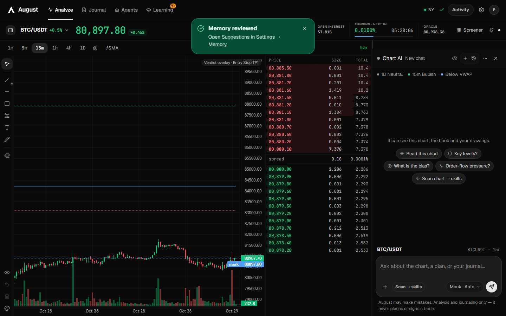
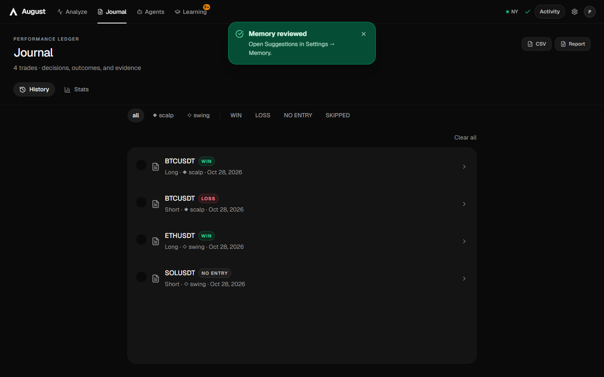
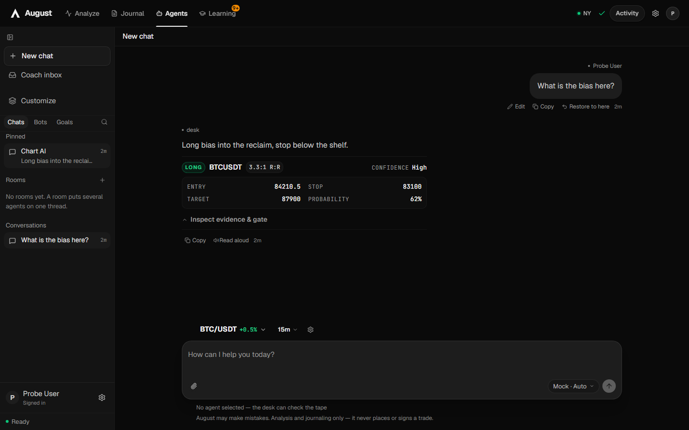
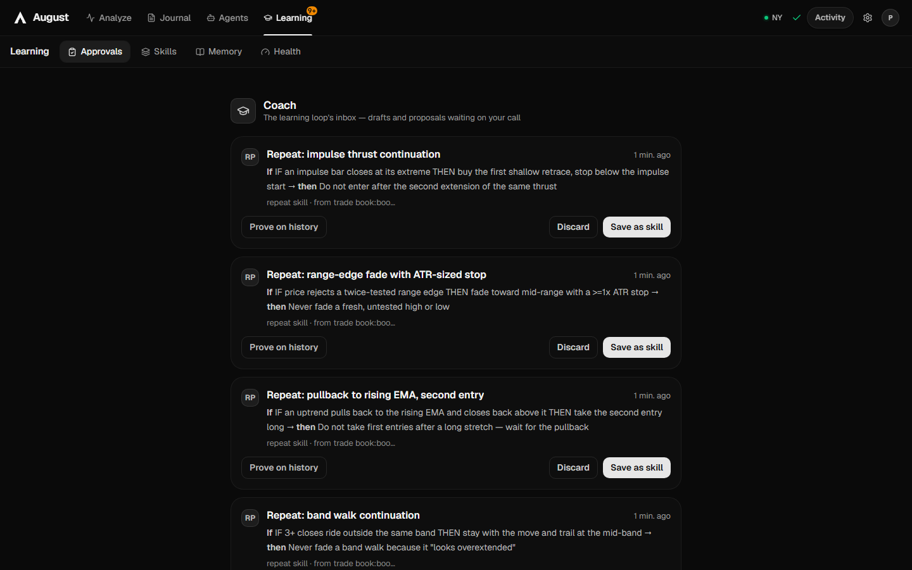

# The four surfaces

August has four top-level surfaces and one overlay (Settings). Their **ids are load-bearing** —
`trade`, `journal`, `agents`, `learn` — because stored routes and dozens of gates pin them. Their
**labels are what the trader reads**, and a label names the function, never a capability the app
lacks.

| Surface | id | Shortcut | It is for | It is not |
|---|---|---|---|---|
| **Analyze** | `trade` | Alt+1 | reading one instrument and running the desk on it | an execution terminal — it never places an order |
| **Journal** | `journal` | Alt+2 | the record of what was decided, plus the review over it | a library of old analyses |
| **Agents** | `agents` | Alt+4 | the named bot roster, DMs, rooms, and the same thread as the chart dock | one generic assistant |
| **Learning** | `learn` | Alt+5 | what the app learned and how it decided to believe it | a library you browse |
| Settings | — | overlay | configuration and data | a surface; it mounts over whatever is current |

Alt+3 is not a surface: it is the Customize row, which opens **Learning → Skills**. The chord and
its icon kept their meaning; only the destination changed.

## Analyze (`trade`)

Anatomy, top to bottom:

- **Market header** — identity + hero price with a 48-bar spark and feed state, then a quiet metrics
  strip (Mark / Oracle / 24h / Volume / OI / Funding with a depleting-window bar).
- **Chart** — full height, with TradingView-style drawing tools. A Chart AI levels card can push
  key levels onto the canvas; those are transient, stamped with the coin they were drawn on, and
  blanked on instrument switch.
- **Order book** — the ladder.
- **Chart AI dock** — drag-resizable, collapsible to a rail, expandable over the chart; its width
  persists. Below the `lg` breakpoint the three panes flatten into an explicit **Chart | AI | Book**
  switcher, one full-height pane at a time, persisted per user.

Live state: one websocket bundle per symbol drives strip + book + candles; REST polling takes over
the moment the socket drops, and the chart's own stall watchdog re-syncs a quiet stream. Prices are
realtime or visibly healing — never silently stale.

Never: executes an order, touches an exchange account, or holds a trading key.

## Journal (`journal`)

- **History** — the trade ledger: every logged trade, its plan, its outcome.
- **Stats** — win-rate and equity-curve dashboards over the same rows.
- **Review cards** — weekly and monthly reviews.
- **Export** — CSV and the printable trade report (open it and print to PDF).

The ledger is the denominator for everything the learning loop believes. A trade that was never
logged did not happen as far as the app is concerned.

## Agents (`agents`)

Three regions: a conversation rail, a main pane, and one pill composer.

- A send routes on **what is selected**, not on a mode switch (there is no switch): a selected bot
  answers through the bot turn path; nothing selected hands the text to the real pipeline, so desk
  tools and memory run exactly as they do from the chart dock.
- Rooms delegate to the group-round view rather than reimplementing it.
- **One thread across homes.** The Agents surface and the chart dock show the same conversation
  under the same id; a run keeps its activity line when the trader switches surfaces. Two stores,
  one thread — this is a contract, not an implementation detail.
- An agent's card opens in `DetailModal`.
- The product's one AI response is claimed by **identity** (`Message.botId`), never by
  provider+model.

## Learning (`learn`)

Tabs in the loop's own order:

1. **Approvals** — everything waiting on a human: action permissions, skill drafts, proposals,
   memory amendments. The default tab.
2. **Skills** — the library the desk learns from; moved here from Settings so the library and the
   notebook sit together.
3. **Memory** — the notebook browser, including per-topic detail docks.
4. **Health** — whether the notebook is sound: memory health, pressure, versions, diagnostics.

Never: the playbook library. Playbook Studio is the one owner of that table and lives under
Settings → Playbooks.

## Settings (overlay)

Grouped, in this order:

- **Setup** — AI setup (providers, keys, models).
- **Analysis** — Analysis, Prompts, Instructions.
- **Learning** — Memory, Playbooks.
- **Account** — Profile, Journal, Data.

Data is where back up / export / import lives. It is the only surface that can destroy or restore
the trader's journal in bulk; treat it accordingly.

## The shell

- A top strip with the four surface tabs; no left rail (the rail was built and rejected on
  2026-10-27 — the top strip stays).
- The sidebar is 240px expanded. `NAV_RAIL_COLLAPSED_PX = 0`: collapsed means it leaves the layout,
  and its expand affordance is the header toggle. Below 1024px it is hidden whatever the user last
  chose — applied at render time, not written back, so widening the window restores the choice.
- Electron's floor is 800px wide. A layout that only breaks below 1024 is a bug.
- Heavy surfaces are `React.lazy` with `SurfaceSkeleton`, never `fallback={null}`.
- Overlays mount **outside** `<main>`. A probe that measures `<main>` after opening one re-reports
  the previous surface and passes vacuously.

## Current state

One 1440px capture per surface, taken 2026-10-29 from the app with the probe's seeded profile:

| Analyze | Journal |
|---|---|
|  |  |

| Agents | Learning |
|---|---|
|  |  |

[Settings](current/settings.png) is the overlay.

These are orientation, not a gate — `render-probe` is the gate. Re-capture with
`npm run probe:surfaces`, then copy `surface-{analyze,journal,agents,learning,settings}.png` here when
a surface changes materially. The Analyze capture carries a "Memory reviewed" toast because the probe
seeds a notebook first; that is real state, not decoration.

## Changing a surface

1. Read this file and the [charter](charter.md).
2. Reuse the shared components the charter lists; do not hand-roll a pill, a tooltip, a dropdown, a
   modal or a focus ring.
3. Run `npm run render-probe` — it is the only gate that can see a surface mount, a rendered row,
   or an inert control.
4. Look at it in a browser at 1440 and at 800. No gate sees a clipped column.
